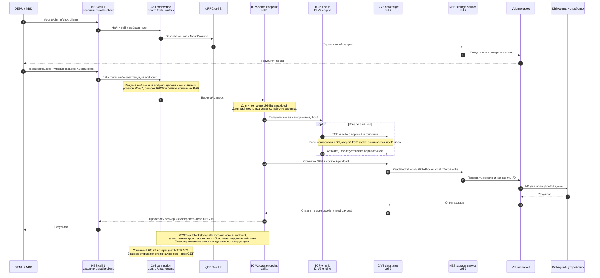

# Архитектурный обзор межцеллового IC V2 в NBS

Анализ выполнен по незакоммиченному рабочему дереву поверх `2f837f09de` и обновлён после изменений мониторинга. Это описание текущей реализации и план её разбиения на ревьюируемые PR. Интерфейс движка `IUringEngineClient`, от которого зависит реализация, уже находится в HEAD (`e0ef26e304`). Остальная интеграция IC V2 находится в незакоммиченных файлах.

## Назначение и граница ответственности

IC V2 переносит блочные данные между двумя cells NBS. Поиск диска, `DescribeVolume`, `MountVolume`, `UnmountVolume` и выбор обслуживающего host остаются на gRPC. Внутренний actor interconnect YDB IC V2 здесь не заменяется.

У принимающего NBS запрос поступает в обычный storage service. Для nonreplicated диска durable-конфигурацией и сессией владеет Volume tablet, распределением устройств занимается DiskRegistry, а полезную нагрузку выполняет DiskAgent на устройстве. IC V2 не является новым владельцем данных или сессий.

## Диаграмма взаимодействия

Для `nrd3-cell2` нижняя ветка проходит через Volume и DiskAgent к nonreplicated устройству. Формат трёх операций задан в [protocol.h](data/protocol.h); преобразование payload выполняют [исходящий endpoint](data/endpoint.cpp) и [принимающий target](data/target.cpp). Локальные SG lists по сети не передаются. Write копируется в собственный payload перед возвратом из вызова; при read размер полученного payload проверяется перед копированием в SG list клиента.

## Владение и жизненный цикл

- [Bootstrap NBS](../daemon/common/bootstrap.cpp) создаёт IC V2 service только при включённом `CellsConfig.IcV2.Enabled`. Сервис владеет listener, движком, входящими и исходящими соединениями, очередями результатов и входящим data target. Его `Stop()` прекращает приём, закрывает каналы и endpoints, затем ждёт уже допущенную работу.
- [Cell connection](../cells/impl/connection.cpp) владеет выбранным host и двумя маршрутизаторами. Control router остаётся на gRPC; data router направляет I/O через gRPC, RDMA или IC V2. [Endpoint router](../cells/impl/endpoint_router.cpp) удерживает выбранный endpoint до завершения каждого отправленного через него запроса.
- [Hello](transport/handshake.cpp) проверяет версию и флаги; идентификаторы cells и настройка checksum не передаются. При XDC он связывает основной и дополнительный сокеты по ID пары. [Request channel](transport/request_channel.cpp) сопоставляет ответы по cookie и проверяет ожидаемый тип и дедлайн.
- Ручной выбор транспорта относится к одному `(CellId, DiskId, ClientId)`. [Cell manager](../cells/impl/cell_manager_impl.cpp) готовит новый endpoint на отдельном worker, чтобы DNS и создание транспорта не блокировали monitoring actor. [Cell connection](../cells/impl/connection.cpp) заменяет data binding и сохраняет ручной выбор при последующей миграции host. Выбор живёт в памяти подключения, но не сохраняется после его закрытия или рестарта NBS.
- [Peer cache](service/peer_connections.cpp) хранит текущее состояние исходящего канала (`idle`, `connecting`, `connected`, `disconnected`), число попыток подключения и их ошибок для каждого host binding. Чтение статуса не создаёт соединение: IC V2 подключается по первому I/O, поэтому сразу после Apply возможен `idle`.
- [Data router](../cells/impl/endpoint_router.cpp) считает завершившиеся успешно `ReadBlocksLocal`, `WriteBlocksLocal`, `ZeroBlocks`, логические байты успешных чтений и записей и ошибки каждого из трёх методов. Счётчики принадлежат текущему target, обнуляются при его замене (в том числе при ручном переключении) и не получают поздний ответ старого target. Строка mount показывает `R: успехи/ошибки (байты)`, `W: успехи/ошибки (байты)`, `Z: успехи/ошибки`. Это статистика запросов data router, а не физических операций DiskAgent; повторная попытка, прошедшая через router, считается отдельным запросом.

## Оценка архитектуры

### Удачные границы

1. Control path и data path разделены: транспорт не принимает на себя управление mount, диском или размещением.
2. Замена endpoint через router сохраняет старый endpoint для уже отправленного I/O и направляет новые запросы на новый.
3. На нескольких уровнях есть ограничения допуска, а поздние ответы и неправильный тип ответа не принимаются как успешный I/O.
4. Общая обёртка [transport](../../../storage/core/libs/icv2/transport/transport.cpp) владеет движком независимо от `TActorSystem`; контракт различает неблокирующий `RequestStop()` из callback и блокирующий внешний `Stop()`.

### Статус замечаний и вопросы до rollout

1. **Доверие к peer — главный блокер для открытой сети; в текущем шаге пропущено.** В реализации нет аутентификации TCP peer и TLS. Принимающий [data target](data/target.cpp) вызывает NBS service с содержимым сетевого запроса. Нужно явно определить доверенную сетевую границу либо добавить подтверждение личности peer. Handshake не проверяет идентичность peer.
2. **Нет автоматического IC V2 → gRPC fallback.** Потерянный канал завершает текущую попытку; последующий запрос может создать новое соединение с тем же host. Повторы выполняет существующий durable client NBS. Это поведение пояснено комментарием в [host_endpoint.h](service/host_endpoint.h), но политика fallback пока не реализована. Если требуется продолжение I/O через gRPC при длительном отказе IC V2, нужны отдельная политика переключения и условия возврата.
3. **Разделение выбора и состояния канала реализовано.** Значок `icv2` в [DescribeDataTransport](../cells/impl/connection.cpp) по-прежнему означает выбранный binding, а соседняя колонка показывает состояние TCP-канала и счётчики попыток/ошибок подключения. Отдельная колонка показывает успешные R/W/Z, их ошибки и объёмы R/W для текущего data target. Повторы durable client видны в его логах; отдельного счётчика этих повторов на странице cells нет. Страница снимает состояние при GET и не обновляется в реальном времени. После Apply сервер отвечает HTTP 303, поэтому обычное обновление страницы не повторяет POST.
4. **Нужен общий расчёт памяти процесса; отложено.** По [конфигурации](../../config/cells.proto) по умолчанию допускаются до 128 исходящих bindings; `MaxDataInflightBytes = 64 MiB` действует на каждый исходящий endpoint. Исходящая очередь transport теперь имеет общий лимит `MaxOutputQueueBytes`, но вместе с лимитами data endpoints он не образует один бюджет NBS. Максимальное совокупное потребление надо измерить и ограничить с учётом числа mounts.
5. **Совместимость настроек XDC реализована.** Старых и новых NBS в этой функции нет: все участники используют одну версию hello. При выключенном XDC хотя бы на одной стороне соединение использует один сокет. Два сокета создаются только когда обе стороны включили XDC. Оба подключаются на один адрес и порт; общий listener различает роли по hello и связывает сокеты по ID пары. Checksum задаётся независимо на каждой стороне и не согласуется в hello.
6. **Остановка ждёт удалённую от транспорта storage operation; отложено.** Это сохраняет владение буферами, но внешний `Stop()` может ждать долго, если операция зависла. Нужны отказный тест и допустимый эксплуатационный предел времени остановки.

Timeout или обрыв после отправки write/zero не доказывает, что удалённая операция не выполнилась. Durable client может повторить попытку; протокол не обещает exactly once и не отменяет уже переданную storage operation. Это ограничение должно остаться частью контракта retry.

## План разбиения на PR

Предлагается стек зависимых PR. После каждого шага соответствующий `ya.make` должен собирать только уже добавленные файлы, а тесты этого слоя должны проходить. Интерфейс движка из `e0ef26e304` уже находится в HEAD и не требует PR из текущего diff.

| № | Содержание | Проверка |
| ---: | --- | --- |
| 1 | Общая обёртка над IC V2 engine в `cloud/storage/core/libs/icv2/transport`: соединение, владение событиями, закрытие и барьеры callbacks. Уже выполнено в `users/drbasic/icv2-transport`. | Unit tests transport: Send/Close/Stop, ранний disconnect, владение буферами. |
| 2a | Общие TCP socket, worker, connector и listener в `cloud/storage/core/libs/icv2/tcp`. | TCP tests: connect, accept, timeout, stop и подготовка сокета. |
| 2b | Handshake в BlockStore, включая согласование XDC и пару сокетов; зависит от общего TCP-слоя. | Handshake tests: частичный hello, неверный заголовок, дедлайн, XDC с одной/двух сторон. |
| 3 | Типизированный request channel: пары событий, cookie, очередь, deadline, ответы и закрытие. | `request_channel_ut`, включая поздний и неверный ответ. |
| 4 | Адаптер блочных данных `data`: read/write/zero, payload и SG list, лимиты и обработка storage future. | `data/ut`, повреждённый payload и владение буферами. |
| 5 | `service`: peer cache, host endpoint, inbound target, Ping, конфигурация `cells.proto` и peer endpoints. Пока без включения в NBS bootstrap. | `service/ut`, обмен двух сервисов, reconnect, остановка. |
| 6 | Интеграция с NBS bootstrap и cells: создание service, IC V2 data binding, gRPC control, миграция host. `Enabled` по умолчанию остаётся выключенным. | `cells/impl/ut`, `endpoints/ut`, сборка `apps/server`, ошибки создания endpoint и миграция. |
| 7 | Ручное переключение через `/blockstore/cells`, логирование, HTTP 303 после Apply, отдельные выбор транспорта и состояние канала, статистика R/W/Z текущего target. | Тесты mon, peer status, счётчиков data router и `(cell,disk,client)`; живой smoke test gRPC ↔ IC V2 с I/O. |
| 8 | Конфигурация двух cells в `example`, инструкции запуска и эксплуатационные ограничения. | `prepare_cells.py`, порты, оба направления, XDC, отказ под нагрузкой. |

Локальные изменения `ya.conf`, задающие путь сборки на конкретной машине и отключающие cache, не следует включать в продуктовые PR. Исторические результаты в [README.md](README.md) служат перечнем сценариев; они не заменяют запуск проверок для каждого выделенного PR.

## Пределы проверки

Обновление основано на текущих исходниках и проверке локального стенда. `cloud/blockstore/libs/cells/impl/ut` прошёл: 151/151 тестов; `cloud/blockstore/apps/server` собран с указанным `--extra-conf`. После перезапуска двух cells четыре страницы NBS `/blockstore/cells` ответили HTTP 200; новая колонка показала формат `R: 0/0 (0 B)`, `W: 0/0 (0 B)`, `Z: 0/0`. Проверка HTTP 303 → GET была выполнена для предыдущего изменения Apply. После изменения согласования XDC весь `transport/ut` прошёл: 69/69, а набор `TIcV2PeerConnectionsTest` — 17/17, включая случай с отсутствующим портом XDC у peer. В общем запуске `service/ut` два теста с повреждённым Ping-ответом завершились аварийно; один тест таймаута в `transport/ut` упал при первом запуске и прошёл при повторном запуске всего набора. Текущая проверка не доказывает корректность счётчиков под длительной нагрузкой или отказных сценариев.

## Изменение handshake

Handshake больше не передаёт и не проверяет идентификаторы cells. Основной и XDC-сокет используют один порт и связываются по ID пары. Выбор исходящего cell остаётся у сервиса управления соединениями. Сведения о версии peer и политика checksum обсуждаются отдельно.
