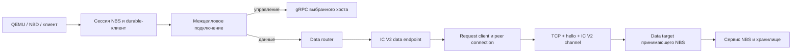

# Межцелловый транспорт IC V2 в NBS

Документ описывает изменения ветки `nbs-interconnect2` относительно `e556a79fa18a1ff078c6d79dd49f1710867f843e` и передачу блочных данных через опциональный XDC (26 октября 2026 года).

## Назначение и текущее состояние

IC V2 передаёт блочные данные между cells NBS аналогично RDMA. В этом документе cell и shard обозначают один и тот же независимый кластер YDB + NBS.

Реализованы:

- Отделение движка Interconnect V2 от `TActorSystem` через интерфейс клиента движка.
- NBS-обёртка с управлением жизненным циклом соединений.
- TCP listener, исходящие подключения и hello с идентификаторами cells.
- Типизированные каналы запросов и ответов с cookies, дедлайнами и ограничением очередей.
- Передача чтения, записи и обнуления блоков.
- Создание и остановка сервиса в bootstrap NBS.
- Выбор IC V2 как транспорта данных существующего межцеллового подключения.
- Переключение gRPC / RDMA / IC V2 из мониторинга для конкретного диска и клиента.
- Конфигурация двух локальных cells и раздельные порты QEMU в examples.

Mount, unmount, поиск диска и другие управляющие операции продолжают использовать gRPC. IC V2 не заменяет акторный interconnect внутри YDB.

## Состав реализации

| Компонент | Ответственность |
| --- | --- |
| [Интерфейс движка](../../../../contrib/ydb/library/actors/interconnect/interconnect_uring_engine.h) | Низкоуровневый движок Interconnect V2 и `IUringEngineClient` |
| [transport](../../../storage/core/libs/icv2/transport/transport.h) | Общая для storage библиотека: независимый от акторной системы клиент движка и безопасный доступ к соединениям |
| [listener](../../../storage/core/libs/icv2/tcp/listener.h), [connector](../../../storage/core/libs/icv2/tcp/connector.h), [handshake](transport/handshake.h) | Общие TCP listener и connector; hello cells перед регистрацией в движке |
| [request_channel](transport/request_channel.h) | Сопоставление типов запросов и ответов, cookies и дедлайны |
| [service](service/service.h) | Listener, peer connections, входящие каналы, data target и рабочие очереди |
| [host_endpoint](service/host_endpoint.h) | Привязка data endpoint к выбранному хосту и контракт транспортных ошибок для NBS |
| [data](data/data.h) | Адаптация локального блочного API NBS к сериализуемым событиям и обратно |
| [cell connection](../cells/impl/connection.cpp) | Маршрутизация control/data, смена хоста и ручной выбор транспорта |
| [monitoring](../cells/impl/mon.cpp) | Страница `/blockstore/cells` и применение ручного выбора |
| [NBS bootstrap](../daemon/common/bootstrap.cpp) | Создание, запуск и остановка IC V2 вместе с приложением NBS |

### Отделение движка от акторной системы

Первый этап ветки изменил код `contrib/ydb`: движок получает клиента через `SetClient()` до первой регистрации соединения. Дальнейшая интеграция NBS реализована в `cloud/blockstore/libs` поверх этого интерфейса.

`IUringEngineClient` отвечает за доставку событий, освобождение переданных объектов и интеграцию остановки. Для акторной системы оставлен отдельный клиент; NBS использует собственный `TEngineClient`, не требующий `TActorSystem`.

В текущем коде `IUringEngineClientPtr` — `std::shared_ptr<IUringEngineClient>`. Переход на `TIntrusivePtr` в эту реализацию не входит.

`IEventDestructor` предоставляет `DestroyEvent()` и `GetAndResetDestroyEventsCycles()`. Измерение охватывает только выполнение `DestroyEvent()`, включая вызванный из него `Flush()` у акторного клиента. Время `Stop()` и асинхронного уничтожения вне этого вызова не включается. Счётчик `DestroyEventsTotalTime` хранится в shard движка и пополняется после успешного завершения записи.

## Путь запроса



Data router также умеет направлять данные через gRPC или RDMA. Он удерживает endpoint до завершения отправленного через него запроса, даже если текущий target уже заменён.

### Передаваемые операции

| Локальный API отправителя | Событие на проводе | Вызов принимающего сервиса |
| --- | --- | --- |
| `ReadBlocksLocal` | `TEvReadBlocksRequest` / `TEvReadBlocksResponse` | `ReadBlocksLocal` |
| `WriteBlocksLocal` | `TEvWriteBlocksRequest` / `TEvWriteBlocksResponse` | `WriteBlocksLocal` |
| `ZeroBlocks` | `TEvZeroBlocksRequest` / `TEvZeroBlocksResponse` | `ZeroBlocks` |

Используются существующие акторные типы событий NBS, protobuf-сериализация и формат потока событий Interconnect V2. Локальные структуры с SG lists по сети не передаются. Список пар событий находится в [data/protocol.h](data/protocol.h).

При записи endpoint синхронно копирует содержимое SG list в собственный payload до возврата из вызова. В protobuf события остаются метаданные, поле `Blocks` пусто. На принимающей стороне число блоков определяется по размеру payload и `BlockSize`. Успешный ответ чтения также содержит ровно один payload и пустой `Blocks`; ответ с ошибкой не содержит данных. Перед копированием чтения проверяется точный размер payload, после чего данные копируются в доступный SG list вызывающей стороны. Некорректный ответ закрывает канал; запоздавший ответ завершённой попытки не изменяет пользовательский буфер.

Принимающий data target удерживает буфер payload и доступ к SG list до фактического завершения storage future. Для чтения он заранее выделяет собственный буфер, который storage заполняет через `ReadBlocksLocal`, а затем передаёт буфер в payload ответа. Входящий payload записи используется через `WriteBlocksLocal`; фрагментированный буфер при необходимости уплотняется один раз, чтобы каждый блок storage был непрерывным. SG list закрывается до освобождения или передачи буфера. Закрытие сетевого канала или таймаут отправителя не отменяют уже начатую операцию хранилища.

### Соединения и hello

Порядок исходящего подключения:

1. Cells выбирает хост и создаёт для него data binding с уникальным, непереиспользуемым ID.
2. IC V2 разрешает адреса именно этого хоста. TCP и hello выполняются при обращении за каналом.
3. Инициатор отправляет hello; принимающая сторона проверяет его и отвечает своим hello.
4. Инициатор проверяет ответ и отправляет подтверждение.
5. После hello создаётся канал, устанавливаются обработчики и выполняется `Activate()`.
6. Начинается обмен событиями IC V2.

Hello v1 содержит magic `ICV2`, версию и флаги. Целые поля передаются в сетевом порядке байтов. Проверяются версия и совпадение настройки `ChecksumEvents`; неизвестные флаги отклоняются. Идентификаторы cells не передаются и не проверяются.

Hello идентифицирует настроенные cells, но не является аутентификацией. В реализации нет TLS для этого TCP-канала. Доступ к порту IC V2 должен соответствовать доверенной сетевой границе развёртывания.

`IcV2.EnableXdc` по умолчанию выключен. Если обе стороны включили XDC, hello согласует второй TCP-сокет на тот же адрес и порт, что и основной. Один listener различает роли сокетов по hello. Если XDC включён только с одной стороны, используется обычный канал. Версия hello остаётся единой: бит 1 предлагает/подтверждает XDC, бит 2 обозначает дополнительный сокет; при установленном бите 1 после заголовка передаётся непрозрачный 16-байтный ID пары. Настройка checksum должна совпадать независимо от XDC.

Инициатор генерирует отдельный ID для каждого основного подключения. Дополнительный сокет сопоставляется с ожидающим основным по ID, поэтому параллельные подключения одних cells не смешиваются. Неизвестные, занятые и уже использованные ID дополнительных сокетов отклоняются. Оба обмена hello и создание дополнительного сокета входят в общий дедлайн основного подключения. Канал активируется только после готовности пары; ошибка или остановка закрывает незавершённую пару. Ошибка I/O любого сокета активной пары закрывает логическое соединение. Движок читает XDC только при ожидании external payload: обрыв простаивающего XDC обнаруживается при следующем I/O; отдельной проверки его liveness пока нет. Переключения в обычный режим и переотправки запросов внутри установленного соединения нет.

XDC передаётся существующему движку без изменений в `contrib`. Блочные данные находятся в payload событий. Движок использует XDC для external sections, когда сериализация события разрешает этот канал; небольшие payload могут оставаться в основном потоке. При выключенном XDC тот же payload сериализуется в основной TCP-поток, дополнительных версий событий нет. Синхронный snapshot записи и копирование чтения в пользовательский SG list сохраняются.

Одновременные обращения за каналом одной привязки разделяют попытку подключения. Установленное соединение переиспользуется. После его потери следующая попытка запроса может создать новое соединение с тем же хостом. Сам транспорт запросы не переотправляет и другой хост не выбирает: сменой хоста занимается существующий механизм cells.

## Жизненный цикл и владение

Контракт низкоуровневой обёртки описан в [connection.h](../../../storage/core/libs/icv2/transport/connection.h).

- `CreateConnection()` подготавливает соединение с готовым handler, но не начинает сетевой приём.
- `Activate()` регистрирует соединение и разрешает callbacks. Он может вызвать callback до своего возврата, поэтому владелец handler должен быть полностью готов заранее.
- До активации пользовательские callbacks не выполняются, включая ранний disconnect.
- `Send()` допускает параллельные вызовы; порядок задаётся приёмом в очередь. Он забирает событие и при отказе. Успешный результат означает принятие, а не доставку.
- `Close()` потокобезопасен, идемпотентен и неблокирующий. Его можно вызвать из callback. Новая работа отклоняется; уже допущенный callback может завершиться после `Close()`.
- Локальное закрытие не вызывает `HandleDisconnect()`. Удалённая ошибка сообщает disconnect один раз.
- Callbacks одного соединения могут выполняться параллельно и вне внутренних блокировок транспорта. Обработчики должны быть потокобезопасными и не бросать исключений.

`WhenClosed()` означает, что соединение закрыто и его последние пользовательские callbacks завершились. У request channel этот барьер также охватывает допущенные обработчики результатов и их continuations.

Это **не подтверждение полного физического дренирования отдельного соединения**. Движок ещё может завершать I/O и удерживать исходящие события или буферы. Обёртка не опирается на обещанное комментарием raw `Unregister()` уведомление о завершении дренирования. Для освобождения движка используется общий внешний `Stop()`.

Полученное событие после передачи handler принадлежит handler. Исходящее событие и сериализованные буферы освобождаются движком через его клиента, когда больше не нужны передаче; `Close()` и `WhenClosed()` сами по себе не задают этот момент.

### Остановка сервиса

Из callback вызывают неблокирующий `RequestStop()`. Блокирующий `Stop()` вызывается внешним потоком. Обработчики и continuations не должны бросать исключения, ждать своего барьера закрытия или останавливать собственный executor.

Сервис прекращает приём новой работы, останавливает listener и hello, закрывает каналы и peer connections, останавливает движок и ждёт callbacks. Затем он дожидается работы data endpoints, включая синхронное копирование записи, и операций data target. Очереди выполнения останавливаются после завершения зависимой работы.

Сервис хранит барьеры закрытия и для уже уничтоженных endpoints, пока их результаты ещё обрабатываются. Остановка data target ждёт реального завершения вызовов storage; произвольное зависание storage future поэтому может задержать `Stop()`.

В bootstrap NBS IC V2 запускается до cell manager. При остановке IC V2 останавливается до cell manager; сервис хранилища и остальные зависимости ещё доступны для завершения допущенной работы. Отдельный bootstrap YDB для запуска NBS IC V2 не требуется.

## Ошибки, дедлайны и повторы

Следующий контракт применяется на границе **host data endpoint NBS**. Низкоуровневый request channel и диагностический Ping имеют собственные ошибки; их не следует использовать вместо этого контракта.

| Причина | Результат для NBS data request |
| --- | --- |
| Потеря канала, TCP/system error, EOF во время hello | `E_UNAVAILABLE` с сохранением причины |
| Истёк дедлайн попытки | `E_TIMEOUT` |
| Превышены лимиты допуска | `E_REJECTED` |
| Остановка владельцем | `E_CANCELLED` |
| Некорректные параметры или протокол | `E_ARGUMENT` / `E_BADMSG` |
| Ошибка внутри ответа хранилища | Исходные код, сообщение и флаги |

Например, `E_IO`, полученный от хранилища внутри ответа, остаётся `E_IO`. Нормализация сетевого сбоя не применяется к storage errors.

Повторы делает существующий durable-клиент NBS. Общий классификатор ошибок не изменён. При повторе сохраняется `RequestId`, увеличивается номер попытки; штатная политика может увеличить `RequestTimeout` после `E_TIMEOUT`. Остановка endpoint запрещает новые сетевые попытки, в том числе когда durable-клиент уже запланировал backoff.

`Headers.RequestTimeout` должен быть положительным. Дедлайн одной попытки включает подготовку данных, ожидание соединения, TCP/hello, отправку, ожидание ответа и очередь публикации результата. Проверки истечения в каналах используют таймер с шагом до 10 мс; при обработке результата дедлайн проверяется повторно.

`RetryTimeout` durable-клиента ограничивает решение о дальнейшем повторе. Это не строгий общий дедлайн операции от входа в NBD/vhost до её завершения. Такой дедлайн на уровне сессии остаётся отдельной задачей.

После потери ответа записи или обнуления результат неизвестен: операция могла уже выполниться. Повтор может исполнить её ещё раз. Сохранение `RequestId` не даёт гарантии exactly-once. Таймаут и disconnect также не означают отмену операции на принимающей стороне.

## Конфигурация

Схема находится в [config/cells.proto](../../config/cells.proto). IC V2 включается независимо от выбора исходящего транспорта данных.

Пример для первого NBS:

```protobuf
CellsEnabled: true
CellId: "cell-1"

IcV2 {
  Enabled: true
  ListenAddress: "127.0.0.1"
  Port: 29602
  EnableXdc: true
}

Cells {
  CellId: "cell-2"
  GrpcPort: 19766
  IcV2Port: 39602
  Transport: CELL_DATA_TRANSPORT_ICV2
  Hosts {
    Fqdn: "localhost"
  }
}
```


`IcV2.Port` нужно задать явно; ноль позволяет выбрать временный порт. Для стабильного подключения peers нужен известный порт. `ListenAddress` — числовой IPv4 или IPv6; IPv6 listener принимает только IPv6.

`Cells.IcV2Port` используется вместе с `Hosts.Fqdn`. Нулевой или отсутствующий порт означает, что исходящий endpoint IC V2 для этой cell не настроен. Настройка не зависит от `Transport`: listener и адреса IC V2 могут быть подготовлены заранее, пока данные идут через gRPC. `Hosts.Transport` переопределяет транспорт cell для конкретного хоста.

При согласовании XDC инициатор открывает второй TCP-сокет на тот же адрес и порт основного соединения. Роль сокета определяется hello. Ошибка дополнительного подключения завершает весь handshake без перехода на один сокет.

При включённом IC V2 ошибки его конфигурации, bind или недоступность движка приводят к ошибке инициализации NBS. Нужен Linux с доступным `io_uring`. Терминальная ошибка listener закрывает admission и существующие соединения; для восстановления требуется новый экземпляр сервиса.

### Ограничения ресурсов

Очередь ожидающих TCP-подключений у общего listener имеет фиксированный backlog 128.

| Параметр `IcV2` | Значение по умолчанию | Область действия |
| --- | --- | --- |
| `Threads` | 1 | Workers движка |
| `HandshakeTimeoutMs` | 5000 | TCP-попытки и hello исходящего подключения |
| `EnableXdc` | false | Второй сокет при согласии обеих сторон |
| `ChecksumEvents` | false | Проверка событий; должна совпадать у peers |
| `MaxConnections` | 128 | Активные логические соединения, включая завершающиеся callbacks. Основные соединения вместе с незавершёнными hello ограничены этим же числом при выключенном XDC и удвоенным при включённом. Завершённый дополнительный hello освобождает место в этом учёте; второй сокет готовой пары живёт вместе с основным |
| `MaxOutgoingConnections` | 128 | Исходящие каналы/попытки; также live и retiring data bindings |
| `MaxPendingRequests` | 1024 | Запросы канала/endpoint, общий data target; отдельно общий диагностический Ping |
| `MaxOutputQueueBytes` | 64 MiB | Общий предел исходящих очередей всех соединений IC V2 в процессе NBS; также суммарные payload диагностических Ping |
| `MaxDataRequestBytes` | 4 MiB | Сериализованный запрос и payload чтения/записи |
| `MaxDataInflightBytes` | 64 MiB | Допущенная работа каждого исходящего endpoint и общего входящего target |
| `CompletionThreads` | 2 | Результаты и continuations |
| `DataWorkers` | 1 | Вызовы storage, декодирование и ответы target |

Допуск учитывает также результаты, ожидающие обработки, и выполняющиеся continuations. Лимит data inflight учитывает резервирование буферов и служебных структур, а не только полезную нагрузку. На исходящем пути превышение лимита отклоняет новую работу без отправки. Принимающий target при отказе в допуске не вызывает storage для этого запроса.

## Переключение транспорта в мониторинге

Страница `/blockstore/cells`, таблица **Intercell mounts**, показывает исходящие подключения этого NBS. В каждой строке есть выбор **gRPC / RDMA / IC V2** и кнопка **Apply**.

Выбор относится к ключу `(CellId, DiskId, ClientId)` на текущем NBS. Другие подключения, в том числе другой клиент того же диска, не переключаются. При проверке в двух направлениях нужно открывать страницу NBS, который обслуживает соответствующий frontend endpoint.

Правила применения:

1. Запрос изменения принимается только через POST.
2. Подготовка нового endpoint выполняется на отдельном worker, чтобы DNS и создание транспорта не блокировали monitoring actor.
3. Подготовка не меняет текущий путь. При её ошибке он остаётся работать.
4. После замены router новые запросы идут через новый endpoint; ранее отправленные удерживают старый endpoint до завершения.
5. Управление продолжает идти через gRPC. Перемонтирование для выбора транспорта не требуется.
6. Ручной выбор сохраняется при последующей миграции подключения на другой хост.
7. Выбор действует до закрытия подключения или перезапуска NBS и не сохраняется в конфигурацию.

Переключение сериализовано со сменой хоста. Если подключение уже меняется, операция возвращает `E_REJECTED`; её можно повторить. Исчезнувший mount даёт `E_NOT_FOUND`.

Метка показывает фактически работающий транспорт, а select — выбранный. Для RDMA сохраняется существующая политика `GrpcDataFallbackEnabled`: при выбранном RDMA метка может показывать `grpc fallback`. Автоматический fallback IC V2 на gRPC не добавлен.

При выключенном RDMA-клиенте или отсутствии RDMA-порта создание RDMA endpoint возвращает ошибку вместо обращения к пустому клиенту.

## Проверка на examples

Подробная подготовка независимых YDB + NBS описана в [examples/README.md](../../../nbs_internal/examples/README.md). На существующем стенде не нужно повторять `0-setup.sh` или инициализацию storage: setup пересоздаёт диски YDB.

### Сборка и обновление существующего стенда

Из корня Arcadia:

```bash
./ya make cloud/blockstore/buildall -r -j4
cd cloud/nbs_internal/examples
```

Генератор `prepare_cells.py` подготавливает конфигурации обоих cells и отдельных NBS nodes. Он выбирает gRPC для данных по умолчанию. Повторная генерация восстанавливает эти defaults; ручные изменения `Transport` нужно применить заново.

Для IC V2 задайте `Transport: CELL_DATA_TRANSPORT_ICV2` в peer-секции файлов `nbs/nbs-cells.txt` и `nbs/nbs-cells2.txt` обоих cells. Альтернатива для живого mount — выбор через мониторинг. Затем перезапустите NBS с обновлённой сборкой и конфигурацией.

Для уже подготовленных YDB можно запустить по одному NBS без disk agents в отдельных терминалах:

```bash
./3-start_nbs.sh --one-nbs --skip-da
./3-start_nbs_cell2.sh --one-nbs --skip-da
```

Это подходит для проверки реплицированных SSD-дисков. Для nonreplicated и mirrored дисков нужны работающие disk agents и завершённый secure erase.

### Диски и QEMU

Следующие команды создания выполняются только если этих тестовых дисков ещё нет:

```bash
./5-create_disk.sh -k ssd --disk-id icv2-cell1
./5-create_disk.sh --cell2 -k ssd --disk-id icv2-cell2
```

Запускать QEMU следует в отдельных терминалах, через противоположный frontend cell:

```bash
# Frontend cell-1, диск хранится в cell-2.
./7-run_qemu.sh --diskid icv2-cell2

# Frontend cell-2, диск хранится в cell-1.
./7-run_qemu.sh --cell2 --diskid icv2-cell1
```

Скрипт создаёт persistent vhost endpoint. Раздельные QMP, SSH и GDB-порты позволяют держать обе VM одновременно. После перезапуска NBS persistent endpoint восстанавливается, но переподключение уже запущенного QEMU автоматически не гарантируется; при разрыве vhost-соединения VM потребуется запустить заново.

| Назначение | cell-1 | cell-2 |
| --- | --- | --- |
| YDB gRPC | 9001 | 19001 |
| YDB monitoring | 8765 | 18765 |
| NBS API, node 1 / node 2 | 9766 / 9786 | 19766 / 19786 |
| NBS IC V2, node 1 / node 2 | 29602 / 29622 | 39602 / 39622 |
| NBS monitoring, node 1 / node 2 | 8766 / 8786 | 18766 / 18786 |
| QEMU QMP | 8678 | 18678 |
| QEMU SSH | 8679 | 18679 |
| QEMU GDB | 1234 | 11234 |

Страницы выбора транспорта для первых nodes:

- [cell-1](http://localhost:8766/blockstore/cells): строка `icv2-cell2`.
- [cell-2](http://localhost:18766/blockstore/cells): строка `icv2-cell1`.

Для проверки переключите gRPC → IC V2, выполните I/O из гостя и сравните прочитанные данные с записанными. Не используйте произвольные записи поверх нужных данных: выделите отдельный тестовый диск или файл.

### Диагностика

- В startup log должна появиться строка `IC V2 listening` с cell ID и адресом.
- В `/blockstore/cells` проверяются host, выбранный и активный транспорт соответствующего mount.
- Счётчики IC V2 находятся в `counters=blockstore/component=icv2`: `Listening`, `ListenerErrors`, `AcceptedConnections`, `RejectedConnections`, `HandshakeErrors`, `ActiveConnections`, `PingRequests`, `PingReplies`.
- Логи первых nodes: `logs/nbs.1.log` и `cell2/logs/nbs.1.log`.
- `blockstore-client ping` проверяет доступность NBS API, а не передачу данных по IC V2.

Внутренний типизированный `IService::Ping()` сохранён для диагностического обмена и тестов. Временный `ExecuteAction("icv2ping")` и обёртка `CreateActionService` удалены из итогового состояния ветки.

## Выполненные проверки

| Проверка | Зафиксированный результат и границы |
| --- | --- |
| Контракт ошибок и durable-клиент | На этапе `7c658d1c` прошли 196 тестов IC V2 и NBS client: временный сбой подключения, потерянный ответ записи, поздний ответ чтения, отмена и backoff |
| Переключатель транспорта | Перед коммитом `bc4321a7` прошли 185 тестов cells и endpoints, включая смену всех трёх транспортов на doubles, изоляцию mounts, миграцию, старые RDMA callbacks и HTML escaping |
| Payload и опциональный XDC, 26 октября | Прошёл 291 тест: data — 21, service — 60, transport — 68, cells — 142. Реальный TCP-обмен блоками в обе стороны проверен во всех комбинациях XDC и checksum; также проверены повреждённые payload, лимиты, владение буферами и durable retry |
| Мониторинг двух IC V2 портов | Прошли 143 теста cells; на обоих examples NBS проверено отображение основного и XDC портов в одной ячейке |
| Форматирование | Текущие C++ изменения обработаны через clangd с `.clang-format` NBS; отдельно проверено, что этот проход меняет только whitespace |
| Сборка приложения | После изменений payload, XDC-портов и мониторинга успешно собран `apps/server`; полный release-пакет `cloud/blockstore/buildall` собирался на этапе `bc4321a7` |
| Два живых cells | На пересобранных NBS проверены ping API, наличие `icv2-cell1` / `icv2-cell2`, восстановление persistent endpoints и POST-переключение gRPC ↔ IC V2 в обоих направлениях |
| Отрицательные HTTP-проверки | GET не меняет транспорт; выбор недоступного RDMA возвращает ошибку и сохраняет IC V2 |
| QEMU | На предыдущем этапе ветки пользователь подтвердил работу межцеллового I/O в обоих направлениях; после последней пересборки VM остановлены пользователем для последующего ручного запуска |

В ветке также есть автономные тесты раннего disconnect, параллельных Send/Close, Stop при callback, TCP/hello, cookies, лимитов, дедлайнов, обработки ошибок storage и владения буферами. На раннем этапе на отдельном локальном стенде проверялись разрыв TCP и перезапуск принимающего NBS под нагрузкой с проверкой подтверждённых записей; эта проверка предшествовала новому контракту транспортных ошибок и не доказывает поведение всех повторов последнего состояния ветки.

Для повторной проверки из корня Arcadia:

```bash
./ya make \
  cloud/blockstore/libs/icv2/transport/ut \
  cloud/blockstore/libs/icv2/data/ut \
  cloud/blockstore/libs/icv2/service/ut \
  cloud/blockstore/libs/client/ut \
  cloud/blockstore/libs/cells/impl/ut \
  cloud/blockstore/libs/endpoints/ut \
  -t -j4
```

Эта объединённая команда приведена для воспроизведения; перечисленные выше количества относятся к отдельным выполненным запускам, а не к результату нового запуска всей команды.

В локальном стенде 23 октября RDMA-клиент не инициализировался из-за отсутствия `librdmacm.so`, peer RDMA-порты не были заданы. Поэтому реальное RDMA I/O последней сборкой здесь не проверялось.

## Ограничения и следующие этапы

- Полного подтверждения физического дренирования каждого отдельного соединения пока нет; доступен барьер пользовательских callbacks и общий `Stop()` движка.
- XDC опционален. Запись делает локальный snapshot, чтение копируется в пользовательский SG list; текущая реализация не заявляет zero-copy.
- Нет exactly-once, отмены уже начатой удалённой storage operation и строгого общего дедлайна сессии.
- Hello не заменяет транспортную аутентификацию и шифрование.
- Ручной выбор транспорта не сохраняется между подключениями и перезапусками.
- Нет автоматического IC V2 → gRPC fallback. При сетевых сбоях работает существующая политика повторов NBS; миграция хоста остаётся задачей cells.
- Для эксплуатационной оценки остаются длительные нагрузочные проверки, отказные сценарии последней сборки с новым retry-контрактом, измерение CPU/latency/throughput и сравнение с gRPC/RDMA на доступном оборудовании.

## Основные этапы истории ветки

| Коммит | Изменение |
| --- | --- |
| `6047b507` | Отделение движка от акторной системы и интерфейс клиента |
| `7550145a` | NBS-обёртка жизненного цикла |
| `ffb64808`, `ddc64bef` | TCP listener/connector и hello |
| `12e3123f`, `7b9e1290`, `7349a1ea` | Request/response channel, ограничения, executor результатов и несколько пар типов |
| `13a87083`, `6ce7a58c`, `4dc6d8db` | Bootstrap NBS, examples и peer endpoint configuration |
| `0f40d466`, `4cbdfd33` | Переиспользуемые исходящие соединения и типизированный Ping |
| `ec4b1c1a`, `38e3421a` | Блочные endpoint/target и включение IC V2 в data path cells |
| `af7c68db`, `d371ac80` | Отдельные GDB-порты QEMU и удаление временного ping action |
| `7c658d1c` | Контракт ошибок и повторов |
| `bc4321a7` | Выбор транспорта диска/клиента через мониторинг |
