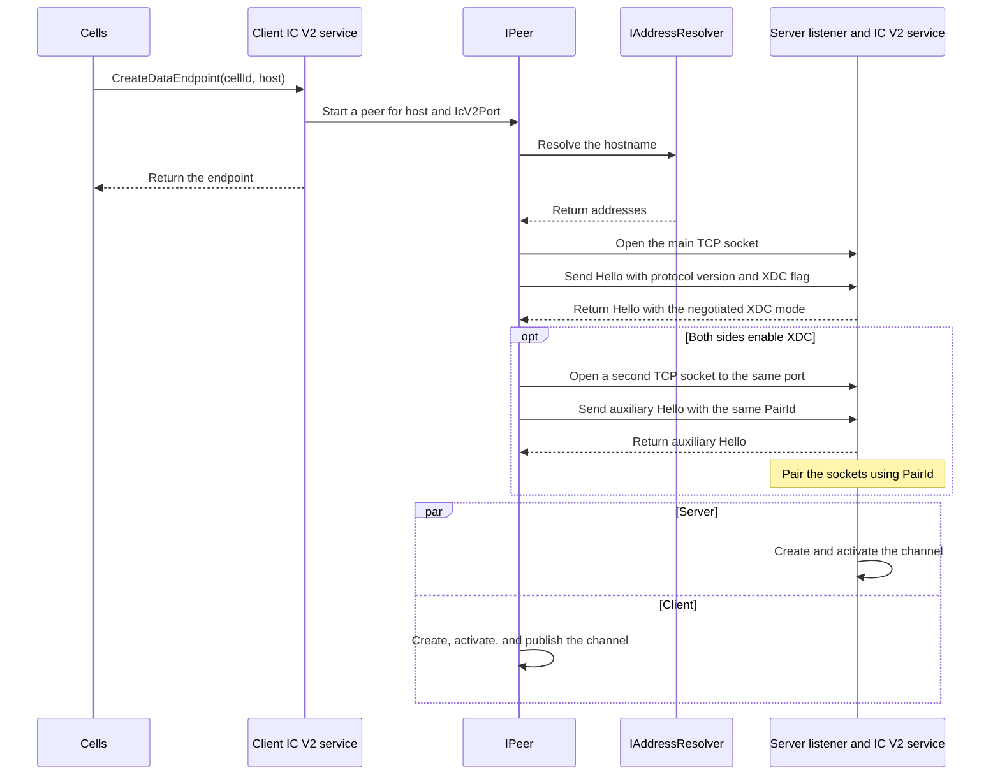

# Establishing an IC V2 connection

Cells passes the remote cell ID and selected hostname to `IDataEndpointFactory::CreateDataEndpoint()`. The service gets the destination port from the remote cell's `IcV2Port` and starts an outgoing peer. Cells receives the endpoint without waiting for DNS, TCP, or the handshake. [Endpoint factory](../../../cloud/blockstore/libs/icv2/iface/data_endpoint_factory.h), [service implementation](../../../cloud/blockstore/libs/icv2/service/service.cpp).

XDC (External Data Channel) adds a second TCP socket for external event data. The main socket carries event framing and control messages. With XDC disabled, the main socket carries the entire exchange. The server creates the channel when the incoming handshake returns `THandshakeReady`. An auxiliary socket does not create its own channel. [Handshake protocol](../../../cloud/storage/core/libs/icv2/handshake/handshake.cpp), [incoming handshake handling](../../../cloud/blockstore/libs/icv2/service/service.cpp).

Once the client peer publishes the channel, `GetRequestChannel()` reuses it while it stays open. The client sends IC V2 transport pings on the established channel. Cells separately checks host availability over gRPC. After a disconnect, the peer schedules a reconnect and publishes a new channel when it succeeds. [Peer implementation](../../../cloud/storage/core/libs/icv2/peer/peer_impl.cpp), [IC V2 ping setup](../../../cloud/blockstore/libs/icv2/service/service.cpp), [Cells host health checks](../../../cloud/blockstore/libs/cells/impl/host_pool.cpp).

While the channel is connecting, the endpoint returns `E_UNAVAILABLE`. With `GrpcDataFallbackEnabled`, Cells routes block I/O over gRPC while IC V2 is unavailable. After a disconnect, `EndpointSettleTime` sets how long the restored channel must stay up before Cells switches back to IC V2. [Peer-backed request sender](../../../cloud/blockstore/libs/icv2/service/peer_request_sender.cpp), [transport switcher](../../../cloud/blockstore/libs/cells/impl/transport_switcher.cpp), [Cells configuration](../../../cloud/blockstore/config/cells.proto).

## Configuration

- Enable `CellsEnabled` and `IcV2.Enabled` on participating NBS nodes. Set the local listener address and port through `IcV2.ListenAddress` and `IcV2.Port`.
- Set `IcV2Port` in the remote cell entry to the IC V2 port on its hosts. Set `Transport` to `CELL_DATA_TRANSPORT_ICV2` to use IC V2 for block I/O.
- Enable `IcV2.EnableXdc` on both sides to negotiate a second socket. [Configuration schema](../../../cloud/blockstore/config/cells.proto).

The two-cell example uses `fio` on remote volumes. Check the active transport for each test mount on `/blockstore/cells`. [Stand verification procedure](../../../example/README.md#verify-intercell-io-over-ic-v2).
