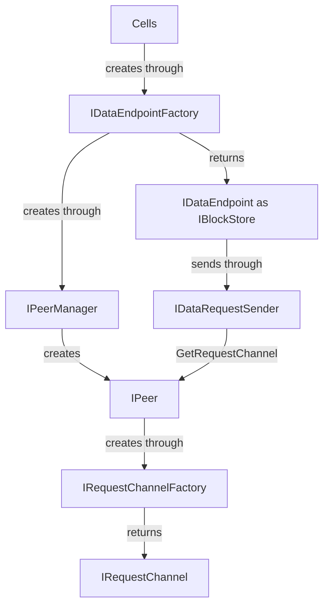
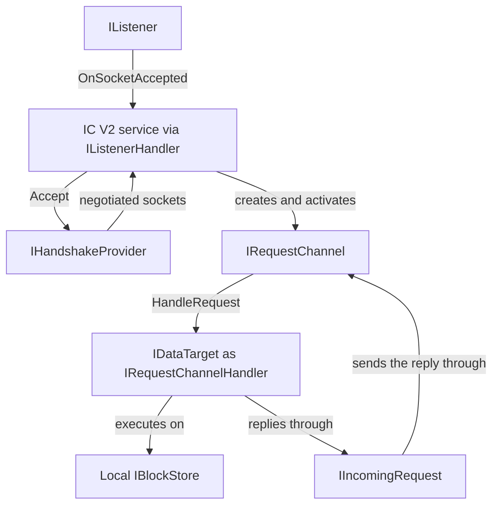

# IC V2 internal architecture

An NBS node can initiate and accept IC V2 connections. For a given connection, the client is the node that opens the TCP sockets, and the server is the node that accepts them.

The [Cells client API](cells-api.md) describes the contract exposed to callers.

## Interface instances

The counts below are local to one NBS process. NBS creates one IC V2 service when both Cells and IC V2 are enabled. [NBS bootstrap](../../../cloud/blockstore/libs/daemon/ydb/bootstrap.cpp).

### Per IC V2 service

| Interface | Instances | Role |
| --- | --- | --- |
| [`IService`](../../../cloud/blockstore/libs/icv2/service/service.h) / [`IDataEndpointFactory`](../../../cloud/blockstore/libs/icv2/iface/data_endpoint_factory.h) | One instance | The service owns the IC V2 lifecycle. Cells uses the same instance through `IDataEndpointFactory`. |
| [`IPeerManager`](../../../cloud/storage/core/libs/icv2/peer/peer_manager.h) | One instance | Creates and tracks outgoing peers. |
| [`IRequestChannelFactory`](../../../cloud/storage/core/libs/icv2/peer/peer_manager.h) | One instance | Builds a request channel after an outgoing handshake. |
| [`IAddressResolver`](../../../cloud/storage/core/libs/icv2/tcp/address_resolver.h) | One instance | Resolves hostnames for outgoing peers. |
| [`IConnector`](../../../cloud/storage/core/libs/icv2/tcp/connector.h) | One instance | Opens TCP sockets for outgoing peers. |
| [`IListener`](../../../cloud/storage/core/libs/icv2/tcp/listener.h) | One instance | Accepts incoming TCP connections. |
| [`IListenerHandler`](../../../cloud/storage/core/libs/icv2/tcp/listener.h) | One instance | Passes accepted sockets and listener errors to the service. |
| [`IHandshakeProvider`](../../../cloud/storage/core/libs/icv2/handshake/handshake.h) | Two instances | `IPeerManager` owns one instance for all outgoing `Connect()` calls. `IService` owns the other for all incoming `Accept()` calls. |
| [`ITransport`](../../../cloud/storage/core/libs/icv2/transport/transport.h) | One instance | Creates transport connections for both outgoing and incoming channels. |
| [`IDataTarget`](../../../cloud/blockstore/libs/icv2/data/target.h) / [`IRequestChannelHandler`](../../../cloud/storage/core/libs/icv2/request_channel/request_channel.h) | One instance | The same data target serves as the request handler on all channels and forwards requests to the local `IBlockStore` provided by NBS. |

NBS supplies the resolver during bootstrap. The service creates the other shared components during initialization. [Service assembly](../../../cloud/blockstore/libs/icv2/service/service.cpp).

### Per outgoing endpoint

| Interface | Instances | Role |
| --- | --- | --- |
| [`IDataEndpoint`](../../../cloud/blockstore/libs/icv2/data/endpoint.h) / [`IBlockStore`](../../../cloud/blockstore/libs/service/service.h) | One instance per successful `CreateDataEndpoint()` call | The data endpoint encodes outgoing block requests and decodes replies. Cells uses the same instance through `IBlockStore`. |
| [`IDataRequestSender`](../../../cloud/blockstore/libs/icv2/data/request_sender.h) | One adapter per endpoint | Gets the peer's current channel for each outgoing request. |
| [`IPeer`](../../../cloud/storage/core/libs/icv2/peer/peer.h) | One peer per endpoint | Connects to the selected host, publishes its active channel, and reconnects after disconnects. |
| [`IClientConnectionHandler`](../../../cloud/storage/core/libs/common/connection_handler.h) | Zero or one callback reference per peer | The caller supplies the optional handler for connection state changes. |

Multiple calls for the same host produce independent endpoints and peers. The endpoint, adapter, and peer stay in place across reconnects. [Endpoint creation](../../../cloud/blockstore/libs/icv2/service/host_endpoint.cpp), [peer reconnect logic](../../../cloud/storage/core/libs/icv2/peer/peer_impl.cpp).

### Per connection or request

| Interface | Instances | Role |
| --- | --- | --- |
| [`IRequestChannel`](../../../cloud/storage/core/libs/icv2/request_channel/request_channel.h) | One local instance per established IC V2 connection | Each outgoing peer has at most one active channel. Each accepted incoming connection has its own channel. The channel correlates replies with requests and dispatches incoming requests. |
| [`IConnection`](../../../cloud/storage/core/libs/icv2/transport/connection.h) | One instance per request channel | Sends events over TCP. |
| [`IConnectionHandler`](../../../cloud/storage/core/libs/icv2/transport/connection.h) | One instance per request channel | Delivers incoming events and disconnect notifications to the channel. |
| [`IIncomingRequest`](../../../cloud/storage/core/libs/icv2/request_channel/request_channel.h) | One instance per incoming request delivered to the handler | Holds the event and lets the handler send a reply with the matching event type and cookie. |

An IC V2 connection has one request channel on each side. XDC adds a second TCP socket inside the same transport connection. [Request channel assembly](../../../cloud/storage/core/libs/icv2/request_channel/request_channel.cpp), [incoming channel assembly](../../../cloud/blockstore/libs/icv2/service/service.cpp).

## Client composition

Cells calls `IDataEndpointFactory::CreateDataEndpoint()`. The service creates a peer through `IPeerManager` and returns an `IDataEndpoint` backed by that peer. `IDataEndpoint` extends `IBlockStore` with asynchronous shutdown and is passed to Cells as `IBlockStore`. The peer runs DNS resolution, TCP connect, and the outgoing handshake. It then calls `IRequestChannelFactory::CreateRequestChannel()` and activates the channel. The service builds the `IDataRequestSender` adapter with `CreateDataRequestSender()`. For each block operation, the adapter asks the peer for its current channel. [Endpoint interface](../../../cloud/blockstore/libs/icv2/data/endpoint.h), [endpoint creation](../../../cloud/blockstore/libs/icv2/service/host_endpoint.cpp), [peer-backed adapter](../../../cloud/blockstore/libs/icv2/service/peer_request_sender.cpp), [peer implementation](../../../cloud/storage/core/libs/icv2/peer/peer_impl.cpp).

## Server composition

`IListener` hands each accepted socket to the service through `IListenerHandler::OnSocketAccepted()`. The service runs the incoming handshake and, once it has the negotiated sockets, creates and activates the request channel directly. The channel invokes the service's `IDataTarget` through `IRequestChannelHandler`. The target calls the local `IBlockStore` and replies through `IIncomingRequest::Reply()`. [Incoming connection assembly](../../../cloud/blockstore/libs/icv2/service/service.cpp), [BlockStore request handling](../../../cloud/blockstore/libs/icv2/data/target.cpp).

Both paths use the service's channel builder, which passes the same BlockStore event types, shared transport, and data target to `CreateRequestChannel()`. The resulting channel can send requests and handle incoming requests. The client peer and the server service manage their respective channels, while the transport handles event delivery through `IConnection` on both sides. [Channel builder](../../../cloud/blockstore/libs/icv2/service/service.cpp), [request channel implementation](../../../cloud/storage/core/libs/icv2/request_channel/request_channel.cpp).
