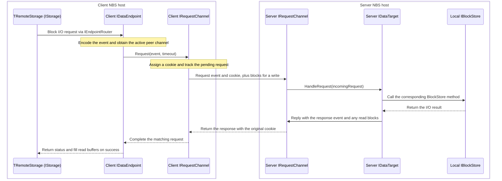

# Block I/O over IC V2

The endpoint method list is in the [Cells API](cells-api.md#supported-requests).

## Interfaces in the request path

1. **`IStorage` → `IEndpointRouter` → `IBlockStore`.** For a remote volume, `TRemoteStorage` implements `IStorage` and forwards the request through the Cells data router. When IC V2 is active, the router calls the IC V2 endpoint through `IBlockStore`. The endpoint implements `IDataEndpoint`, which extends `IBlockStore`. [Remote storage](../../../cloud/blockstore/libs/cells/impl/remote_storage.cpp), [data router](../../../cloud/blockstore/libs/cells/impl/endpoint_router.h), [data endpoint](../../../cloud/blockstore/libs/icv2/data/endpoint.h).
2. **`IDataRequestSender`, `IPeer`, and `IRequestChannel`.** The endpoint validates the request and encodes it as an event. Its `IDataRequestSender` adapter calls `IPeer::GetRequestChannel()` and sends the event through the active `IRequestChannel`. The channel assigns a cookie and tracks the pending request. [Data endpoint](../../../cloud/blockstore/libs/icv2/data/endpoint.cpp), [peer-backed adapter](../../../cloud/blockstore/libs/icv2/service/peer_request_sender.cpp), [request channel](../../../cloud/storage/core/libs/icv2/request_channel/request_channel.cpp).
3. **`IConnection` → `IConnectionHandler`.** The sending channel calls `IConnection::Send()` to send the event over TCP. On the receiving side, `IConnectionHandler` delivers the event to its request channel. The diagram combines these transport steps into the arrow between the two channels. [Transport connection](../../../cloud/storage/core/libs/icv2/transport/connection.h).
4. **`IRequestChannelHandler` → local `IBlockStore`.** The receiving channel calls `HandleRequest()` on its handler, an `IDataTarget`. The target issues the corresponding block operation through the local BlockStore service's `IBlockStore`. [Data target](../../../cloud/blockstore/libs/icv2/data/target.cpp).
5. **`IIncomingRequest`.** The target calls `Reply()` on the incoming request. The server channel sends the response with the original cookie, and the client channel uses it to complete the pending request. [Reply handling](../../../cloud/storage/core/libs/icv2/request_channel/request_channel.cpp).

## Wire format

The wire protocol uses the `TEvReadBlocks`, `TEvWriteBlocks`, and `TEvZeroBlocks` event families. The protobuf metadata identifies the volume and block range. Block data travels separately in the event payload, in the request for writes and in the response for successful reads. Zeroing needs only metadata. The target prepares the buffers for the local BlockStore call. [Event types](../../../cloud/blockstore/libs/icv2/data/protocol.h), [request and response encoding](../../../cloud/blockstore/libs/icv2/data/endpoint.cpp), [request execution](../../../cloud/blockstore/libs/icv2/data/target.cpp).

The endpoint passes `Headers.RequestTimeout` to the channel. On timeout, the channel completes the local request with `E_TIMEOUT`. The remote operation may still execute. A disconnect fails pending requests on the closed channel. The calling layer decides whether to retry. [Channel contract](../../../cloud/storage/core/libs/icv2/request_channel/request_channel.h).
