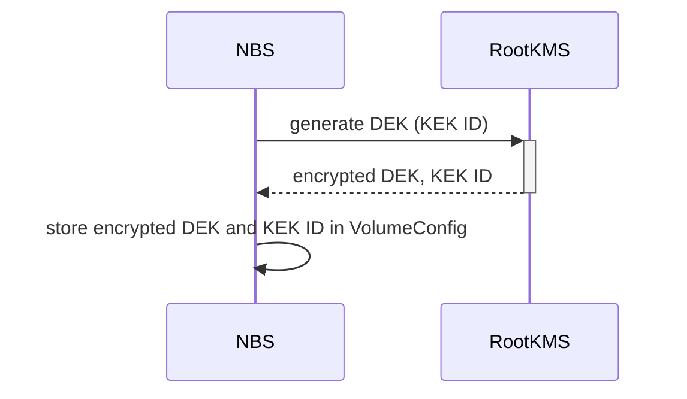
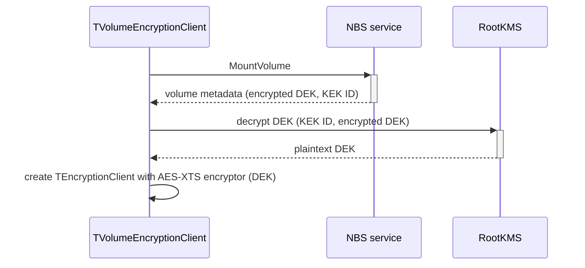

# Encryption with a Root KMS-provided key (NRD/Mirrored)

## General information

This document describes encryption with a Root KMS-provided key for non-replicated disks (NRD) and mirrored disks.

The data encryption key (DEK) is stored in encrypted form, together with the key encryption key (KEK) ID, in the volume metadata ([EncryptionDesc](https://github.com/ydb-platform/nbs/blob/7e02f27e5ff0473ce899ed037d35897de43d09db/contrib/ydb/core/protos/blockstore_config.proto#L117)). The root key management service (RootKMS) generates DEKs and encrypts and decrypts them using the KEK. The KEK remains in RootKMS; NBS requests reference it by its ID.

When rotating the KEK, existing DEKs can be re-encrypted under the new KEK. Both the encrypted DEKs and their KEK IDs must then be updated in the volume metadata. This does not require re-encrypting volume data.

## Creating a volume

NBS requests a new DEK from RootKMS, sending the configured KEK ID. RootKMS returns the encrypted DEK and the KEK ID, which NBS stores in the volume metadata. The plaintext DEK is not requested during volume creation.

## Mounting a volume

During session initialization, [TVolumeEncryptionClient](../../../cloud/blockstore/libs/encryption/encryption_client.cpp) obtains the encrypted DEK and the KEK ID from the volume metadata returned in the MountVolume response. It requests the plaintext DEK from RootKMS, sending the encrypted DEK and the KEK ID, and creates a [TEncryptionClient](https://github.com/ydb-platform/nbs/blob/7e02f27e5ff0473ce899ed037d35897de43d09db/cloud/blockstore/libs/encryption/encryption_client.cpp#L138) with an AES-XTS encryptor initialized with that DEK.

TEncryptionClient encrypts write data before forwarding it to storage and decrypts read data before returning it to the caller. In the endpoint path, this client runs inside the NBS endpoint process, which has access to the plaintext DEK and I/O data.

