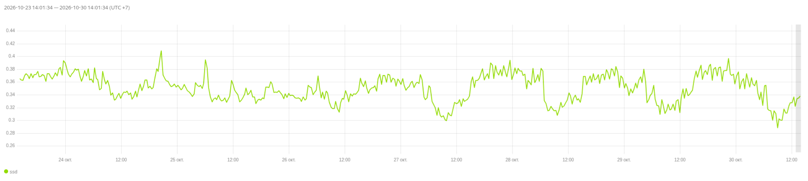
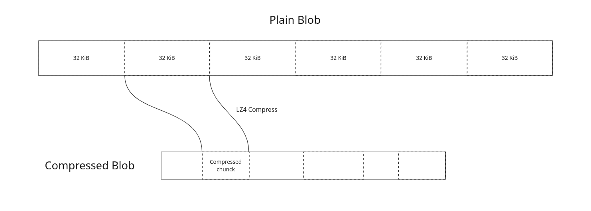

## Problem

Data on our disks is very compressible. We already have some metrics in the partition that show significant potential for data compression. They show that we can save up to 60% of disk space.



*Compressed bytes written relative to uncompressed bytes written on SSD. The ratio stays near 0.30–0.40.*


## Goal

Save a significant amount of SSD disk space.

## Solution

Compress blobs in chunks of K consecutive blob bytes. After compression, we can store the offset of each chunk and the chunk size in a compression metadata struct.

```
message TCompressionMetadata
{
    enum ECodec
    {
        // library/cpp/blockcodecs: lz4-fast14-safe.
        LZ4 = 0;
        // library/cpp/blockcodecs: zstd08_1 (compression level 1).
        ZSTD = 1;
    }

    ECodec Codec = 1;

    // Uncompressed chunk size in bytes used when writing this blob.
    uint32 ChunkSize = 2;

    message TPlainChuncks
    {
        // Offsets of each compressed chunk in blob in bytes,
        // starting from the second one.
        repeated uint32 ChunkOffsets = 1;
    }

    oneof Chuncks
    {
        TPlainChuncks PlainChuncks = 1;
    }
}
```



Candidates are new merged blobs from direct merged writes and ordinary compaction.
Fresh logs, fresh/mixed blobs, and deletion markers retain their existing formats.
Existing blobs may be replaced through ordinary compaction. We can perform full compaction across the entire cluster to compress all data.

We want to compress merged data because it's already very dense: the vast majority of the information stored on disk is in the merged table. The merged index is also organized well: when we look up blocks in the merged index, we already get all the information needed about the blobs that contain them.

### Codec

For the initial approach, we will use the LZ4 codec and will not experiment with other codecs.

### Index modifications

This compression metadata struct can be placed in the MergedIndex table alongside other fields and in blobmeta in the BlobIndex table.

`MergedBlocksIndex` (`part_schema.h`). Key: `RangeEnd`, `CommitId`.

| Column | Id | Type | Notes |
| --- | --- | --- | --- |
| RangeStart | 1 | Uint32 | |
| RangeEnd | 2 | Uint32 | key |
| CommitId | 3 | Uint64 | key |
| BlobId | 4 | Uint64 | |
| HoleMask | 5 | String (`THoleMask`) | deprecated |
| SkipMask | 6 | String (`TBlockMask`) | |
| CompressionMetadata | 7 | protobuf `NProto::TCompressionMetadata` | **new** |

We use the merged table to serve user reads, so getting compression metadata from it should be cheap. The only downside is that storing compression metadata will decrease the number of blobs that can fit in the blob cache, so using a chunk size of one block may not be very effective. Looking up every required blob in BlobIndex is very expensive, which is why we duplicate the information in two tables.

BlobIndex is used for metadata rebuilding and other operations and contains complete information about blobs, so let's keep compression metadata there too.

This compression metadata should be passed to the readblob actor to correctly plan and execute BlobStorage requests. We should explicitly indicate whether a blob is compressed. Missing compression metadata is unsafe and should not be interpreted as indicating that the blob is uncompressed. We should report an impossible event and reject such requests.

That's why we should first start verifying the presence of compression information and only then enable writing compressed blobs.

For data integrity, we already have a mechanism that works on top of this reading logic to ensure read correctness.

### Rollout and rollback

First, we must fully roll out a binary that supports the new compression metadata fields in BlobIndex and MergedIndex and can read compressed blobs, while keeping compressed blob writes disabled. Only after this rollout is complete can we enable writing compressed blobs. Once compressed blobs have been written, rolling back two versions to a binary that lacks these fields and cannot read compressed data is not supported, as it will lead to data corruption. Disabling compressed blob writes does not remove this restriction, because existing compressed blobs still need to be read. The only way to roll back to a binary that cannot read compressed blobs is to perform full compaction across the cluster using a version that supports compressed reads, with compressed writes disabled, and delete all checkpoints with data in NBS (or just wait for them to be deleted automatically, since checkpoints are short-lived). After these operations, we can safely downgrade to a version without support for compressed reads.

Before enabling nbs with new feature wich start to write new compressed blobs we need to update minumum supported version to the one that supports reading compressed blobs to prevent start of old binaries in cluster as it can leed to corruption. It can be done by updating this files:
```contrib/ydb/apps/version/version_definition.cpp```
```cloud/storage/core/libs/version_ydb/version.cpp```

### Chunk sizes

For the initial approach, we will use chunks of a constant size per blob, for example, 32 KiB. To find the most effective chunk size, we will add new CompressedBytesWritten metrics for each size. We will compress a blob using different chunk sizes and, for each size, report the number of compressed bytes written.

The chunk size can't be too small, because this will increase the index size and fewer blobs will fit in the blob cache. But increasing the chunk size also increases read amplification. After deploying in preproduction, we should carefully examine BlobStorage performance and tune the chunk size. Greater read amplification will increase CPU usage on the BlobStorage side because of erasure coding and encryption. SSD time should increase by only 4% for each requested chunk with a maximum size of 32 KB relative to 4 KB requests, according to the following model with latency = 100 µs and Bandwidth = 7 GB/s:

```T = latency + RequestSize / Bandwidth```

### Incompressible data

We can keep some blobs compressed and others uncompressed. If a blob is not compressible, we discard the compression result and keep the original blob. We can use different metrics for this: look at the difference in blob sizes or keep a blob compressed if it fits into a smaller huge slot after compression.

Huge blobs are stored in huge slots of fixed sizes. Adjacent huge slot sizes differ by approximately 12%. So if a blob's size is reduced by 12% or more, it is almost guaranteed to fit into a smaller huge slot and consume less SSD space. But even a reduction of 1 byte can save up to 12% of SSD space: if a blob is only a few bytes larger than a huge slot size, even modest compression can put it into a smaller huge slot category.

So we should implement different ways to classify incompressible data and compare them in an experiment in a production cluster. If classification based on huge slot sizes does not provide significant savings, there is no need to spend developers' time implementing and maintaining this complex algorithm.

We should also create a way to stop compressing data if a disk contains mostly incompressible data, to avoid wasting CPU on ineffective compression. There are large clusters of ClickHouse and other OLAP systems that contain already compressed data. We can track metrics such as compressed bytes and uncompressed bytes for the last N compression attempts. If there is little difference between these metrics, we can disable compression for the whole disk until the metrics show that compressing data is worthwhile. While compression is disabled for the whole disk, we can monitor compressibility by sampling: try to compress every nth blob and retain metrics for a number of these attempts.

### Compressing huge blobs into non-huge blobs

Compression may turn a huge blob into a non-huge blob, which can cause additional CPU usage during BlobStorage compaction. But it is difficult to estimate the number of such blobs, so it is better to wait until the feature is enabled in preproduction and then examine BlobStorage performance. If the number of small blobs stays the same and CPU usage during compaction does not increase, we can keep such blobs even if they are no longer huge. Otherwise, we can disallow compression that is too successful (turning huge blobs into non-huge blobs) or stop compressing a blob if compressing another chunk would make it too small.

We can also modify the BlobStorage API to force blobs to be stored as huge blobs. If we are sure that a blob will live for a long time, let's store it as a huge blob to avoid the CPU and WA costs of storing it.

### Caching or different compression for ranges with different temperatures

For now, we are not adding other features, such as caching or different compression for different ranges based on the user workload.

### Encrypted disks

For the initial approach, we will disable compression for encrypted disks. For now, it seems that there are not enough encrypted disks to justify adding specific logic.

If we also want to compress encrypted disks, we should pass the encryption key to the partition and allow it to encrypt and decrypt data for compression purposes. Alternatively, we could rework the entire encryption mechanism and apply it at the blob read/write layer.
