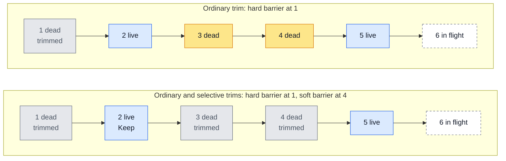
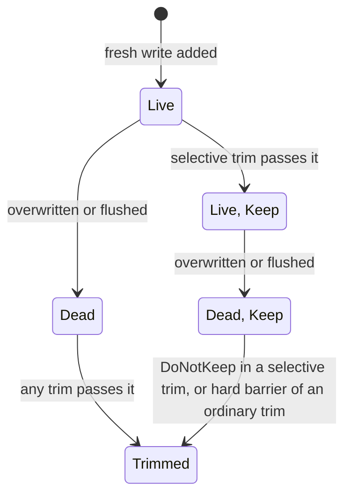
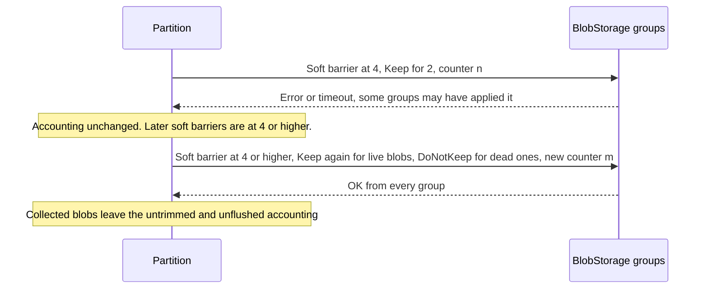

# Selective Fresh Log Trim

## Problem

Small writes go to fresh channels as fresh blobs. The partition trims them with a CollectGarbage barrier at `TrimFreshLogToCommitId`, which stays below every fresh blob with a referenced block and every in-flight fresh write. A trim used to follow each flush.

In an overwrite-heavy workload, most fresh blobs die long before a flush: all their blocks are overwritten. Until the next flush, such blobs:

- occupy BlobStorage space;
- count as unflushed, so they trigger flushes (`FreshBlobCountFlushThreshold`, `FreshBlobByteCountFlushThreshold`, `FreshBlobAgeFlushThreshold`) and count toward `FreshByteCountHardLimit`.

Trimming without a flush is not enough: the barrier stops below the oldest live blob, and the dead blobs above it stay.

*Blobs are numbered by commit id.*

## Goal

- Trim dead fresh blobs without waiting for a flush, including the dead blobs behind live ones.
- Stop counting trimmed blobs as unflushed, so overwrite-heavy workloads flush less often and hit `FreshByteCountHardLimit` less often.
- Keep the BlobStorage API, the blob format and the partition schema unchanged. Nothing new is persisted.

## Solution

A fresh blob is live while any of its blocks holds a trim barrier reference. It dies when its last reference is released by an overwrite or a flush. Versions needed by checkpoints keep their references.

There are two kinds of trims, and only one runs at a time. Each sends CollectGarbage to every group in the history of each fresh channel.

| Trim | Barrier | Flags | Trims |
| --- | --- | --- | --- |
| Ordinary | Hard, at `TrimFreshLogToCommitId` | None | Every blob at or below the barrier. A hard barrier ignores Keep flags. |
| Selective | Soft, on the newest dead blob below every in-flight fresh write | Keep for live blobs below the barrier, DoNotKeep for kept blobs that died | Dead blobs at or below the barrier |

A fresh write stays in flight until the partition adds it, so every blob below a selective barrier is known to the partition. The barrier does not go past the newest dead blob it can reach: live blobs above the barrier need no Keep. A trim sends at most `MaxCollectGarbageFlagsPerMessage` flags, and Keep flags come first. The limit can delay DoNotKeep flags or stop the barrier lower, but it never leaves a live blob below the barrier without Keep.

Keep flags are stored by BlobStorage, so a live blob gets Keep only once:

### When a trim starts

`T` is `FreshDeadBlobByteCountTrimThreshold`.

| Trim | Starts when |
| --- | --- |
| Ordinary | `TrimFreshLogToCommitId` moved since the previous ordinary trim, and one of: `T` is 0 (as before), a flush completed, the previous ordinary trim failed, the dead blobs at or below `TrimFreshLogToCommitId` reach `T`. |
| Selective | Selective trims are enabled, and all of: the dead blobs above `TrimFreshLogToCommitId` reach `T`, `T` more bytes died since the partition last tried a selective trim, unless that trim failed, no flush runs or is due, `TrimFreshLogToCommitId` is in the current tablet generation. |

When both are due, they alternate.

### Failures

A failed or timed-out CollectGarbage may still have been applied by some groups:

The retry needs a new counter: a VDisk answers `ALREADY` to a repeated counter without applying its new flags.

### Restart

BlobStorage keeps the barriers and flags. Selective trims do not move the persisted `TrimFreshLogToCommitId`, so live kept blobs are loaded as usual. Each loaded block takes a trim barrier reference, so every loaded fresh blob starts live.

Selective trims resume after the startup flush moves `TrimFreshLogToCommitId` into the current generation. Until then, a soft barrier of an earlier generation may be higher, and VDisks reject a decreasing barrier. Hard barriers of ordinary trims collect the kept blobs of earlier generations.

### Settings

| Setting | Default | Effect |
| --- | --- | --- |
| `FreshDeadBlobByteCountTrimThresholdSSD/HDD` | `0` | `T`. A nonzero value enables trims without waiting for a flush. |
| `FreshSelectiveTrimEnabledSSD/HDD` | `false` | Enables selective trims. Needs a nonzero `T`. |

SSD settings apply to SSD disks, HDD settings to HDD and hybrid disks.

### Costs

- More CollectGarbage requests and flags, and Keep flags stored by BlobStorage. `T` and `MaxCollectGarbageFlagsPerMessage` bound them.
- Many live blobs between dead ones spend many Keep flags for little space.
