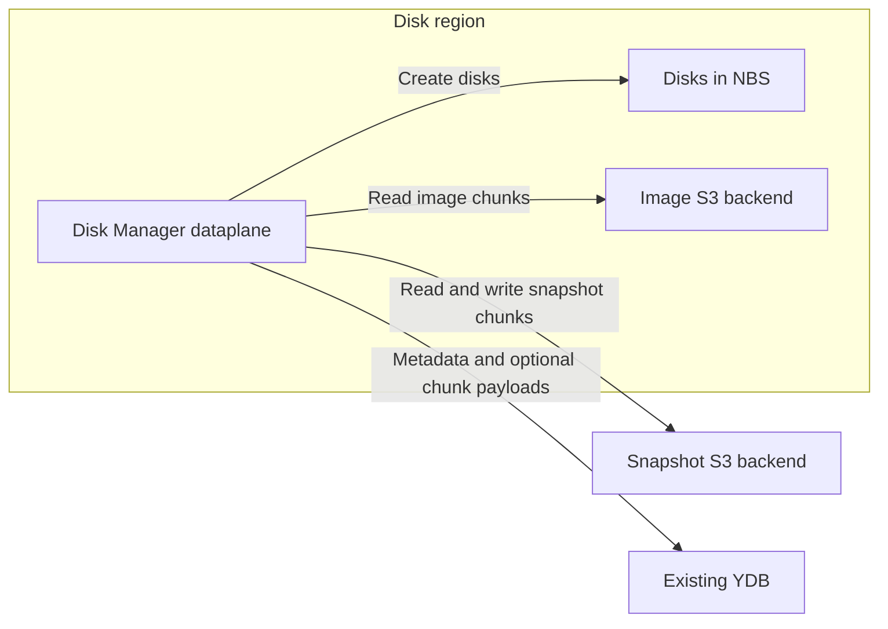
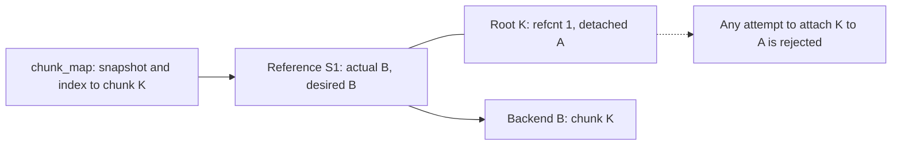
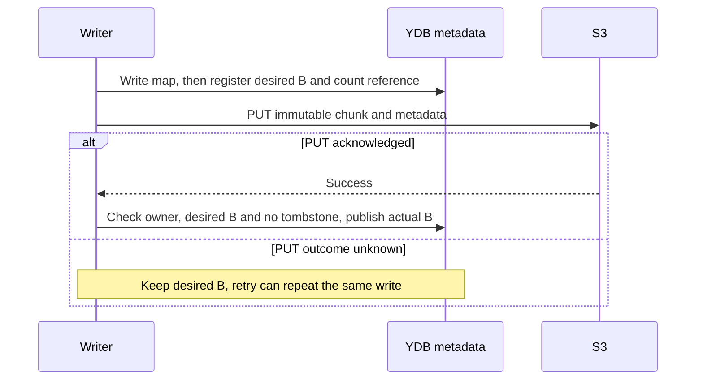
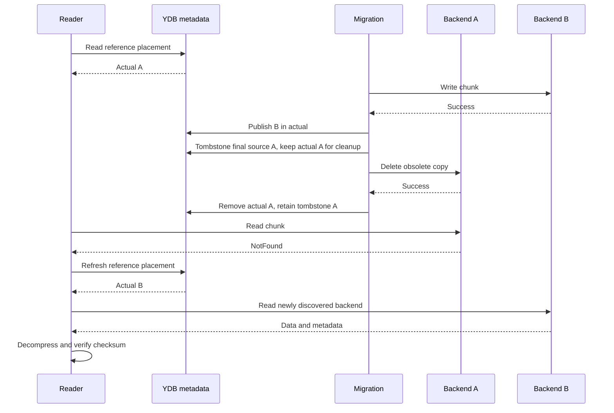
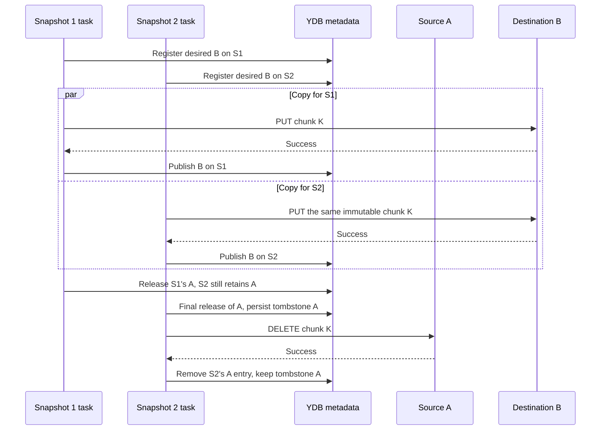
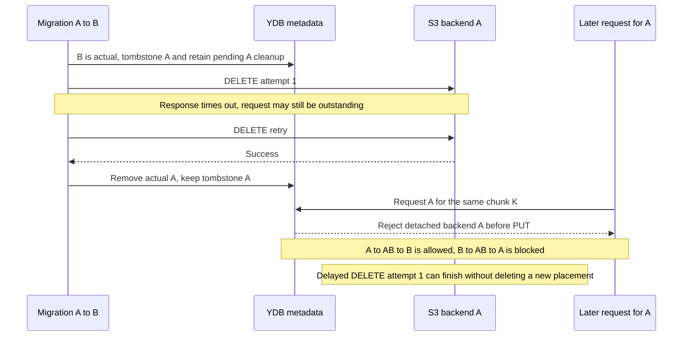
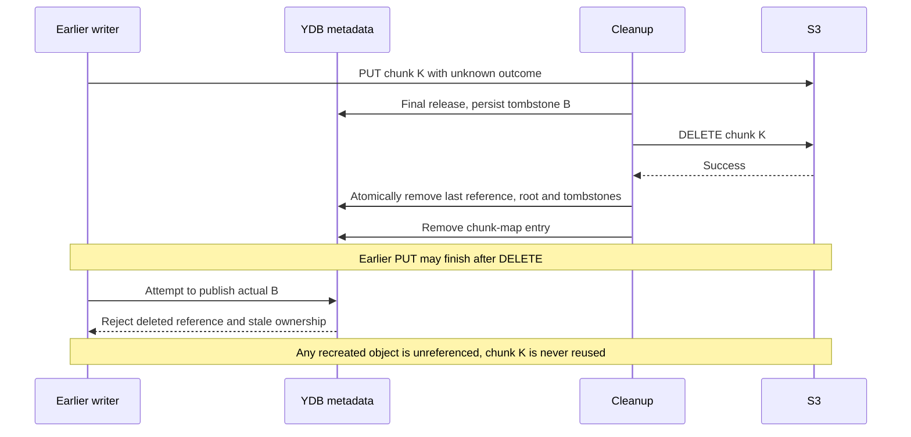
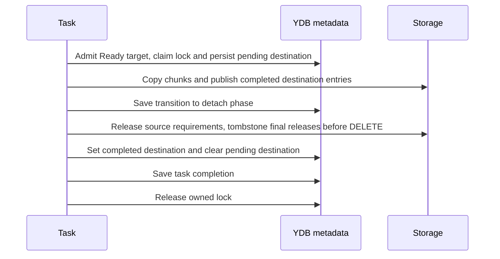
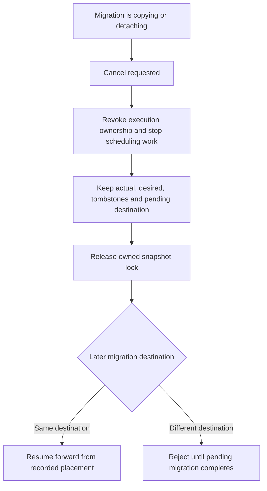

# Multiple storage backends for Disk Manager chunks

**Technical design record**  
**Status:** Draft for review  
**Date:** 2026-10-15

Select chunk storage per image or snapshot and migrate chunks between YDB and configured S3 backends. The first version supports one requested backend per resource and migration, without ongoing replication. A shared chunk can remain on several backends while different snapshots require those copies. A snapshot with unspecified backend can retain its existing per-chunk placement.

## Purpose and scope

Use different S3 backends for images and snapshots. Task and metadata storage stay in the existing YDB databases.

Images are disk templates; snapshots are backups. Separate chunk storage lets us store images in the disks' region, put snapshots in slower storage or another region, and move data to new capacity before retiring an old backend.



Support YDB to S3, S3 to YDB, and S3 to S3 migration. Moving a chunk preserves its ID and references. Backend changes on an existing reference do not change its reference count.

Migration accepts only dataplane snapshots in the **Ready** state. Images use the same dataplane snapshot records. Disk Manager continues serving reads during migration. A lock on the migrating snapshot protects it from deletion.

The controlplane selects a backend for each new image or snapshot and passes its ID to the dataplane. Creating a reference reuses a completed copy on that backend or copies the same chunk there. Other snapshots keep their own backend requirements.

Migration proceeds forward. Detaching the last requirement for a backend records a tombstone before physical deletion and retains it for the remaining lifetime of the chunk. The same chunk cannot subsequently be attached to that backend again, because an earlier S3 DELETE could still arrive. This restriction also applies when creating another snapshot that shares the chunk ID. Final chunk deletion removes the root and its tombstones.

## Existing code

[SnapshotConfig](../../../cloud/disk_manager/internal/pkg/dataplane/snapshot/config/config.proto) and [NewStorage](../../../cloud/disk_manager/internal/pkg/dataplane/snapshot/storage/factory.go) currently support YDB and one S3 backend. Image and snapshot services select newly written chunk storage using `UseS3`.

The [schema](../../../cloud/disk_manager/internal/pkg/dataplane/snapshot/storage/schema/schema.go) has snapshot records with status, base snapshot, sizes, encryption information, and `lock_task_id`. `chunk_map` maps a snapshot and chunk index to `chunk_id` and currently includes `stored_in_s3`. In `chunk_blobs`, the row with `referer = ""` holds `refcnt` and the optional YDB payload, checksum, and compression format. Rows with `referer = snapshot_id` represent references. S3 objects hold compressed data and checksum/compression metadata.

[Snapshot sources](../../../cloud/disk_manager/internal/pkg/dataplane/snapshot/source.go) cache chunk-map entries. Keep caching the chunk ID, but resolve its placement from `chunk_blobs` on each read. The cached `stored_in_s3` boolean cannot follow migrations or identify additional S3 backends.

[ShallowCopyChunk](../../../cloud/disk_manager/internal/pkg/dataplane/snapshot/storage/storage_ydb_impl.go) already shares a chunk by adding a reference to its ID. Extend it to register backend requirements and copy the payload when the requested backend has no reusable copy.

[backupChunksTask](../../../cloud/disk_manager/internal/pkg/dataplane/backup_chunks_task.go) copies compressed chunks to separate backup S3 storage. [backupSnapshotDataTask](../../../cloud/disk_manager/internal/pkg/dataplane/backup_snapshot_data_task.go) saves chunk maps and coordinates chunk backups. Their reads must also resolve current placement.

The existing [snapshot migration](../../../cloud/disk_manager/internal/pkg/dataplane/migrate_snapshot.go) and [database migration](../../../cloud/disk_manager/internal/pkg/dataplane/migrate_snapshot_database_task.go) copy data into another database. Reuse their resumable transfer and child-task scheduling patterns. This feature keeps the snapshot database and chunk IDs unchanged; ordering by chunk creator is not required for correctness.

## Configuration and stored fields

### Backend selection

`S3Backends` is a repeated configuration field containing a stable unsigned 32-bit ID, S3 connection settings, bucket, and key prefix. ID `0` denotes the existing singleton S3 backend; `0x7fffffff` denotes YDB chunk data. Other IDs identify additional S3 backends.

Backend IDs MUST remain stable and MUST NOT be reassigned to another storage namespace. Distinct backend IDs identify distinct physical object namespaces. Changing the storage location requires a new ID; rotating credentials for the same location preserves its identity. Reject duplicate IDs, the reserved YDB ID in S3 configuration, and incomplete settings. YDB-only configurations remain valid. An unused singleton bucket setting must not conflict with an explicit backend list.

The controlplane selects the image or snapshot service default, optionally overridden by an individual creation request. The dataplane request's backend ID is optional, so an explicit `0` remains distinguishable from an absent field.

For a request with an explicit backend ID, that ID takes precedence over `UseS3` and applies to both newly written and referenced chunks. Persist the selection before starting chunk work. A configuration change on retry must not select another destination.

For a snapshot with unspecified backend, disk and URL creation preserve their existing behavior: `UseS3` selects S3 `0` or YDB for newly written chunks, while unchanged chunks reuse their source placement. Snapshot-to-snapshot requests without a backend ID inherit completed source locations. Previously persisted tasks keep these rules, including chunks before their saved milestone. Their completion does not require conversion to a uniform backend. References whose placement fields remain empty follow the shared root's inferred location as described below; they do not promise to retain their original backend.

Validate each selected backend before creating records, including all-zero inputs. Invalid or unknown selections fail before writes begin. If validation succeeds but a backend later becomes unavailable, preserve recorded work and retry the operation using the same ID.

### References, payloads, and detach tombstones

Use the existing `snapshots`, `chunk_map`, and `chunk_blobs` tables. No additional table is required for placement or tombstones.

Add `s3_backend_ids` and `desired_backend_ids` to each `chunk_blobs` reference row:

- **Actual** (`s3_backend_ids`) records completed copies available to this reference. During detachment, an actual entry remains until physical deletion is acknowledged; a read can therefore encounter NotFound and refresh its locations.
- **Desired** (`desired_backend_ids`) records this reference's requirements, including unfinished writes. A desired-only entry is not proof that data can be read. During cleanup of an unfinished write, it can remain solely to identify outstanding deletion work.

State examples use **desired → actual**. To add backend A to a reference on backend `0`, first record `{0,A} → {0}`, then copy the data and publish `{0,A} → {0,A}`. The first state reserves A before its payload is written.

Add **`detached_backend_ids`** to the shared row with `referer = ""`. This set is append-only during the chunk's lifetime and contains chunk-wide tombstones. A tombstone is written when the last reference starts physically detaching a backend, before any S3 DELETE. It forbids every subsequent requirement, reuse, or publication of that `(chunk_id, backend_id)`, including requests from a different snapshot.

Releasing one reference while another still needs the backend does not create a tombstone: the physical copy remains live. Detach tombstones are created only for the final release that authorizes physical deletion.

All three sets can contain the YDB ID. Store sets as sorted, unique sequences of four-byte, big-endian IDs in YDB `String` columns. NULL and zero-length bytes decode as empty sets. ID `0` occupies four bytes and is not empty. Invalid byte lengths are errors. IDs in active actual or desired sets must be configured. Historical detached IDs can outlive their backend configuration; reading a tombstone does not require an S3 client.

`refcnt` counts reference rows, including those retained for unfinished cleanup. Increment it once when inserting a reference; decrement it once when removing the reference after cleanup. Update it in the same transaction as that insertion or removal. Backend changes on a reference do not change the count.

Keep detach tombstones while the chunk has any references, including references retained for unfinished cleanup. Once physical cleanup finishes and the last reference is removed, delete the root and its tombstones in that same transaction; do not retain a root with `refcnt = 0`. Deleting one backend copy while another remains does not end the chunk's lifetime. New chunk IDs must not reuse previously deleted chunk identities.

For an existing reference, both actual and desired empty means that placement has not yet been specified in the new fields. Empty actual with non-empty desired means an unfinished write. Non-empty actual with empty desired means retained cleanup work. A missing reference is NotFound and must never trigger unspecified-backend inference.

Every newly inserted reference has non-empty desired in the insertion transaction. When cleanup removes its last actual or desired entry, delete that reference and decrement `refcnt` in the same transaction; never persist a new reference with both sets empty. Preserve root tombstones while other references remain; remove the root when the last reference is removed.



All mutations compute their result from the main chunk table and mirror it to the configured shadow table in the same transaction. This includes reference counts, placement sets, payloads, and tombstones. Preserve existing tombstones during retries and when populating a previously missing shadow row; do not replace the root with a fresh default row.

### Resolve a snapshot with unspecified backend

When both placement fields are empty on an existing reference, read that reference and the root row in one consistent database read. Infer YDB presence from the root's payload: non-empty `data` identifies YDB; no payload identifies existing S3 backend `0`. An S3 copy stores its payload and checksum/compression metadata in the S3 object. Compression alone is not a presence indicator: uncompressed YDB chunks also have empty compression. Zero chunks have no payload or reference and are recognized from `chunk_map`. A missing root for an existing reference is an error, not evidence of S3 placement.

Resolve an existing reference with both fields empty as having actual and desired both equal to the inferred backend. For an S3-backed chunk, this is `{0}` in both sets: the empty encoding does not mean that the reference retains no backend. Apply this interpretation to reads, reuse, and every detach decision, including checks of other references. It uses the existing chunk's location, independently of the current service default for new writes.

Populate explicit sets only on the reference being changed, using its inferred placement in the same transaction as the update. For an S3-backed reference, requesting A changes `"" → ""` to `{0,A} → {0}` in desired → actual notation. Other references need no initialization pass. S3-to-S3 migration leaves the inference unchanged, so other empty references continue to retain backend `0`.

When S3-to-YDB copying atomically writes a complete root payload and publishes the copying reference's actual YDB entry, other references with both fields empty begin resolving to YDB. This is valid for those references because they have no explicit backend requirement. Detach decisions must count them as retaining YDB, so the payload cannot be cleared while any such reference remains. Explicit requirements for S3 `0` continue to retain that copy independently. When moving a reference from YDB to S3, populate its inferred YDB entries before changing them; other empty references still retain YDB.

If a placement transaction fails before commit, neither its explicit sets nor its YDB payload changes become visible. If its response is lost after commit, retry from the stored state without resetting populated sets. Concurrent placement and detach transactions resolve references against the same root state or retry. A reader that selected S3 `0` before a YDB copy appeared can discover YDB through the all-NotFound refresh described below if S3 `0` is subsequently deleted. New writers always create explicit sets; enable placement changes only after all dataplane writers understand inference and honor detach tombstones. A cached `stored_in_s3` boolean is not authoritative placement after migration.

## Snapshot lifetime and operation ownership

Reuse the existing `snapshots.lock_task_id` for the migrating snapshot. In the acquisition transaction, require Ready status and claim that existing lock; migration does not introduce a separate snapshot lock. Hold it through copying and detachment to protect the snapshot from deletion. Reads do not acquire it. Task execution ownership alone cannot provide this protection because deletion runs as a different task.

Do not lock parents or chunk creators merely because snapshots share chunks. Children can migrate concurrently, and a deleted creator requires no substitute snapshot lock. Reference transactions and chunk-wide detach tombstones coordinate physical copies. Creation protects the source snapshot from deletion while reading its map and registering references. Reusing the existing exclusive source lock can make creation retry while that source is itself being migrated.

The target's existing exclusive lock admits one migration task at a time. Persist `snapshots.pending_backend_id` when admitting a migration. If it is already set to a different destination, reject the new request; a matching request can resume after the previous owner has stopped. Cancellation preserves this destination. Clear it only when migration completes or the snapshot is explicitly deleted.

Store an execution generation in `snapshots.operation_generation` alongside operation ownership (`lock_task_id` for migration and the creation owner for creation). Advance the generation when a new execution is admitted or ownership is revoked. Every chunk-map insertion/update, reference registration, write publication, detach decision, and completion update checks the snapshot lifecycle and current owner/generation in its transaction. A stopped execution must not start new chunks, recreate deleted mappings or references, or clear a newer owner's lock. Task-state generation checks alone do not fence snapshot-storage mutations. Integrate admission and cancellation with the task framework's execution ownership; a cancelled execution cannot reacquire ownership as if it were a new request.

If deletion marks the target Deleting before migration admission, admission fails. If migration acquires its lock first, deletion waits. A failed admission transaction starts no chunk operations. A lost admission response is retried idempotently by the same execution; it does not change the destination or steal another owner's lock.

## Chunk operations

### Write a new chunk

Preserve the existing ordering: create the `chunk_map` entry before registering or writing the blob. The map-write transaction itself checks destination lifecycle and operation ownership, so a stale writer cannot insert a mapping after cleanup has passed it. The destination is still Creating, so this mapping is not exposed as a completed snapshot. It makes unfinished work discoverable by retry or creation cleanup. Chunk IDs remain deterministic for the creating task and chunk index.

In one serializable transaction, check destination ownership and status, check that the requested backend is not tombstoned, insert the reference with empty actual and the backend in desired, and increment `refcnt` only if the reference is new. An existing reference is resumed without resetting its sets. Do not erase a root's tombstones when initializing its other fields.

For S3, compress the data and PUT it with checksum/compression metadata. After success, publish the backend in actual in a transaction that rechecks ownership, reference existence, desired membership, and absence of a tombstone. For YDB, write the payload and publish actual in the same transaction. Zero chunks need only their applicable map representation.

If the map write fails, retry before creating any blob. If only the map commits, cleanup sees the mapping and treats a missing reference as already cleaned. If reference registration commits but PUT fails or times out, desired remains and the chunk is not readable through that reference. Retry the same immutable payload and ID. If PUT succeeds but publication fails, repeat PUT or verify completion through the normal retry path; desired alone never proves success.

If creation cleanup wins before publication, the writer must not recreate the reference. Its late PUT may still complete remotely. If another reference retains that backend, its requirement keeps the object live; otherwise final cleanup deletes the location using the detach protocol. A PUT that finishes after cleanup can leave an unreferenced object, as described under snapshot deletion. A stale worker that has not registered its next chunk is rejected by destination lifecycle/ownership checks before registering it.



### Read a chunk

Get the chunk ID from `chunk_map` and pass the snapshot referer through the read API. Read the reference's actual and desired sets from `chunk_blobs`. If both placement fields are empty on an existing reference, resolve it from the root `chunk_blobs` row in the same consistent read, using the compatibility rules above. A missing reference is NotFound. Invalid metadata and unknown backend IDs are errors. An empty actual set with non-empty desired has no completed copy to read; do not use the unspecified-backend fallback or read a desired-only backend.

Keep a set of backend IDs already attempted during this read:

1. Try every actual backend not yet attempted, in random order, until one returns the chunk. Decompress it and verify its checksum. A YDB read uses the root row's payload; a missing payload is NotFound.
2. On NotFound or Unavailable, continue with the remaining candidates. If none succeeds and any candidate was Unavailable, return Unavailable. Propagate other errors and context cancellation.
3. Only when all attempted candidates returned NotFound, reread the reference's placement consistently, including the root row if unspecified-backend resolution is needed. Try only actual backend IDs that were not attempted before.
4. Repeat this process across successive forward moves. If refreshed metadata contains no new actual backend, return NotFound. All metadata reads and backend requests use the caller's context; stop when it is canceled or its deadline expires.

An initially empty actual set returns NotFound without waiting for an unfinished write. Repeated metadata reads do not retry an already-attempted backend or make desired-only copies readable. This allows a reader that captured A before migration to discover B after A is deleted, and then C if another move overtakes its read of B.



If the refreshed set still contains only A, there is no untried location and the read returns NotFound. If A is NotFound and B is Unavailable, the read returns Unavailable after exhausting the candidates. A metadata-read failure is returned as an error, not converted to NotFound.

### Reference an existing chunk

Protect the source from deletion while reading its map and registering the new reference. Write the destination map before or in the same transaction as reference registration, so a crash cannot leave an undiscoverable counted reference. A separate map-write transaction also checks destination lifecycle and operation ownership; it must not recreate mappings after cleanup.

Resolve unspecified source reference fields using the shared root, without rewriting the source references. In one serializable transaction, require an existing source reference, inspect the root tombstones and source references, register the destination reference with explicit sets, and increment `refcnt` exactly once. A missing source reference or root cannot be recreated from a cached chunk-map entry. A reusable copy must occur in both effective actual and desired on a reference and must not be tombstoned. Actual-only copies may already be undergoing deletion; desired-only copies are unfinished.

For an explicit destination B, reuse B from any qualifying reference by setting the new reference's actual and desired to `{B}`. Do not inherit unrelated locations just because the source also has them. If no reusable B exists, register completed, retained source locations in actual and `{B}` in desired. Those actual entries pin the source data while copying B. When creating a snapshot with unspecified backend, inherit completed, retained locations according to the request compatibility rules.

If B is tombstoned for this chunk, reject the request before adding a reference or issuing PUT. This applies even if the new snapshot has never used B: a stale DELETE is tied to the shared chunk key. A source on B cannot override the tombstone. The first version does not generate replacement chunk IDs to evade this restriction.

If registration and another reference's release race, serializable transactions determine the outcome. Registration first makes the new requirement visible, so the releaser keeps the physical object. Final detachment first writes a tombstone, so registration fails. A retry after an acknowledged or ambiguous commit preserves the destination reference's progress and does not increment its count twice. A source disappearing before registration causes an error; after registration, the destination's own actual/desired entries protect its copies.

After registering temporary source locations, use the copy operation below. Once every destination chunk is available, release temporary locations using detach. A failed copy keeps those locations readable and counted. Creation cancellation uses the explicit reference-cleanup procedure; migration cancellation never performs that cleanup.

### Copy to another backend

`replicateChunk(snapshot_id, chunk_id, destination)` preserves the chunk ID, reference, and reference count. Migration invokes it for an existing reference; creation invokes it after registering the destination reference.

In a transaction, check the current operation owner, reference, and root tombstones, resolve and populate this reference's fields if unspecified, then add the destination to desired. A tombstoned destination is rejected before any write. If this reference already has a completed, retained destination, the copy is complete. A completed, retained destination on another reference can be reused transactionally without PUT, using its effective sets if its fields are unspecified. Otherwise read compressed data and checksum/compression metadata from an actual source using the read-and-refresh algorithm, then write through the selected destination client.

After a successful S3 PUT, publish the destination in actual only if the reference still exists, the operation is current, the backend remains desired, and the root has no tombstone for it. For YDB, write the complete payload and publish actual in the same transaction with those same checks; references whose fields are still empty can then infer YDB presence. S3-to-S3 transfer uses separate clients, allowing different endpoints, buckets, credentials, and regions.

If the desired update fails, no payload write starts. If source reading fails, desired remains and all existing actual locations are kept. A PUT timeout leaves an unknown physical outcome, so retry writes the same immutable data. If publication fails after successful PUT, the existing desired entry retains the obligation to complete or clean that write. If publication is rejected because the snapshot is being deleted or the backend is tombstoned, it must not recreate that reference's readable placement. Another reference's requirement can keep the object live; otherwise final cleanup deletes the location using the detach protocol. A PUT that finishes after cleanup can leave an unreferenced object, as described under snapshot deletion.

Two references may concurrently copy the same chunk to B. Both register desired B before writing and publish completion only on their own references. Duplicate PUTs contain the same immutable payload and metadata. The faster task may release A, but it cannot physically delete A while the slower reference still retains A. Desired-only B also prevents another reference from deleting B while a copy is unfinished.



### Detach one backend

`detachChunkBackend(snapshot_id, chunk_id, backend_id)` releases one reference's requirement for a backend. Migration and creation's temporary-source cleanup use it only after a completed destination remains in both actual and desired and is not tombstoned. Snapshot deletion uses the same final-release protocol without requiring an alternative readable copy.

In a serializable transaction, read this reference, the root, and all other references for the chunk, including references whose snapshots are being deleted. Resolve unspecified fields for every reference when computing its effective actual and desired sets, and populate this reference's fields before changing them. If this reference no longer contains the backend in either effective set, its release is already complete. If another reference retains the backend in effective actual or desired, remove it from both sets on this reference and commit. Keep the physical object and do not create a tombstone. Every entry-removal transaction, including this shared-copy branch, deletes an emptied reference and decrements `refcnt` in that same transaction.

If no other reference retains the backend, append its ID to the root's `detached_backend_ids` in that transaction. This is the irreversible detachment decision. For an actual entry, remove desired and retain actual as pending cleanup. For a desired-only entry, retain desired as pending cleanup. The tombstone distinguishes this entry from a new write requirement and prevents a late writer from publishing it.

Only after the tombstone transaction commits may S3 DELETE begin. After success or NotFound, remove the retained backend entry transactionally. If that empties a reference, remove the reference and decrement `refcnt` exactly once. Keep the root and its tombstones while any reference remains. If this removes the last reference, delete the root, including its tombstones, in the same transaction. For YDB, write the tombstone, clear unneeded payload/checksum/compression columns, and release the entry in one transaction; no external DELETE is needed. The same final-reference rule applies to the YDB transaction.

The transaction that registers any new requirement reads the same root and checks for a tombstone. Therefore a final detach and a new requirement cannot both win: if the new requirement commits first, detach observes it and leaves the object; if detach commits first, registration rejects the destination. Concurrent last releases also serialize: one releases its entry while another still retains the backend, and the final releaser retains responsibility for physical deletion.

If the tombstone transaction fails, no DELETE is issued. If it commits but its response is lost, a retry observes the tombstone and resumes the retained cleanup entry. If DELETE fails, preserve both the tombstone and pending entry and retry. If DELETE succeeds but metadata cleanup fails, repeating DELETE is safe: a surviving chunk retains the tombstone, and a fully deleted chunk ID is never reused. If migration is cancelled at any point, its cancellation handler leaves the tombstone and pending entry unchanged; a later continuation completes the forward operation.

The tombstone prevents the stale-delete race even after a successful retry: the original DELETE may still arrive after its retry has succeeded. It must never encounter a newly attached copy of the same chunk on that backend.



Tombstones do not expire on a timeout or after deleting just one backend copy. They are removed with the root during final chunk cleanup. Until snapshot deletion finishes, its lifecycle prevents recreation under the same snapshot ID; a later creation uses a new chunk identity. Sharing the old chunk requires a surviving source reference, checked transactionally. If another snapshot still references the chunk, the root and tombstones remain. A delayed DELETE for a fully deleted chunk therefore cannot delete a newly created chunk.

### Delete a snapshot reference

Snapshot deletion and creation cancellation are separate from migration cancellation. They mark the destination Deleting, stop new work through lifecycle/ownership checks, and clean its references. Keep each chunk-map entry until reference cleanup finishes so a retry can find all remaining work.

For each backend in this reference's effective actual union desired, including inferred placement when both fields are empty, run the detach protocol. When another reference retains a backend, release only this reference's entries. For the final requirement, keep the reference counted until physical deletion succeeds or returns NotFound. Then remove the entry; remove an empty reference and decrement its count in the same transaction. If this removes the last reference, also delete the root and its tombstones. A retry of a missing reference succeeds without decrementing again or recreating the root. After reference cleanup, remove the chunk-map entry.

A crash before reference cleanup leaves the map and counted reference. A crash after reference cleanup but before map removal leaves a discoverable mapping whose missing reference is already cleaned. Repeated deletion cannot decrement the count twice. Two snapshots deleting the same shared chunk do not both abandon the physical object: their checks and releases conflict, and the last one records its tombstone before DELETE.

If a PUT was outstanding when deletion began, it may complete after DELETE and recreate an unreferenced object. Its actual publication is rejected, but remote completion cannot be undone by local cancellation. This is a separate orphan-object cleanup issue: it cannot make a deleted chunk readable or let a stale DELETE affect a new chunk. Final chunk cleanup still removes the root and tombstones. A successful DELETE does not prove that every earlier PUT has settled; collecting such unreferenced objects is not a reason to retain chunk metadata indefinitely.



## Snapshot migration

### Copy, then detach

The request stores the dataplane snapshot ID and destination. State stores the phase, a chunk-index milestone for that phase, operation ownership, and a completion flag. The snapshot stores the pending destination so a new task can continue after cancellation without guessing from per-chunk sets.

After Ready-only admission, scan the snapshot map and copy every nonzero chunk to the destination. Each chunk publishes its completed destination before its milestone can advance. Retain source requirements throughout this phase. A source read or destination write failure leaves the original data available and the destination's desired entry available for retry.

Only after every chunk has its destination completed, save the transition to the detach phase with a fresh phase milestone. Then release other backends from each reference. Shared copies stay while other snapshots need them; final releases create tombstones and delete the payload. This two-phase ordering preserves the complete source during copying. Detach is irreversible and never restores a source backend.

If a worker stops before saving a chunk milestone, replay that chunk: completed copies are reused, pending copies repeat immutable writes, and detach resumes from its tombstone and retained entry. If all copies finish but the phase transition is not saved, rerun the copy scan and skip completed destinations. Never begin detachment before that transition is durably recorded. If a new task continues after cancellation without the old milestone, start the copy scan from the beginning; its same destination is already present on previously detached chunks, so this performs no backwards copying.

When every reference has actual and desired equal to the destination, transactionally set `snapshots.s3_backend_ids` to that destination and clear `pending_backend_id`. Other snapshots may retain source copies, and root tombstones may retain detached IDs. Neither prevents completion. Save task completion, then release the owned lock. If completion was saved before unlocking finished, a retry only finishes the unlock; it does not restart placement work.



### Migration cancellation and continuation

Migration cancellation stops new work, invalidates the execution's ownership, stops and joins workers belonging to that execution where possible, and releases its owned lock. It **does not delete objects, remove references, detach backends, or migrate data backwards**. Preserve actual, desired, root tombstones, pending deletion entries, and `pending_backend_id` exactly as recorded by operations that committed before cancellation.

Cancellation cannot retract an S3 request that was already sent. An earlier PUT or DELETE may still finish after cancellation. A stale execution cannot publish metadata or start another chunk after ownership is revoked. A completed PUT whose publication was rejected remains represented by desired and can be repeated on continuation. A DELETE already authorized by a tombstone may finish; the retained cleanup entry makes it resumable, and the tombstone prevents reattachment.

Cancellation can run in a different task instance, so joining its own local workers is not proof that a previous execution has stopped. Storage mutations must enforce the ownership checks above. A failed cancellation transaction or unlock is retried idempotently. It must not clear another execution's lock or forget the pending destination.

A later migration continues toward the same pending destination. A request for another destination is rejected until that continuation finishes. Copy-phase cancellation leaves sources intact. Detach-phase cancellation can leave a mixture of completed releases and pending deletions, but every chunk already has the requested destination. Continuation completes those releases; it does not re-create detached sources. An explicit snapshot deletion can subsequently clean the resource through the separate deletion procedure.



This cancellation rule applies to migration. Cancellation of snapshot or image creation retains its existing behavior of deleting the partial destination and cleaning its references; it must use the tombstone-aware deletion protocol. It does not delete source snapshots or change their backend requirements.

## Bulk migration

The bulk request contains a dataplane snapshot ID prefix and destination backend ID. Validate the destination and save a cutoff once. Wait for creation tasks started before the backend change before capturing that cutoff, because `created_at` records creation completion.

Select Ready snapshots before the cutoff whose completion field is unset:

```sql
SELECT id, created_at
FROM snapshots
WHERE status = Ready
  AND created_at < $cutoff
  AND StartsWith(id, $dataplane_id_prefix)
  AND s3_backend_ids IS NULL
ORDER BY created_at, id
LIMIT $batch_size;
```

`Ready` represents the stored status. Run up to ten children by default, with a configurable limit. Save selected snapshot IDs before scheduling. Use a stable bulk-task/snapshot scheduling key, then save child task IDs before waiting. Keep the cutoff and only active snapshot/task pairs in task state. Remove finished pairs, save, and select again. Snapshots sharing a chunk can run concurrently; no parent or creator has to be migrated first or included outside the requested prefix.

If the parent stops before scheduling, the saved snapshot ID remains to schedule. If scheduling succeeds but saving the child ID fails, repeat scheduling with the same key to recover that child. If a child sets the completion field before finishing its unlock, the query stops returning the snapshot, but the parent still waits for the saved child. Retain completed child-task records for the supported restart interval so a restarted parent can resolve those IDs.

A child skips a snapshot that no longer exists or is Deleting when it attempts admission; a direct single-snapshot request reports an error. A lock held by another operation causes retry. A different pending destination, unknown backend, or tombstoned destination is an error. Transient source unavailability follows normal retry behavior. A permanently failed child must be reported, not silently removed and treated as successful migration.

An empty batch after filtering active or unavailable candidates is not completion. Finish only when the underlying selection query is empty and no saved child remains. Otherwise wait for active work or reselect. The NULL-only selector intentionally does not select already-migrated snapshots for another move; use explicit single-snapshot requests or a separate source/target selector for later moves.

Bulk cancellation stops scheduling, recovers any scheduled child whose ID was not saved using its original key, cancels all active children, and waits for cancellation to finish. Child cancellation preserves chunk placement and pending work as described above. If cancelling a child or saving the parent state fails, retry using saved IDs and stable keys; do not initiate data cleanup or rollback.


## Creation and incrementality

Keep existing incremental base lookup and checkpoint handling. A base on a different backend remains usable: register references to unchanged chunk IDs and reuse or copy their payloads to the selected backend. Write new or changed chunks directly to that backend. A backend difference does not require new chunk IDs or reading unchanged blocks from the disk.

For an explicit backend, complete creation when every nonzero chunk has that destination in actual and temporary-source detachment has finished. Reusable copies register only the requested backend, so creation does not accidentally pin unrelated source locations. For a snapshot with unspecified backend, apply the existing per-chunk selection and inheritance rules; mixed placement is valid and previously processed chunks need no conversion.

If a chunk copy fails, preserve its map, reference count, desired destination, and actual source locations for retry. If all copies finish but readiness publication fails, retry the completion path without resetting references or rewriting already completed chunks. If a requested backend was previously detached for a shared chunk, creation fails explicitly; it must not issue a backwards PUT under that chunk ID. Creation cancellation deletes its partial destination through the reference-cleanup protocol while preserving the source's references.

## Backup and existing database migration

Backup reads resolve actual backends from current reference rows, including the all-NotFound refresh behavior. Pass the source snapshot referer through the backup read API. A chunk-ID-only operation resolves surviving references consistently and uses their actual locations; it never treats a tombstone or a desired-only entry as readable. Resolve unspecified placement from the shared root in the same database read.

If the creator disappeared but another reference survives, use the surviving reference rather than assuming the creator still exists. If all references disappear, return NotFound; final chunk cleanup removes the root as well. Source protection must cover any backup that requires the snapshot to remain available for the operation. A backend failure leaves the backup task retryable according to the read result; a map must not be reported complete until all chunk IDs it contains have backup payloads.

Preserve compressed data, checksums, and compression metadata. Backup objects remain separate from actual chunk backends; moving a chunk does not change its existing backup object key. Update the source and destination wrappers used by existing database-migration tasks to resolve the new fields, without transferring source detach tombstones as destination placement history into an unrelated chunk-ID namespace.

## Capacity and deployment

Configure new backends in the dataplane before selecting them for new writes. Plan for source and destination payloads to coexist during the copy phase. Shared source copies remain until every reference releases them. Count physical copies by `(chunk_id, backend_id)` when estimating capacity. Configure simultaneous-snapshot, chunk-operation, and byte limits, with separate request and bandwidth limits per backend.

Deploy schema and compatible dataplane reads/writes first. Keep placement changes disabled until all writers register explicit actual/desired state and honor tombstones. Existing controlplane requests and saved tasks continue using the unspecified-backend rules. After dataplane rollout, enable controlplane backend selection and migrations.

Before retiring a backend, check active references using both explicit sets and unspecified-backend resolution, outstanding creation/migration destinations, and pending physical cleanup. Finish or explicitly resolve those operations, including ambiguous S3 requests. Tombstones on surviving chunks remain after active configuration is removed and continue to forbid reusing that backend ID for those chunks. Final chunk deletion removes them with the root. Do not clear tombstones on surviving chunks to make a backend appear unused.

## Implementation steps

1. Add stable multi-S3 configuration, request presence handling, and client selection.
2. Add reference placement sets, root detach tombstones, pending snapshot destination, and execution ownership checks, including transactional shadow-table updates.
3. Add consistent unspecified-backend resolution and backend refetching after all attempted locations return NotFound.
4. Extend writes, reference reuse, copying, detach, and deletion with the transaction and retry rules above.
5. Add Ready-only migration admission, saved copy/detach phases, and migration cancellation that preserves placement.
6. Add bounded bulk scheduling with stable child keys and cancellation that waits for children.
7. Integrate backend selection into image/snapshot creation and update backup/database-migration reads.

## Details to settle

- Whether copying preserves the source storage class or uses the destination's configured class.
- Default bandwidth/concurrency limits and completed child-task retention for bulk restarts.
- The access path for bounded bulk selection.
