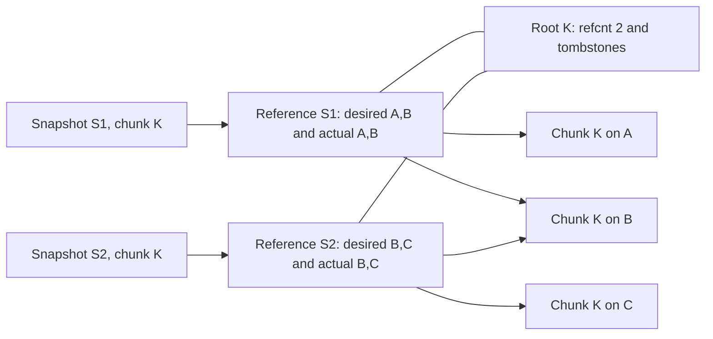
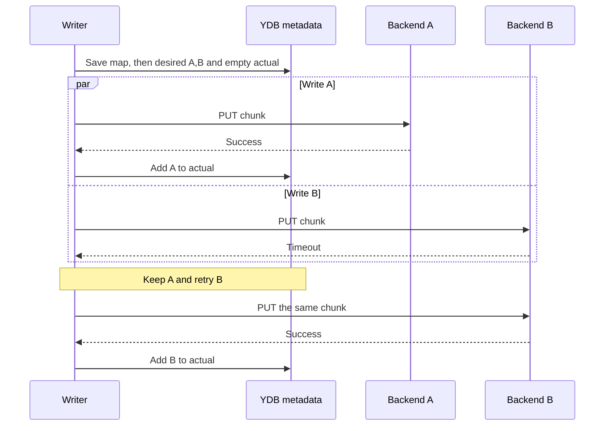
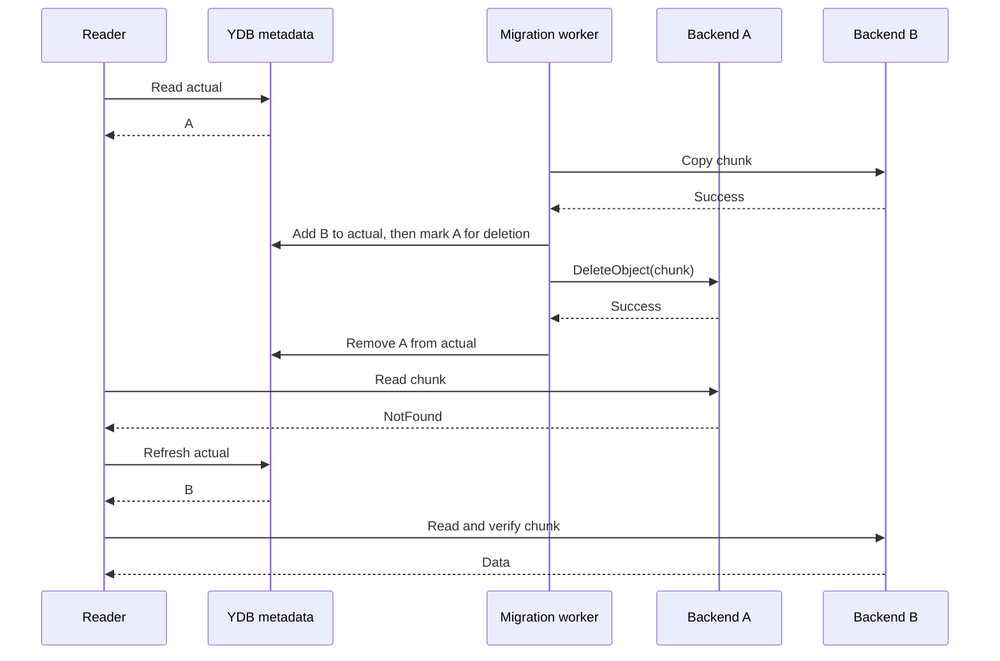
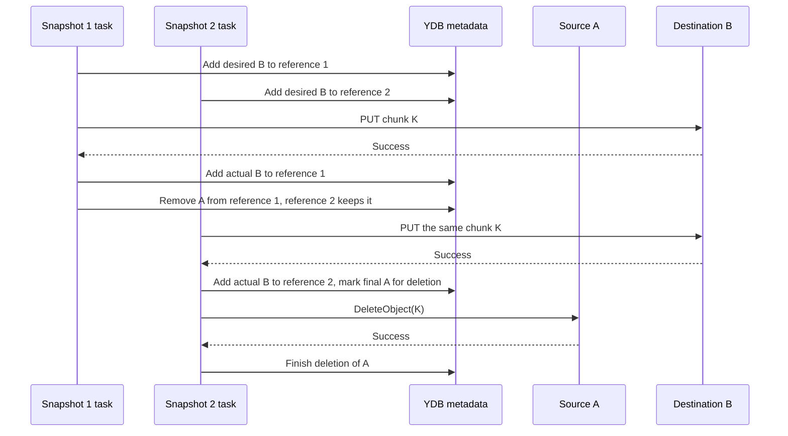
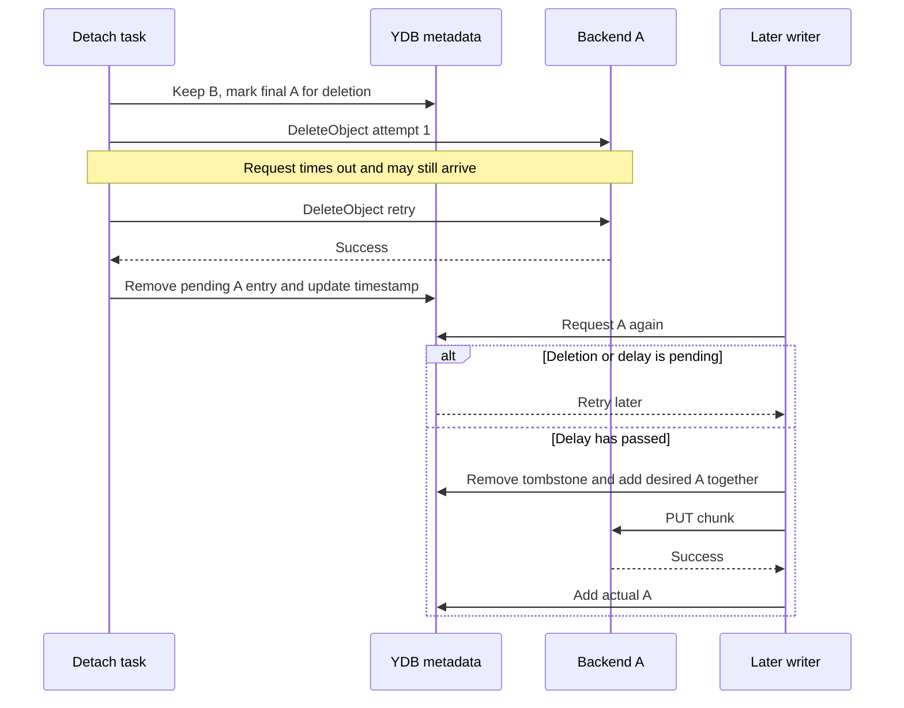
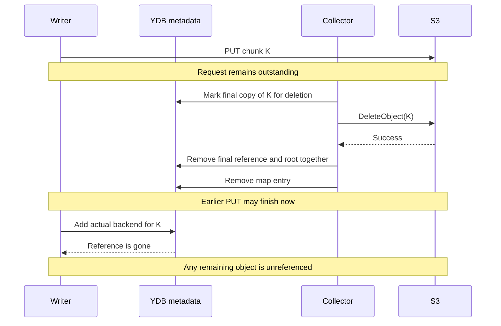
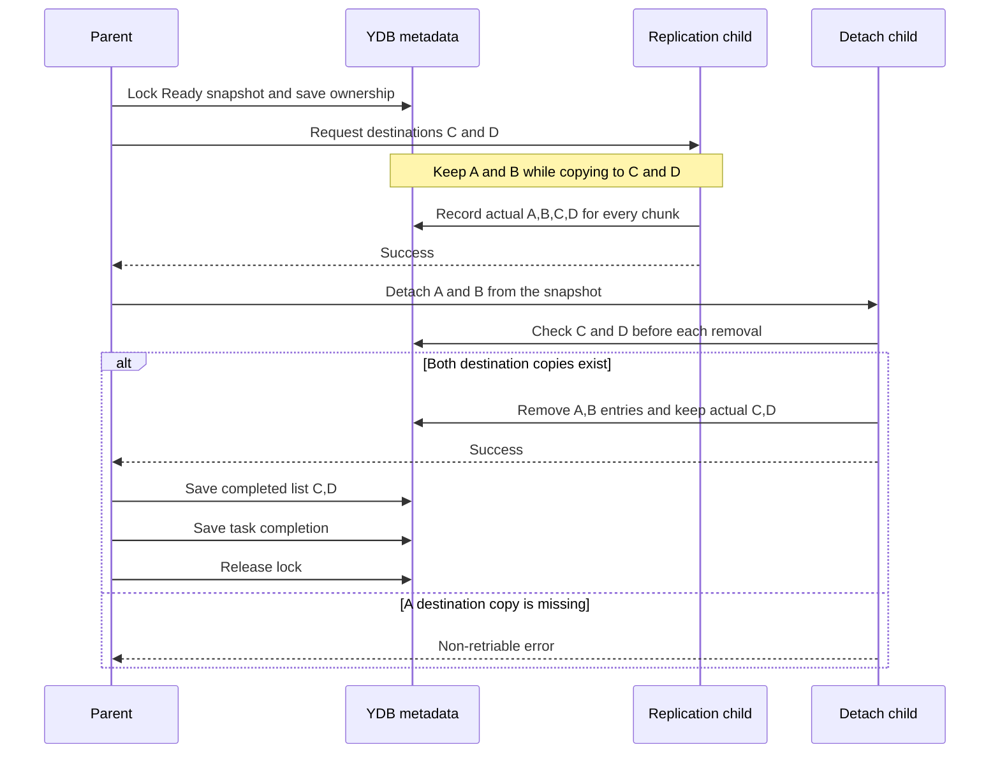
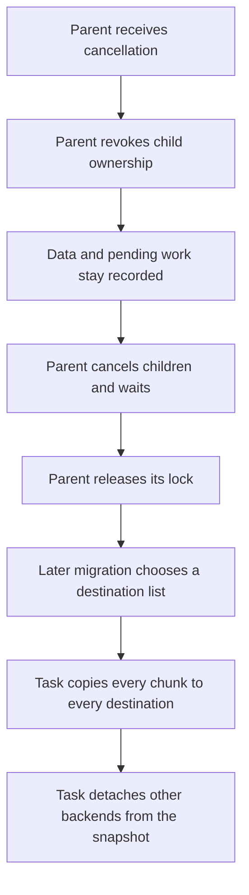
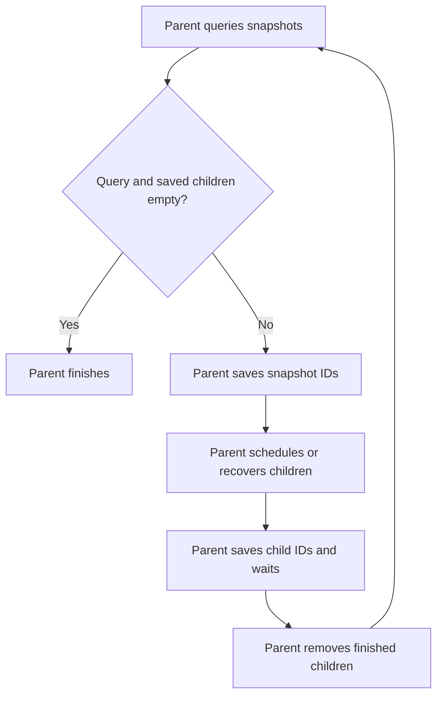

# Multiple storage backends for Disk Manager chunks

An image or snapshot can store its chunks on one or several backends. A creation request for `[A, B]` writes each chunk to both backends. Replication adds copies: a request for `[B, C]` copies chunks to B and C while keeping existing copies on A.

Migration takes a destination list. To move from `[A, B]` to `[C, D]`, it first creates both new copies, then detaches A and B from that snapshot: `[A, B] → [A, B, C, D] → [C, D]`. Other snapshots keep the copies they still need. Replication and migration preserve chunk IDs and shared references.

## Purpose and scope

Images are disk templates. Snapshots are backups. We can put images near their disks, keep snapshot replicas in another region, and move chunks before retiring a backend. Task storage and snapshot metadata stay in the existing YDB databases.

The controlplane passes a backend list when creating a snapshot. The dataplane supports YDB and several S3 backends. Each snapshot keeps its own list for each shared chunk.

Migration accepts **Ready** snapshots. Images use the same dataplane snapshot records. Readers continue working during migration. The migration task holds the snapshot's existing lock to prevent deletion.

## Existing code

[SnapshotConfig](../../../cloud/disk_manager/internal/pkg/dataplane/snapshot/config/config.proto) and [NewStorage](../../../cloud/disk_manager/internal/pkg/dataplane/snapshot/storage/factory.go) support YDB and one S3 backend. We call that backend's connection, bucket, and key-prefix settings the **singleton S3 configuration**. Creation tasks use `UseS3` to select storage for new chunks.

The [schema](../../../cloud/disk_manager/internal/pkg/dataplane/snapshot/storage/schema/schema.go) contains three main tables:

- `snapshots` stores status, base snapshot, sizes, encryption information, and `lock_task_id`.
- `chunk_map` maps a snapshot and chunk index to `chunk_id`. It also stores `stored_in_s3`.
- `chunk_blobs` stores references and chunk data. The **root row**, with `referer = ""`, holds `refcnt` and any YDB payload, checksum, and compression format. A **reference row**, with `referer = snapshot_id`, connects one snapshot to that chunk. S3 objects contain their own data, checksum, and compression metadata.

Reference rows make reference counting idempotent. A transaction inserts a missing reference and increments `refcnt`, or removes an existing reference and decrements it. A retry checks whether the reference exists, so it changes the count only once.

[Snapshot sources](../../../cloud/disk_manager/internal/pkg/dataplane/snapshot/source.go) cache chunk-map entries. The reader uses cached `stored_in_s3` to choose YDB or S3. [ShallowCopyChunk](../../../cloud/disk_manager/internal/pkg/dataplane/snapshot/storage/storage_ydb_impl.go) shares an existing chunk by adding a reference.

[backupChunksTask](../../../cloud/disk_manager/internal/pkg/dataplane/backup_chunks_task.go) copies compressed chunks to backup S3 storage. [backupSnapshotDataTask](../../../cloud/disk_manager/internal/pkg/dataplane/backup_snapshot_data_task.go) saves chunk maps and schedules chunk backups.

The existing [snapshot migration](../../../cloud/disk_manager/internal/pkg/dataplane/migrate_snapshot.go) copies a snapshot to another YDB/S3 combination. It keeps the snapshot ID and contents but creates new chunk IDs. Each snapshot gets separate copies, so migration loses incremental sharing. The source snapshot stays in its original storage. [Database migration](../../../cloud/disk_manager/internal/pkg/dataplane/migrate_snapshot_database_task.go) schedules these copies, with base snapshots first.

This S3-to-S3 copy requires a separate destination snapshot database. It cannot move or replicate shared chunks between S3 backends within the existing database.

## Configuration and stored fields

### Backend selection

`DEFAULT_BACKEND_ID` is the configured `DefaultS3BackendID`, initially `0`. The singleton configuration defines this S3 backend. `S3Backends` lists additional backends. Each entry has a `uint32` ID, connection settings, bucket, and key prefix. ID `0x7fffffff` selects YDB chunk data.

Each ID always identifies the same S3 endpoint, bucket, and key prefix. Each such combination has its own ID. The dataplane rejects duplicate IDs, incomplete settings, and the YDB ID in S3 settings. The singleton settings remain required when S3 fallback is enabled. YDB-only configurations remain valid.

Creation requests contain a `BackendIds` list:

- `[]` uses the default rules below.
- `[0]` selects backend zero, even when `DEFAULT_BACKEND_ID` is different.
- `[A, B]` requests a complete copy on both backends. The list can also include the YDB ID.

For creation, an empty list keeps the existing `UseS3` and inheritance rules. New S3 chunks use `DEFAULT_BACKEND_ID`; new YDB chunks use YDB. Unchanged chunks inherit their source copies. A non-empty list overrides `UseS3` and applies to every chunk, including shared chunks.

Replication accepts a destination list and adds copies while keeping existing copies. Migration and bulk migration take a non-empty destination list. Migration first replicates to every destination, then detaches backends outside that list. Bulk migration passes the same list to each snapshot migration.

Tasks sort and deduplicate their backend lists. They validate every selected backend before creating records, even for an all-zero snapshot. An unavailable configured backend causes a retry; an unknown ID causes a non-retriable error.

Snapshot creation tasks must survive version upgrades. Their saved requests have an empty list and keep the existing behavior. For a snapshot with unspecified backend, the reader infers YDB or the default S3 backend from chunk metadata.

The current backend stays the default until its chunks have been migrated to other backends or deleted and every remaining reference has explicit backend IDs. All tasks using the old configuration finish before the default changes. The deployment steps below describe this barrier. Each task uses the backend IDs in its request.

### References, copies, and tombstones

For each snapshot and chunk, the writer stores two lists in the reference row:

- `desired_backend_ids` (**desired**): the backends this snapshot needs.
- `s3_backend_ids` (**actual**): the backends where the chunk has been written.

The writer first saves desired. It then copies the chunk to each backend in desired but missing from actual. After each successful copy, it adds that backend to actual. It can reuse a completed copy that another snapshot still needs.

To **detach a backend from a snapshot**, the task removes that backend from the snapshot's chunk references. It keeps a chunk's stored copy if another reference lists that backend in actual **or** desired. Otherwise, it writes a **tombstone** on the root row to block new writes to that chunk on that backend. It then calls [S3Client.DeleteObject](../../../cloud/tasks/persistence/s3.go) for an S3 copy, or removes a YDB payload in a transaction. For that S3 deletion, the task keeps its backend entry until it records success or NotFound. A retry can then find unfinished work.

Examples use **desired → actual**. A new chunk requested on A and B starts as `{A,B} → {}`. After A succeeds, it becomes `{A,B} → {A}`. After B succeeds, it becomes `{A,B} → {A,B}`.



We add `detached_backend_ids` and `last_tombstone_at` to the root row. The detach task advances the timestamp when it writes a tombstone. For S3, it advances it again when a transaction removes the pending entry after `DeleteObject` succeeds or returns NotFound. For YDB, the task writes the tombstone and removes the payload in one transaction. The database supplies the time. Each timestamp update must advance it, even within one clock tick.

A writer can reuse a tombstoned backend after deletion finishes and `BackendReattachDelay` passes. Its transaction checks both conditions, removes that tombstone, and adds the backend to desired. Until then, the writer retries. A timestamp update delays reuse of all tombstoned backends on that chunk.

The delay must cover outstanding `DeleteObject` requests and stalled workers. A `DeleteObject` that arrives after this delay can delete a new copy. Tombstones stay until reuse or final chunk deletion removes them.

The storage layer encodes each list as sorted, unique, four-byte big-endian IDs in a YDB `String`. NULL and empty bytes mean an empty list; ID zero uses four bytes. The storage layer rejects malformed lists and unknown active IDs. Tombstones can keep IDs whose backend configuration has been removed.

Every new reference starts with non-empty desired. A transaction that empties an explicit reference removes the row and decrements `refcnt`. References waiting for `DeleteObject` still count. The last reference removal also removes the root and its tombstones. New chunks use fresh IDs; retries of the same chunk use the same ID.

Each change to `chunk_blobs` uses a serializable transaction. The transaction reads the main table and writes the same result to the configured shadow table. It preserves existing counts, payloads, tombstones, and timestamps unless the operation changes them. After a failed or lost commit response, the task rereads the rows and retries from their saved state.

### Snapshots with unspecified backend

Both lists can be empty on an existing reference. The reader reads that reference and its root together. A non-empty root payload means YDB. An empty payload means `DEFAULT_BACKEND_ID`. The chunk map identifies zero chunks, which need no payload.

All operations treat both empty lists as containing the inferred backend. A missing reference returns NotFound. A missing root for an existing reference is a metadata error. Only the reference being changed gets explicit lists.

A transaction that writes a YDB payload also adds YDB to the copying reference's actual list. Other references with empty lists then infer YDB and keep that payload alive. References with explicit S3 IDs keep their S3 copies. These rules also apply when detach checks other references.

A failed transaction leaves the old payload and lists intact. Concurrent copy and detach transactions either see the same root state or retry. A reader that chose S3 just before a YDB copy appeared can find YDB through the refresh step below.

## Snapshot lifetime and migration ownership

Creation uses the existing lifecycle checks. Deletion marks the snapshot Deleting. The creator sees that status in its progress checks and stops its workers. The collector deletes chunks after `SnapshotCollectionTimeout`, currently 30 minutes. This relies on workers stopping within that delay; a worker stalled longer remains an existing race.

The migration task checks Ready status and takes `snapshots.lock_task_id` in one transaction. It keeps this lock until both the replication and detach children finish. Deletion waits for the lock; readers continue. If deletion marks the snapshot first, migration fails admission.

Incremental creation uses the same lock on its source snapshot. Creation retries while migration holds it. Migration likewise waits for a creator holding the lock. Snapshots that share chunks can otherwise migrate independently, even after the chunk's original snapshot has been deleted.

The parent task also uses `snapshots.operation_generation`. It advances this value when it takes ownership or cancels. Children receive the parent's task ID and generation. Every migration write checks Ready status, that ID, and that generation. Retries keep the same generation. A cancelled task cannot take the lock again.

If the admission response is lost, the task recovers its existing lock and generation. After cancellation, a new migration task can take the lock and choose another destination list.

## Chunk operations

### Write a new chunk

1. The writer saves the chunk-map entry first. The collector can then find the chunk if creation fails.
2. A transaction inserts the reference with all requested backends in desired and empty actual. It checks tombstones and increments `refcnt` only for a new reference. A retry keeps the existing reference's lists.
3. The writer uploads to each backend missing from actual. It can upload to several backends concurrently.
4. After each successful S3 PUT, a transaction adds that backend to actual. It checks that the reference exists, still desires the backend, and has no matching tombstone. For YDB, the transaction writes the payload and updates actual together.

The writer keeps successful copies when another backend fails. A retry writes only the missing copies. A timed-out PUT may have succeeded, so the writer can repeat it with the same chunk ID, data, checksum, and compression metadata. The chunk finishes only when every requested backend is in actual.

If only the map write succeeds, deletion treats the missing reference as already removed. If PUT succeeds but the actual update fails, the backend stays in desired for retry. Creation cancellation lets the collector delete partial copies using the reference deletion procedure below.



### Read a chunk

The source caches chunk IDs and passes the snapshot ID to the reader. On every read, the reader fetches the reference's lists and root timestamp together. It infers unspecified lists as described above. An empty actual list returns NotFound. Invalid metadata or unknown IDs return an error.

1. The reader tries actual backends in random order. It returns the first copy that passes decompression and checksum checks.
2. On NotFound or Unavailable, it tries the remaining backends. If none succeeds and any returned Unavailable, it returns Unavailable. It returns other errors directly.
3. If all backends return NotFound, it rereads the lists and timestamp. It tries newly added backends. It also retries a previously tried backend if the timestamp changed, because that copy may have been recreated.
4. The reader tries each `(backend_id, last_tombstone_at)` pair once. If the refresh finds no untried pair, it returns NotFound. The caller's deadline or cancellation stops the read.

A YDB copy comes from the root payload. A missing payload returns NotFound. The reader returns database errors unchanged. A timestamp change for an unrelated backend can cause one extra attempt.



### Reference an existing chunk

The creator locks the source against deletion while reading its map and adding references. It saves the destination map before, or together with, the new reference.

A transaction checks that the source reference and root still exist. It uses only copies that appear in both actual and desired on a source reference and have no tombstone. This check covers reused, inherited, and temporary source copies. The new reference gets the requested list in desired. Its actual list contains reusable destinations and source copies needed to finish replication. The transaction increments `refcnt` once.

For an empty creation list, the new reference puts these usable source backends in both desired and actual. For a non-empty list, the creator copies to every missing destination. It detaches temporary source backends from the new snapshot only after all requested copies exist. A failed copy leaves the source copies readable.

If a requested backend is tombstoned, registration waits for deletion and the reuse delay. The transaction that adds a reference and the detach transaction check the same root. If registration commits first, the new lists keep the object alive. If detach commits first, the tombstone makes registration retry. A retry after registration reuses the saved reference and count. A cached chunk ID cannot replace the source-reference check.

### Replicate a chunk

The replication task keeps the chunk ID and reference count. It checks tombstones before adding requested backends, as described below. Its transaction adds every requested backend to desired and keeps the current source requirements. The same transaction can reuse a completed copy from another reference, with the checks used for reference creation. The task then writes each backend missing from actual. It reads the source with the read procedure above. Separate S3 clients allow different endpoints, buckets, credentials, and regions.

The task records each successful copy in actual with the same checks as a new write. Migration also checks the parent's ownership generation. The task advances its chunk milestone only after every requested copy is recorded. A source read failure or failed destination leaves the successful copies and remaining desired entries for retry.

Two tasks can write the same chunk concurrently. Their PUTs use the same immutable data and metadata. Each task updates its own reference. When one task detaches a source backend from its snapshot, the other reference keeps the source object.



If this reference has a pending `DeleteObject` for a requested backend, the task finishes that `DeleteObject` first while keeping another usable copy. It then waits for the reuse delay. If another reference owns the pending `DeleteObject`, that snapshot's migration or deletion must finish it. A retry reports the blocking snapshot. A cancelled owner needs a new migration or snapshot deletion to finish this work.

The writer starts PUT only after desired commits. If cancellation, deletion, or a tombstone blocks the actual update, the writer leaves metadata as it stands. A late PUT can leave an unreferenced object after deletion, as described below.

### Detach a backend from a snapshot

The detach task handles each chunk reference of that snapshot. For each chunk, its transaction reads the root and all references, including references of Deleting snapshots. It infers any unspecified lists before checking them.

If the backend is already absent, the operation succeeds. Otherwise, the transaction requires another backend in both actual and desired on this reference, with no tombstone. An attempt to remove the last usable copy returns a **non-retriable error** before any change or `DeleteObject`. During migration, every backend in the destination list must be usable before the task detaches a backend outside that list.

If another reference lists the backend in actual **or** desired, the task removes only its own entries. The object stays. If this is the final reference to that backend, the transaction adds a root tombstone and advances its timestamp. For S3, it removes desired but keeps actual as a pending `DeleteObject` record. If the S3 write has only a desired entry, it keeps that entry instead.

The task issues S3 `DeleteObject` only when its pending entry and tombstone both exist. After success or NotFound, a transaction removes the entry and advances the timestamp. This starts the reuse delay. For YDB, one transaction writes the tombstone and removes the payload, checksum, compression fields, and backend entry.

Concurrent detach tasks run their checks in serializable transactions. One task may remove its entry while another reference keeps the object. For S3, the last task records the pending `DeleteObject`. These checks prevent the tasks from removing the same snapshot's last usable copy.

If the tombstone transaction fails, the task retries before `DeleteObject`. If `DeleteObject` fails, or its final metadata update fails, the task keeps the pending entry and tombstone and retries. A retry after the entry was removed succeeds without another `DeleteObject`. A completed tombstone alone never authorizes `DeleteObject`.



The reuse transaction and the transaction that records `DeleteObject` completion check the same root. A conflict makes one retry. The delay protects a recreated copy only if earlier `DeleteObject` requests finish within the configured bound.

### Delete a snapshot reference

Snapshot deletion and creation cancellation mark the snapshot Deleting. After the collection delay, the collector visits each chunk-map entry. It detaches every backend in actual or desired from the snapshot using the procedure above. Snapshot deletion may remove the last usable copy.

The collector keeps each reference until its S3 `DeleteObject` requests succeed or return NotFound. It then removes the reference and decrements `refcnt` in one transaction. The last removal also deletes any YDB payload and the root with its tombstones. The collector removes the map entry last. A missing reference means its deletion already finished.

A crash leaves either a map and reference to finish, or a map whose reference is already gone. Retries handle both without changing `refcnt` twice. Concurrent snapshot deletions use the same final-reference checks as detach.

An earlier PUT can finish after `DeleteObject` and leave an unreferenced S3 object. Its actual update fails because the reference is gone. Separate orphan cleanup must remove that object. A later snapshot creation uses fresh chunk IDs, so an old `DeleteObject` cannot delete its data. The same snapshot ID becomes available only after its deletion finishes.



## Snapshot migration

### Replicate, then detach other backends

The parent request contains a snapshot ID and a destination backend list. The parent takes the Ready snapshot's lock and saves its ownership generation. It starts two children in order:

1. The replication child adds every destination to each chunk's desired list and keeps the source backends. It copies missing data and saves its milestone after all destinations are in actual.
2. After replication finishes for the whole snapshot, the detach child removes backends outside the destination list. Before each removal, it checks that every destination is in actual and desired and has no tombstone. Any missing destination copy causes a non-retriable error before removal.

Both children receive the destination list and the parent's ownership token. Each child saves its own chunk milestone. The parent holds the lock until both finish.

For `[A, B] → [C, D]`, the replication child keeps A and B while copying to C and D. If C succeeds and D fails, it keeps A, B, and C and retries D. Detachment starts only after every chunk has both C and D.

The parent uses a stable scheduling key for each child and saves the child IDs. If scheduling succeeds but saving the ID fails, the parent recovers the same child with that key. If a child stops before saving progress, it repeats the current chunk from stored lists. A permanent child failure fails the parent; completed copies remain available.

When actual and desired on every reference equal the destination list, the parent writes that list to `snapshots.s3_backend_ids`. It then saves completion and releases its lock. A retry after completion only finishes the unlock. Other snapshots can still keep copies on additional backends.



### Cancellation and continuation

The parent stops scheduling, revokes its ownership generation, and keeps the snapshot lock. It recovers any child whose scheduling result was lost, cancels active children, and waits for their cancellation. It then releases its own lock.

Migration cancellation keeps all objects, references, actual and desired lists, tombstones, timestamps, and pending `DeleteObject` requests. An already issued PUT or `DeleteObject` may still finish. The revoked generation blocks further metadata writes from old workers.

A later migration can choose another destination list. After a cancelled move to `[C, D]`, migration to `[E, F]` creates both E and F before detaching any other backend. For a tombstoned destination, the task first waits for its `DeleteObject` and reuse delay. Every cancellation step retries safely and leaves any newer owner's lock intact.



Creation cancellation keeps its existing behavior: the collector deletes the partial snapshot and its references. Source snapshots keep their copies.

## Bulk migration

The bulk request contains a snapshot ID prefix and a destination backend list. The parent validates every destination and saves a cutoff once. To drain the default backend, the controlplane first sends new creation to explicit backend lists. The bulk task waits for earlier creation tasks before taking its cutoff, because `created_at` is the creation completion time.

The task selects Ready snapshots whose completed backend list is unset:

```sql
SELECT id, created_at
FROM snapshots
WHERE status = Ready
  AND created_at < $cutoff
  AND StartsWith(id, $dataplane_id_prefix)
  AND s3_backend_ids IS NULL
ORDER BY created_at, id
LIMIT $batch_size;
```

The parent runs up to ten snapshot migrations at once by default. It saves snapshot IDs before scheduling, uses a stable key per snapshot, and saves child IDs before waiting. Each child receives the same destination list. Shared chunks impose no parent-snapshot ordering.

After a restart, the parent recovers unsaved child IDs with the same keys. It waits for every saved child, even if the query already excludes that snapshot. Completed child records must remain available for the supported restart interval. The parent removes finished children from state and selects again. It finishes only when the query and saved child list are both empty.

A bulk child skips an absent or Deleting snapshot; a direct migration reports an error. A busy lock, unavailable backend, pending `DeleteObject`, or reuse delay causes a retry. An unknown backend or missing required copy causes a non-retriable error. The parent reports permanent child failures.

This query covers a snapshot's first completed migration. Later moves use direct requests or another selector. Cancellation stops scheduling, recovers uncertain child IDs, cancels all children, and waits. Children keep their data and pending work.



## Creation and incrementality

Creation keeps the existing base lookup and checkpoints. For unchanged chunks, it adds references to the same chunk IDs and copies only to missing requested backends. It writes changed chunks to every requested backend. A base on another backend remains usable.

For a non-empty request list, creation finishes when every nonzero chunk has all requested copies and temporary source backends have been detached from the new snapshot. For an empty list, creation keeps the existing per-chunk rules and accepts mixed backends. A retry preserves chunks written before its saved milestone.

A failed copy keeps its map, reference, successful copies, and remaining desired entries. If all copies succeed but marking the snapshot Ready fails, the task retries that step using the saved copies. Tombstones cause retries after deletion and the reuse delay. Creation cancellation deletes the partial destination through the reference deletion procedure.

## Backup and existing database migration

Backup readers use the same actual-list lookup and NotFound refresh. A reader with only a chunk ID reads surviving references to find completed copies. It can use another reference after the original snapshot is deleted. It returns NotFound when no references remain.

The backup task protects any snapshot it needs from deletion. It marks a chunk map backed up only after every listed payload is backed up. Read failures keep their error classification. Backup objects keep their existing keys and stay separate from active chunk copies.

Copy operations preserve compressed data, checksums, and compression metadata. Existing database-migration readers and writers also need the new list handling. A separate destination chunk gets its own metadata; source tombstones stay with the source chunk.

## Capacity and deployment

Replication needs space for all requested copies and any source copies still in use. Capacity estimates count `(chunk_id, backend_id)` pairs. Configuration limits concurrent snapshots, chunk operations, and bytes, with request and bandwidth limits per backend.

The rollout first adds the schema and compatible readers and writers. Backend selection and migration start after every writer handles the lists and tombstones. Tasks already creating snapshots continue under the empty-list rules.

To change the default, operators:

1. Configure destination backends and route new creation to explicit lists.
2. Migrate snapshots off the current default or delete them. Check that every remaining reference has explicit IDs.
3. Pause new top-level task admission and finish queued tasks, child tasks, retries, and cancellation.
4. Finish old-backend `DeleteObject` requests and check that references and unfinished tasks no longer need it.
5. Move the destination's settings to the singleton configuration with its existing ID, remove its duplicate `S3Backends` entry, and update all dataplane instances before resuming admission.

Any backend removal requires the same reference, task, and pending `DeleteObject` checks. Remaining tombstones keep their IDs and timestamps after configuration removal.

## Implementation steps

1. Add backend configuration, request lists, and client selection.
2. Add reference lists, root tombstones and timestamps, and migration ownership checks.
3. Update reads, writes, sharing, replication, detach, and deletion, including shadow-table writes.
4. Add replication and detach children, then bulk scheduling.
5. Update creation, backup, and database migration to use the lists.

## Details to settle

- Does a copy keep the source storage class or use the destination's class?
- What are the default transfer limits and completed-task retention period?
- Which database access path supports the bulk query?
- What value of `BackendReattachDelay` covers outstanding `DeleteObject` requests and stalled workers?
