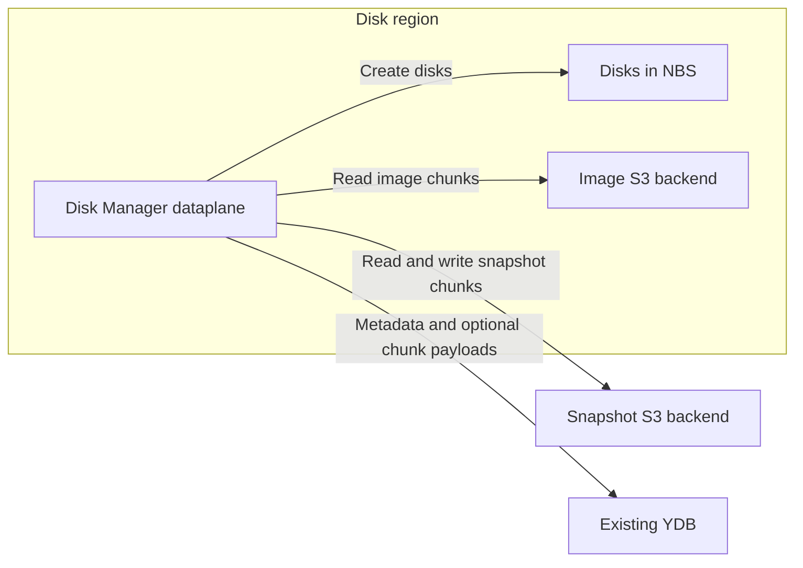
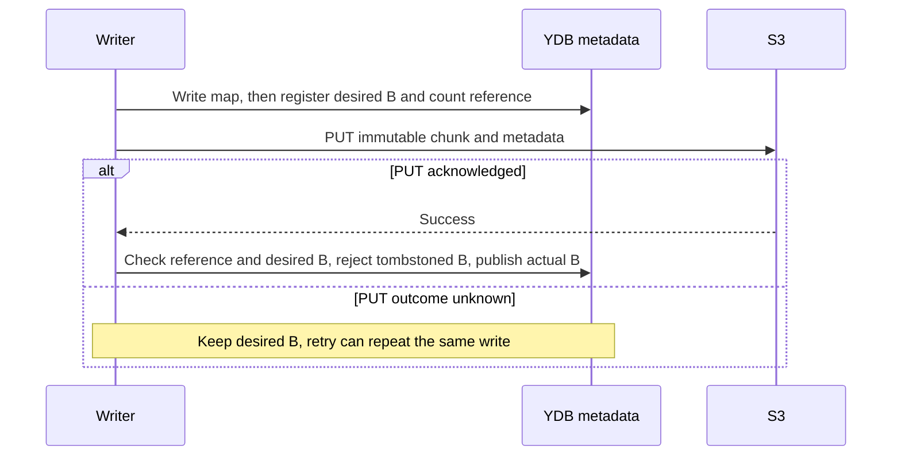
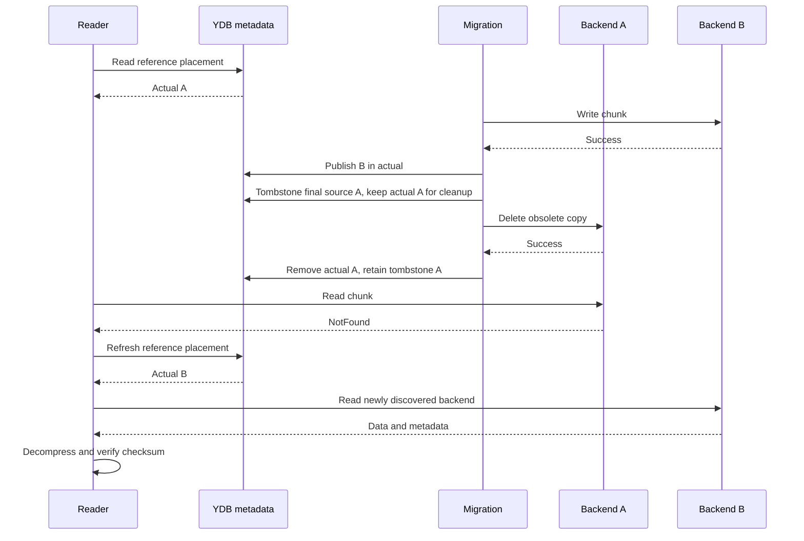
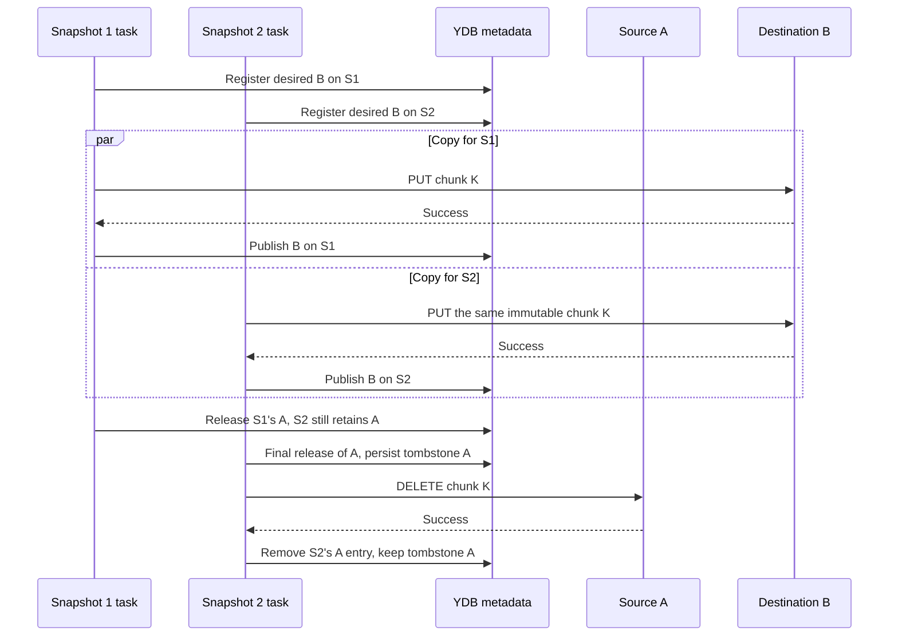
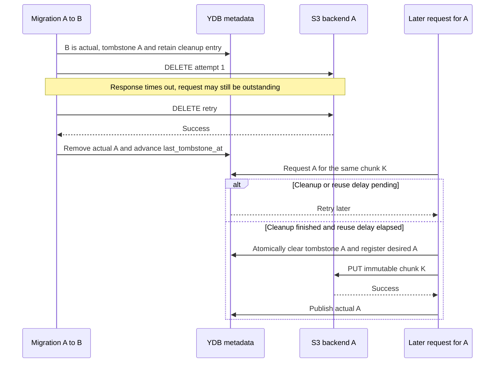
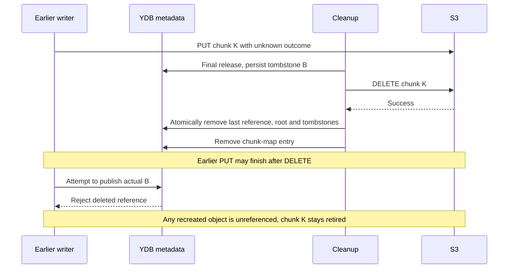
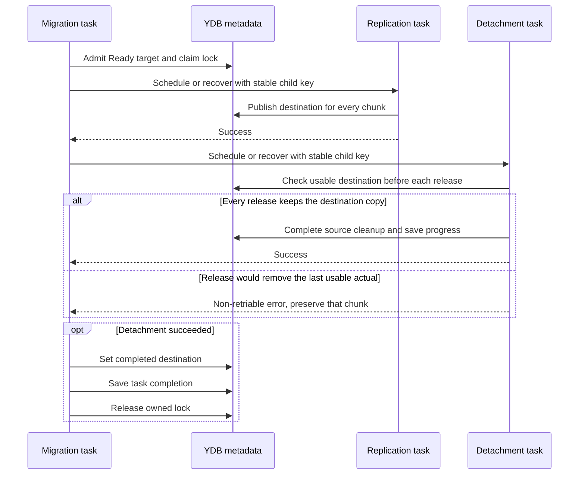
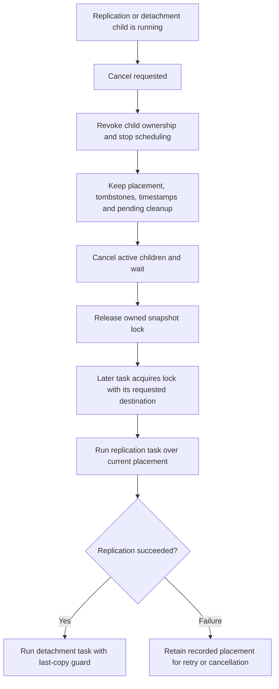
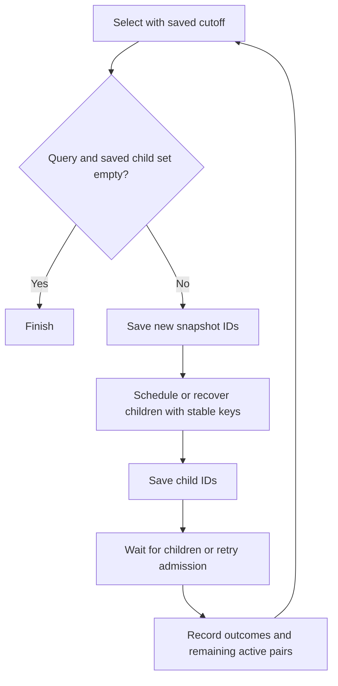

# Multiple storage backends for Disk Manager chunks

Select chunk storage per image or snapshot and migrate chunks between YDB and configured S3 backends. The first version assigns one requested backend per resource and copies data during creation and migration. A shared chunk can remain on several backends while different snapshots require those copies. A snapshot with unspecified backend can retain its existing per-chunk placement.

## Purpose and scope

Use different S3 backends for images and snapshots. Task and metadata storage stay in the existing YDB databases.

Images are disk templates; snapshots are backups. Separate chunk storage lets us store images in the disks' region, put snapshots in slower storage or another region, and move data to new capacity before retiring an old backend.



Support YDB to S3, S3 to YDB, and S3 to S3 migration. Moving a chunk preserves its ID, references, and reference count.

Migration accepts only dataplane snapshots in the **Ready** state. Images use the same dataplane snapshot records. Disk Manager continues serving reads during migration. A lock on the migrating snapshot protects it from deletion.

The controlplane selects a backend for each new image or snapshot and passes its ID to the dataplane. Creating a reference reuses a completed copy on that backend or copies the same chunk there. Other snapshots keep their own backend requirements.

Migration first replicates chunks to the destination, then detaches the old copies. Detaching the last requirement for a backend records a tombstone before physical deletion. Reattachment becomes available after cleanup and a configured delay. Final chunk deletion removes the root and its tombstones.

## Existing code

[SnapshotConfig](../../../cloud/disk_manager/internal/pkg/dataplane/snapshot/config/config.proto) and [NewStorage](../../../cloud/disk_manager/internal/pkg/dataplane/snapshot/storage/factory.go) currently support YDB and one S3 backend. Its connection, bucket, and key-prefix settings form the **singleton S3 configuration**. Image and snapshot services select newly written chunk storage using `UseS3`.

The [schema](../../../cloud/disk_manager/internal/pkg/dataplane/snapshot/storage/schema/schema.go) has snapshot records with status, base snapshot, sizes, encryption information, and `lock_task_id`. `chunk_map` maps a snapshot and chunk index to `chunk_id` and currently includes `stored_in_s3`. In `chunk_blobs`, the row with `referer = ""` holds `refcnt` and the optional YDB payload, checksum, and compression format. Rows with `referer = snapshot_id` represent references. S3 objects hold compressed data and checksum/compression metadata.

The rows with `referer = snapshot_id` make reference counting idempotent. Insert a missing reference and increment the root's `refcnt` in one transaction; remove an existing reference and decrement the count in one transaction. Retries check whether that reference exists, so each snapshot contributes to the count exactly once.

[Snapshot sources](../../../cloud/disk_manager/internal/pkg/dataplane/snapshot/source.go) cache chunk-map entries. Cache chunk IDs and resolve their placement from `chunk_blobs` on each read to follow migrations and select among configured backends.

[ShallowCopyChunk](../../../cloud/disk_manager/internal/pkg/dataplane/snapshot/storage/storage_ydb_impl.go) already shares a chunk by adding a reference to its ID. Extend it to register backend requirements and copy the payload when the requested backend has no reusable copy.

[backupChunksTask](../../../cloud/disk_manager/internal/pkg/dataplane/backup_chunks_task.go) copies compressed chunks to separate backup S3 storage. [backupSnapshotDataTask](../../../cloud/disk_manager/internal/pkg/dataplane/backup_snapshot_data_task.go) saves chunk maps and coordinates chunk backups. Their reads must also resolve current placement.

The existing [snapshot migration](../../../cloud/disk_manager/internal/pkg/dataplane/migrate_snapshot.go) and [database migration](../../../cloud/disk_manager/internal/pkg/dataplane/migrate_snapshot_database_task.go) copy data into another database. Reuse their resumable transfer and child-task scheduling patterns within the existing snapshot database. Reference transactions support migration in any chunk-creator order.

## Configuration and stored fields

### Backend selection

`DEFAULT_BACKEND_ID` denotes the configured `DefaultS3BackendID`, initially `0`. The singleton S3 configuration defines the backend with that ID. `S3Backends` defines additional backends, each with a stable unsigned 32-bit ID, S3 connection settings, bucket, and key prefix. ID `0x7fffffff` denotes YDB chunk data.

Keep the singleton settings alongside `S3Backends` to serve requests using the default. When replacing the default S3 backend, give its new singleton configuration a fresh ID and retain the former configuration in `S3Backends` under its original ID until it is unused.

Each backend ID MUST remain bound to one storage namespace (an S3 endpoint, bucket, and chunk key prefix). Give each namespace its own ID. Reject duplicate IDs, the reserved YDB ID in S3 configuration, and incomplete settings. YDB-only configurations remain valid when S3 fallback is disabled.

The controlplane selects the image or snapshot service default, optionally overridden by an individual creation request. Use a scalar `uint32` backend ID in dataplane creation requests. A zero value follows the existing `UseS3` and inheritance rules: new S3 chunks use `DEFAULT_BACKEND_ID`, and new YDB chunks use the YDB ID. A nonzero value selects that backend directly. Resolve and persist the numeric destination before chunk work so retries keep that selection.

For a creation request with a nonzero backend ID, that ID takes precedence over `UseS3` and applies to both newly written and referenced chunks. The reserved YDB ID also uses this path. Persist the selection before starting chunk work. Retries use the persisted destination across configuration changes.

Snapshot creation tasks in progress must continue across version upgrades. For a snapshot with unspecified backend, infer YDB or S3 `0` from the stored chunk metadata.

A zero destination in a new migration request resolves to `DEFAULT_BACKEND_ID`; save the resolved ID in task state before admission and pass it directly to child tasks. Stored placement IDs and inferred historical S3 ID `0` keep their original namespace identity as the configured default changes.

Validate each selected backend before creating records, including all-zero inputs. Reject invalid or unknown selections before writes begin. If a validated backend later becomes unavailable, preserve recorded work and retry the operation using the same ID.

### References, payloads, and detach tombstones

Track placement on each snapshot's reference so a shared chunk can move for one snapshot while other snapshots retain their copies. Actual placement identifies readable copies, desired placement records the copies being requested, and shared tombstones temporarily block reuse of locations undergoing deletion. Replication establishes the destination before detachment releases the old placement.

Store placement and tombstones in the existing `snapshots`, `chunk_map`, and `chunk_blobs` tables.

Add `s3_backend_ids` and `desired_backend_ids` to each `chunk_blobs` reference row:

- **Actual** (`s3_backend_ids`) records completed copies available to this reference. During detachment, an actual entry remains until physical deletion is acknowledged; a read can therefore encounter NotFound and refresh its locations.
- **Desired** (`desired_backend_ids`) records this reference's requirements, including unfinished writes. Readers use completed copies recorded in actual. During cleanup of an unfinished write, a desired-only entry can remain solely to identify outstanding deletion work.

State examples use **desired → actual**. To add backend A to a reference on backend `0`, first record `{0,A} → {0}`, then copy the data and publish `{0,A} → {0,A}`. The first state reserves A before its payload is written.

Add **`detached_backend_ids`** and **`last_tombstone_at`** to the shared row with `referer = ""`, alongside `refcnt`. Write a backend's tombstone and update the timestamp when its final reference authorizes physical deletion. Refresh the timestamp when acknowledged cleanup removes the retained backend entry. Use database time and strictly advance the timestamp, including updates within one clock tick. A shared timestamp conservatively extends the reuse delay for all tombstones on that chunk.

Configure `BackendReattachDelay`. Re-add a tombstoned backend after its pending cleanup has finished and this delay has elapsed since `last_tombstone_at`. In the transaction registering the new requirement, check both conditions, remove that backend's tombstone, and add it to desired. Earlier attempts return a retriable error and preserve placement. The delay assumes previously authorized DELETEs, including requests from stalled workers, finish within that interval. A DELETE arriving later can remove a reattached copy; the selected delay must cover the operational request and worker-stall bounds.

A per-reference release keeps the physical copy live while another reference still needs that backend. Record a detach tombstone only for the final release that authorizes physical deletion.

All three sets can contain the YDB ID. Store sets as sorted, unique sequences of four-byte, big-endian IDs in YDB `String` columns. NULL and zero-length bytes decode as empty sets. Encode ID `0` as four bytes. Reject invalid byte lengths and require configured IDs in active actual or desired sets. Tombstones may reference backends removed from configuration.

`refcnt` counts reference rows, including those retained for unfinished cleanup. Increment it once when inserting a reference; decrement it once when removing the reference after cleanup. Update it in the same transaction as that insertion or removal. Preserve the count when changing a reference's backends.

Keep each tombstone until an eligible reattachment removes it or final chunk deletion removes the root. For final chunk deletion, require success or NotFound from DELETE for the chunk on every remaining S3 backend. Then remove any YDB payload, the last reference, and the root with its tombstones in one database transaction. A chunk remains live while any backend copy is still retained. Allocate a fresh identity for each new chunk.

For an existing reference, both actual and desired empty identifies unspecified placement. Empty actual with non-empty desired means an unfinished write. Non-empty actual with empty desired means retained cleanup work. Return NotFound immediately for a missing reference.

Every newly inserted reference has non-empty desired in the insertion transaction. When cleanup removes its last actual or desired entry, delete that reference and decrement `refcnt` in the same transaction. Preserve root tombstones while other references remain; remove the root when the last reference is removed.


All mutations compute their result from the main chunk table and mirror it to the configured shadow table in the same transaction. This includes reference counts, placement sets, payloads, tombstones, and their timestamp. Carry existing tombstones and `last_tombstone_at` into root updates during retries and when populating a previously missing shadow row.

### Resolve a snapshot with unspecified backend

When both placement fields are empty on an existing reference, read that reference and the root row in one consistent database read. Infer YDB presence from the root's payload: non-empty `data` identifies YDB; an empty payload identifies existing S3 backend `0`. An S3 copy stores its payload and checksum/compression metadata in the S3 object. Use payload presence for inference, since uncompressed YDB chunks have empty compression. Identify zero chunks from `chunk_map` and store only their applicable map representation. Report a missing root for an existing reference as a metadata error.

Resolve an existing reference with both fields empty as having actual and desired both equal to the inferred backend. For an S3-backed chunk, interpret both empty fields as `{0}`. Apply this interpretation to reads, reuse, and every detach decision, including checks of other references. The chunk's stored state determines this interpretation.

Populate explicit sets only on the reference being changed, using its inferred placement in the same transaction as the update. For an S3-backed reference, requesting A changes `"" → ""` to `{0,A} → {0}` in desired → actual notation. During S3-to-S3 migration, other empty references continue to retain backend `0` through inference.

When S3-to-YDB copying atomically writes a complete root payload and publishes the copying reference's actual YDB entry, other references with both fields empty begin resolving to YDB. Their unspecified placement follows the new root payload. Detach decisions count them as retaining YDB and keep the payload while any such reference remains. Explicit requirements for S3 `0` continue to retain that copy independently. When moving a reference from YDB to S3, populate its inferred YDB entries before changing them; other empty references still retain YDB.

If a placement transaction fails before commit, its explicit sets and YDB payload remain at their last committed state. If its response is lost after commit, retry from the stored state and preserve populated sets. Concurrent placement and detach transactions resolve references against the same root state or retry. A reader that selected S3 `0` before a YDB copy appeared can discover YDB through the all-NotFound refresh described below if S3 `0` is subsequently deleted. New writers always create explicit sets; enable placement changes only after all dataplane writers understand inference and honor detach tombstones.

## Snapshot lifetime and migration ownership

Creation uses the existing lifecycle checks and worker shutdown. Deletion marks the destination Deleting; creation observes that state through its progress checks and stops its workers. The collector begins physical cleanup after `SnapshotCollectionTimeout`, which defaults to 30 minutes. This ordering relies on creation workers stopping within that interval. A worker stalled beyond the collection delay remains an existing lifecycle edge case.

Reuse the existing `snapshots.lock_task_id` for the migrating snapshot. In the acquisition transaction, require Ready status and claim that lock. Hold it through copying and detachment so deletion tasks wait for migration to release the snapshot. Serve concurrent reads throughout the lock's lifetime.

Reference transactions and chunk-wide detach tombstones coordinate physical copies. Children can migrate concurrently, including after their creator's snapshot record has been deleted. Creation locks the source snapshot against deletion while reading its map and registering references. Reusing the existing exclusive source lock can make creation retry while that source is itself being migrated.

The target's existing exclusive lock admits one migration task at a time. Each task stores its requested destination in its request and its resolved ID in state, then uses the resolved ID on retries. After cancellation releases the lock, a later task acquires it and migrates toward its own destination, starting from the recorded chunk placement.

Store a migration ownership generation in `snapshots.operation_generation` alongside `lock_task_id`. Advance it on initial admission and ownership revocation. The orchestrator holds the lock across replication and detachment and passes its owner/generation to both child tasks. Ordinary retries resume the admitted token. Each migration transaction that updates placement, payloads, detach state, or completion checks Ready status and that token. Cancellation revokes the token before cancelling children, then releases the owned lock after their cancellation completes. Integrate admission and cancellation with the task framework's ownership, and reject acquisition by a cancelled task.

If deletion marks the target Deleting before migration admission, reject admission. If migration acquires its lock first, deletion waits. Start chunk operations after admission commits successfully. Resolve a lost admission response by retrying idempotently from the same execution, preserving the recorded destination and lock ownership.

## Chunk operations

### Write a new chunk

Preserve the existing ordering: create the `chunk_map` entry before registering or writing the blob. The destination remains Creating while the mapping identifies unfinished work for retry or creation cleanup. Chunk IDs remain deterministic for the creating task and chunk index.

In one serializable transaction, reject a tombstoned backend, insert the reference with empty actual and the backend in desired, and increment `refcnt` only if the reference is new. Resume an existing reference from its recorded sets. Preserve the root's tombstones when initializing its other fields.

For S3, compress the data and PUT it with checksum/compression metadata. After success, publish the backend in actual in a transaction that checks reference existence, desired membership, and absence of a tombstone. For YDB, write the payload and publish actual in the same transaction. Zero chunks need only their applicable map representation.

If the map write fails, retry before creating any blob. If only the map commits, cleanup sees the mapping and treats a missing reference as already cleaned. If reference registration commits but PUT fails or times out, keep desired as pending work and require successful publication before serving reads through that reference. Retry the same immutable payload and ID. If PUT succeeds but publication fails, repeat PUT or verify completion through the normal retry path. Use actual membership to establish completion.

Creation cancellation leaves recorded actual and desired entries for the collector to clean through the detach protocol. If another reference retains a backend, its requirement keeps the object live; otherwise final cleanup deletes that location. An S3 PUT with an unknown outcome may finish remotely after the worker has stopped. A PUT that finishes after cleanup can leave an unreferenced object, as described under snapshot deletion.



### Read a chunk

Get the chunk ID from `chunk_map` and pass the snapshot referer through the read API. Read the reference's actual and desired sets together with the root's `last_tombstone_at` consistently. If both placement fields are empty on an existing reference, resolve them from that root using the compatibility rules above. A missing reference is NotFound. Invalid metadata and unknown backend IDs are errors. An empty actual set with non-empty desired represents an unfinished write and returns NotFound. Read candidates come from the effective actual set.

Track each attempted location as `(backend_id, observed last_tombstone_at)`:

1. Try every actual location not yet attempted with that timestamp, in random order, until one returns the chunk. Decompress it and verify its checksum. A YDB read uses the root row's payload; a missing payload is NotFound.
2. On NotFound or Unavailable, continue with the remaining candidates. If none succeeds and any candidate was Unavailable, return Unavailable. Propagate other errors and context cancellation.
3. Only when all attempted candidates returned NotFound, reread the reference's placement and root timestamp consistently. Try newly added actual backends and retry existing IDs whose timestamp has changed.
4. Repeat this process across placement changes. If every refreshed `(backend_id, timestamp)` pair was already attempted, return NotFound. All metadata reads and backend requests use the caller's context; stop when it is canceled or its deadline expires.

An initially empty actual set returns NotFound immediately. Each location is attempted once per observed timestamp. This allows a reader that captured A before migration to discover B after A is deleted, then retry A if it was later reattached. A timestamp change caused by another backend's detachment can cause an extra read attempt.



If the refreshed set still contains only A with the same timestamp, the read has exhausted its candidates and returns NotFound. If A is NotFound and B is Unavailable, the read returns Unavailable after exhausting the candidates. Propagate metadata-read failures with their error classification.

### Reference an existing chunk

Protect the source from deletion while reading its map and registering the new reference. Write the destination map before or in the same transaction as reference registration, so every counted reference has a discoverable mapping after a crash.

Resolve unspecified source reference fields using the shared root and preserve the source references' stored fields. In one serializable transaction, require an existing source reference, inspect the root tombstones and source references, register the destination reference with explicit sets, and increment `refcnt` exactly once. Reject registration if the source reference or root is missing, including when the caller supplies a cached chunk-map entry. Reuse requires membership in both effective actual and desired on a reference, together with a tombstone check. Reject tombstoned copies. Actual-only copies may already be undergoing deletion; desired-only copies are unfinished.

For a creation request selecting a nonzero destination B, reuse B from any qualifying reference by setting both sets on the new reference to exactly `{B}`. If no reusable B exists, register completed, retained source locations in actual and `{B}` in desired. Those actual entries pin the source data while copying B. When creating a snapshot with unspecified backend, inherit completed, retained locations according to the request compatibility rules.

If B is tombstoned for this chunk, apply the cleanup and reuse-delay checks before registering its requirement. While either check is pending, return a retriable error before adding a reference or issuing PUT. Once eligible, clear B's tombstone and register desired B in the same transaction, retaining another source location until the new copy completes. Apply this rule to every requesting snapshot because the tombstone belongs to the shared chunk key.

If registration and another reference's release race, serializable transactions determine the outcome. Registration first makes the new requirement visible, so the releaser keeps the physical object. Final detachment first writes a tombstone, so registration waits for cleanup and the reuse delay. A retry after an acknowledged or ambiguous commit resumes the destination reference's recorded progress and count. A source disappearing before registration causes an error; after registration, the destination's own actual/desired entries protect its copies.

After registering temporary source locations, use the copy operation below. Once every destination chunk is available, release temporary locations using detach. A failed copy keeps those locations readable and counted. Creation cancellation uses the explicit reference-cleanup procedure. Migration cancellation preserves recorded placement for continuation.

### Copy to another backend

`replicateChunk(snapshot_id, chunk_id, destination)` preserves the chunk ID, reference, and reference count. Migration invokes it for an existing reference and applies its owner/generation checks to each placement transaction. Creation invokes it after registering the destination reference, using the existing creation lifecycle.

In a transaction, check the reference and root tombstones, resolve and populate this reference's fields if unspecified, then add the destination to desired. For a tombstoned destination, first apply the cleanup and reuse-delay checks and clear its tombstone in this transaction when eligible. If this reference already has a completed, retained destination, the copy is complete. Reuse a completed, retained destination on another reference by registering it transactionally, using its effective sets if its fields are unspecified. Otherwise read compressed data and checksum/compression metadata from an actual source using the read-and-refresh algorithm, then write through the selected destination client.

If this reference retains unfinished cleanup for the requested destination, resume that already-authorized cleanup while retaining another usable copy, then wait for the reuse delay. Cleanup retained by another reference must finish through its owning snapshot's migration or deletion. If that migration was cancelled, resume it or delete its snapshot before reattachment can proceed; return a retriable error identifying the blocking snapshot in the meantime. Other obsolete placements are released by detachment after replication succeeds.

After a successful S3 PUT, publish the destination in actual only if the reference still exists, the backend remains desired, and the root has no tombstone for it. For YDB, write the complete payload and publish actual in the same transaction with those same checks; references whose fields are still empty can then infer YDB presence. S3-to-S3 transfer uses separate clients, allowing different endpoints, buckets, credentials, and regions.

Begin payload writes after the desired update commits. If that update fails, retry the transaction. If source reading fails, keep desired and all existing actual locations. A PUT timeout leaves an unknown physical outcome, so retry writes the same immutable data. If publication fails after successful PUT, the existing desired entry retains the obligation to complete or clean that write. If publication is rejected because the reference was removed, the backend is tombstoned, or migration ownership was revoked, preserve the current metadata state. Another reference's requirement can keep the object live; otherwise final cleanup deletes the location using the detach protocol. A PUT that finishes after cleanup can leave an unreferenced object, as described under snapshot deletion.

Two references may concurrently copy the same chunk to B. Both register desired B before writing and publish completion only on their own references. Duplicate PUTs contain the same immutable payload and metadata. When the faster task releases A, the slower reference's requirement keeps the physical copy on A. Desired-only B likewise retains B while a copy is unfinished.



### Detach one backend

`detachChunkBackend(snapshot_id, chunk_id, backend_id)` releases one reference's requirement for a backend while retaining a readable copy for that snapshot. Snapshot deletion uses a separate reference-cleanup operation that permits releasing every location.

In a serializable transaction, read this reference, the root, and all other references for the chunk, including references whose snapshots are being deleted. Resolve unspecified fields and populate this reference's fields before changing them. If the requested backend is already absent from both effective sets, return success. Otherwise require another backend on this reference in both actual and desired, with a completed copy and an absent tombstone. Removing the last usable actual backend returns a **non-retriable error** before any mutation or DELETE. Apply this check even when another snapshot retains the physical copy. Desired-only entries and other snapshots' copies qualify through replication and publication onto this reference first.

If another reference retains the backend being released in effective actual or desired, remove it from this reference's sets and commit. Keep the physical object and the root's tombstones. Concurrent releases on this reference serialize their checks, so one succeeds and an attempt to remove the remaining copy fails. The deletion cleanup operation follows the same physical-release protocol below and removes an emptied reference with its count in one transaction.

If no other reference retains the backend, add its ID to `detached_backend_ids` and advance `last_tombstone_at` in that transaction. For an actual entry, remove desired and retain actual as pending cleanup. For a desired-only entry, retain desired as pending cleanup. The tombstone distinguishes this entry from a new write requirement and rejects its publication until cleanup finishes and reattachment is admitted.

Begin S3 DELETE after the tombstone transaction commits. Each attempt requires the matching retained cleanup entry and tombstone. After success or NotFound, remove that entry and advance `last_tombstone_at` in the same transaction; this starts the reuse delay after cleanup. In deletion cleanup, an emptied reference is removed and `refcnt` decremented exactly once. Keep the root while any reference remains; remove it and its tombstones with the last reference. For YDB, write the tombstone, clear the unneeded payload/checksum/compression columns, advance the timestamp, and release the entry in one transaction.

The transaction that registers a new requirement reads the same root and checks cleanup and tombstone age. If registration commits first, detach observes the requirement and leaves the object. If detach commits first, registration retries after cleanup and the reuse delay. Concurrent last releases also serialize: one releases its entry while another retains the backend, and the final releaser retains responsibility for physical deletion. Reattachment clears the eligible tombstone and registers desired in one transaction; a conflicting cleanup update forces that transaction to retry.

If the tombstone transaction fails, retry it before issuing DELETE. If its response is lost after commit, resume from the retained cleanup entry. If DELETE fails or metadata cleanup fails after DELETE, preserve the entry and tombstone and retry. Their presence blocks reattachment throughout these retries. After metadata cleanup commits, a retry observes the removed entry and returns success. Cancellation preserves recorded cleanup and timestamps for a later task.

An original DELETE may arrive after its retry succeeds. The reuse delay starts at committed cleanup and covers this remaining request lifetime under the bounded-delay assumption above. Retries authorize DELETE through pending cleanup entries, while completed tombstones serve the reuse-delay check.



Keep tombstones through timeouts and cleanup retries. Remove an eligible backend's tombstone during reattachment, or remove all remaining tombstones with the root during final chunk cleanup. Until snapshot deletion finishes, its lifecycle rejects recreation under the same snapshot ID; a later creation uses a new chunk identity. Sharing an existing chunk requires a surviving source reference, checked transactionally. A delayed DELETE for a fully deleted chunk targets its retired identity, while newly created chunks use fresh identities.

### Delete a snapshot reference

Snapshot deletion and creation cancellation mark the destination Deleting. Existing creation lifecycle checks stop workers, and the collector cleans references after the collection delay. Migration cancellation preserves recorded placement for continuation. Keep each chunk-map entry until reference cleanup finishes so a retry can find all remaining work.

For each backend in this reference's effective actual union desired, including inferred placement when both fields are empty, run the physical-release protocol. This deletion operation permits removal of the snapshot's last actual copy. When another reference retains a backend, release only this reference's entries. For the final requirement, keep the reference counted until physical deletion succeeds or returns NotFound. Then remove the entry and advance the root timestamp; remove an empty reference and decrement its count in the same transaction. If this removes the last reference, also delete the root and its tombstones. A retry of a missing reference returns success and preserves the current metadata. After reference cleanup, remove the chunk-map entry.

A crash before reference cleanup leaves the map and counted reference. A crash after reference cleanup but before map removal leaves a discoverable mapping whose missing reference is already cleaned. Reference removal decrements the count exactly once. When two snapshots delete the same shared chunk, their checks and releases conflict, and the last one records its tombstone before DELETE.

If a PUT was outstanding when deletion began, it may complete after DELETE and recreate an unreferenced object. Reject its actual publication. Reference validation keeps the deleted chunk inaccessible, and fresh chunk identities isolate new data from a stale DELETE. Final chunk cleanup removes the root and tombstones. An acknowledged DELETE establishes completion of that request; an earlier PUT can still finish afterward and leave an unreferenced object requiring separate orphan-object cleanup.



## Snapshot migration

### Replication and detachment tasks

The migration task orchestrates two child tasks: replication followed by detachment. Its request contains the dataplane snapshot ID and destination. Save the resolved destination before admission, then acquire the Ready snapshot's lock and persist the owner/generation before scheduling children. The parent also saves child task IDs and a completion flag, and holds the lock until both children finish. Child requests carry the resolved destination and the parent's ownership token; each child stores its own chunk-index milestone.

Schedule the replication task with a stable key derived from the migration task ID, save its task ID, and wait for success. Replication scans every nonzero chunk, reuses or creates the destination copy, and publishes actual before advancing its milestone. It retains all source requirements. A source read or destination write failure leaves those copies available and the desired destination recorded for retry. A destination whose reuse delay is pending causes a retriable error.

After replication succeeds, schedule the detachment task with its own stable key, save its task ID, and wait for success. Detachment releases other backends in each reference's actual or desired sets, including unfinished writes and pending cleanup from earlier migrations. Each release requires the requested destination in both actual and desired with an absent tombstone, and applies the last-copy guard. A missing usable destination or an attempt to remove the last actual copy returns a non-retriable error before that release. Shared copies remain while other snapshots require them.

If scheduling succeeds and saving a child ID fails, repeat scheduling with the same key to recover the child. If the parent stops after replication completes, recover its saved child and schedule detachment after observing success. A child stopping before saving its milestone replays that chunk: replication reuses completed copies or retries immutable writes, and detachment resumes retained cleanup. A permanent child failure is reported through the migration task; cancellation preserves recorded placement. Every fresh migration after cancellation starts with a new replication task over the current chunk placement.

After detachment succeeds and every reference has actual and desired equal to the destination, transactionally set `snapshots.s3_backend_ids` to that destination. Determine completion from this snapshot's references while retaining copies required by other snapshots and root tombstones. Save migration completion, then release the owned lock. If completion was saved before unlocking finished, a retry finishes the unlock and returns success.



### Migration cancellation and continuation

Migration cancellation stops scheduling and revokes the token used by its child tasks while retaining the parent's lock. Recover any child with an uncertain scheduling outcome through its stable key, cancel active children, and wait for their cancellation to finish before releasing the owned lock. Parent and child cancellation handlers **retain objects, references, and backend placement for continuation**. Preserve actual, desired, root tombstones and timestamps, and pending cleanup entries as recorded by operations that committed before cancellation.

An earlier PUT or DELETE may still finish remotely after cancellation. Revoked ownership rejects further placement updates by the children. A completed PUT whose publication was rejected remains represented by desired and can be repeated on continuation. An authorized DELETE may finish; its retained cleanup entry remains resumable and blocks reattachment until acknowledged cleanup and the reuse delay finish.

Cancellation can run in a different task instance. Joining local workers covers that instance, while storage transactions enforce the parent's ownership token against previous executions. Retry token revocation, child cancellation, and unlocking idempotently. Release only the cancelling migration's lock and preserve any newer owner's lock.

A later migration uses its own requested destination and starts a new replication task. After cancelling A-to-B, a task targeting C first establishes C for every chunk, then detaches the remaining A and B entries. A task targeting B reuses completed B copies. A task returning to A waits for any retained A cleanup and the reuse delay; its replication task can resume that already-authorized cleanup before reattachment. Replication cancellation leaves source copies intact. Detachment cancellation leaves completed releases and pending deletions, with the requested destination already present. Explicit snapshot deletion can clean the resource through the separate deletion procedure.



This cancellation rule applies to migration. Cancellation of snapshot or image creation retains its existing behavior of deleting the partial destination and cleaning its references through the tombstone-aware deletion protocol. It preserves source snapshots and their backend requirements.

## Bulk migration

The bulk request contains a dataplane snapshot ID prefix and destination backend ID. Validate the destination and save a cutoff once. Wait for creation tasks started before the backend change before capturing that cutoff, because `created_at` records creation completion.

Select Ready snapshots before the cutoff whose completion field is unset:

```sql
SELECT id, created_at
FROM snapshots
WHERE status = Ready
  AND created_at < $cutoff
  AND StartsWith(id, $dataplane_id_prefix)
  AND s3_backend_ids IS NULL
ORDER BY created_at, id
LIMIT $batch_size;
```

`Ready` represents the stored status. Run up to ten children by default, with a configurable limit. Save selected snapshot IDs before scheduling. Use a stable bulk-task/snapshot scheduling key, then save child task IDs before waiting. Keep the cutoff and only active snapshot/task pairs in task state. Remove finished pairs, save, and select again. Schedule snapshots sharing a chunk concurrently within the requested prefix, independently of parent or creator migration order.

If the parent stops before scheduling, the saved snapshot ID remains to schedule. If scheduling succeeds and saving the child ID fails, repeat scheduling with the same key to recover that child. If a child sets the completion field before finishing its unlock, the query excludes the snapshot and the parent continues waiting for the saved child. Retain completed child-task records for the supported restart interval so a restarted parent can resolve those IDs.

A child migration skips a snapshot that is absent or Deleting when it attempts admission; a direct single-snapshot request reports an error. A lock held by another operation causes retry. An unknown backend or a last-copy guard violation is a non-retriable error. Pending destination cleanup, the reuse delay, and transient source unavailability cause retries. Report a permanently failed child as a migration error.

After filtering active or unavailable candidates, continue waiting or selecting while the underlying query has candidates or a saved child remains. Complete the bulk task when both the underlying query result and the saved child set are empty. The NULL-only selector targets snapshots awaiting their first completed migration; use explicit single-snapshot requests or a separate source/target selector for later moves.

Bulk cancellation stops scheduling, recovers any scheduled child with an unsaved ID using its original key, cancels all active children, and waits for cancellation to finish. Child cancellation preserves chunk placement and pending work as described above. If cancelling a child or saving the parent state fails, retry using saved IDs and stable keys while retaining the objects, references, placement, and pending work recorded by the children.



## Creation and incrementality

Keep existing incremental base lookup and checkpoint handling. A base on a different backend remains usable: register references to unchanged chunk IDs and reuse or copy their payloads to the selected backend. Preserve those IDs and use snapshot storage for any payload transfer when backends differ. Write new or changed chunks directly to the selected backend.

For a nonzero backend ID, complete creation when every nonzero chunk has that destination in actual and temporary-source detachment has finished. Reusable copies register only the requested backend. For a snapshot with unspecified backend, apply the existing per-chunk selection and inheritance rules; completion accepts mixed placement and the recorded or inferred placement of previously processed chunks.

If a chunk copy fails, preserve its map, reference count, desired destination, and actual source locations for retry. If all copies finish and readiness publication fails, reuse the existing references and completed payloads while retrying readiness publication. If a requested backend is tombstoned for a shared chunk, retry after its cleanup and reuse delay before issuing PUT. Creation cancellation deletes its partial destination through the reference-cleanup protocol while preserving the source's references.

## Backup and existing database migration

Backup reads resolve actual backends from current reference rows, including the all-NotFound refresh behavior. Pass the source snapshot referer through the backup read API. A chunk-ID-only operation resolves surviving references consistently and treats their completed actual locations as its read candidates. Tombstones and desired-only entries retain their cleanup and write-tracking roles. Resolve unspecified placement from the shared root in the same database read.

If the creator disappeared and another reference survives, use the surviving reference. If all references disappear, return NotFound; final chunk cleanup removes the root as well. Source protection must cover any backup that requires the snapshot to remain available for the operation. A backend failure leaves the backup task retryable according to the read result. Report a map complete once every chunk ID it contains has a backup payload.

Preserve compressed data, checksums, and compression metadata. Backup objects remain separate from actual chunk backends, and each chunk retains its existing backup object key across moves. Update the source and destination wrappers used by existing database-migration tasks to resolve the new fields. When the destination uses an unrelated chunk-ID namespace, initialize its placement history independently and retain source detach tombstones in the source namespace.

## Capacity and deployment

Configure new backends in the dataplane before selecting them for new writes. Plan for source and destination payloads to coexist during replication. Shared source copies remain until every reference releases them. Count physical copies by `(chunk_id, backend_id)` when estimating capacity. Configure simultaneous-snapshot, chunk-operation, and byte limits, with separate request and bandwidth limits per backend.

Deploy schema and compatible dataplane reads/writes first. Enable changes to the singleton namespace, default backend ID, and chunk placement once all writers register explicit actual/desired state and honor tombstones. Existing controlplane requests and saved tasks continue using the unspecified-backend rules. After dataplane rollout, enable controlplane backend selection and migrations.

Before retiring a backend, check active references using both explicit sets and unspecified-backend resolution, outstanding creation/migration destinations, and pending physical cleanup. Finish or explicitly resolve those operations, including ambiguous S3 requests. Preserve remaining tombstones and timestamps when removing backend configuration. Eligible reattachment removes a backend's tombstone; final chunk deletion removes the root and all remaining tombstones.

## Implementation steps

1. Add stable multi-S3 configuration, default S3 backend selection, zero-value request compatibility, and client selection.
2. Add reference placement sets, root tombstones and `last_tombstone_at`, and migration ownership checks, including transactional shadow-table updates.
3. Add consistent unspecified-backend resolution and placement refetching after all attempted locations return NotFound, using the timestamp to recognize reattached backends.
4. Extend writes, reference reuse, replication, detach, and deletion with the transaction rules, configured reuse delay, and non-retriable last-copy guard.
5. Run replication and detachment child tasks sequentially under the migrating snapshot's existing lock, with stable child keys and cancellation that preserves placement.
6. Add bounded bulk scheduling with stable child keys and cancellation that waits for children.
7. Integrate backend selection into image/snapshot creation and update backup/database-migration reads.

## Details to settle

- Whether copying preserves the source storage class or uses the destination's configured class.
- Default bandwidth/concurrency limits and completed child-task retention for bulk restarts.
- The access path for bounded bulk selection.
- The value of `BackendReattachDelay` and the bound on outstanding DELETE requests and stalled workers that it covers.
