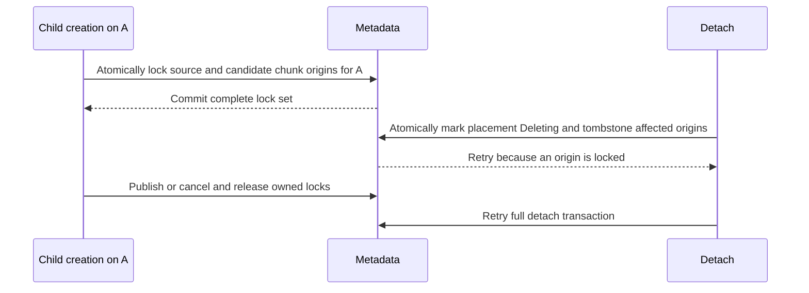
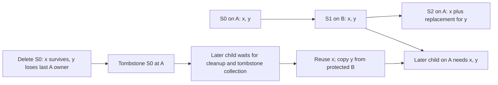
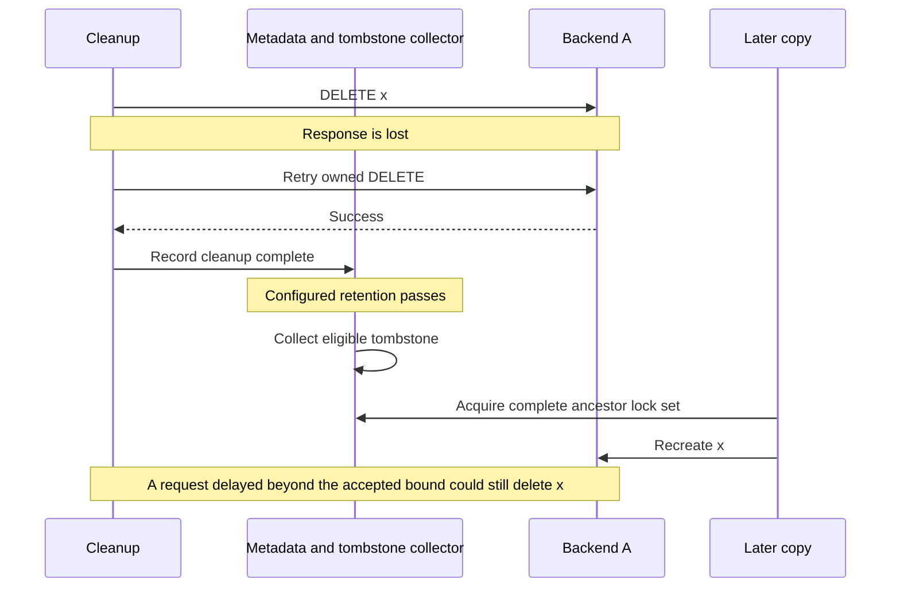

# Problem

Snapshots and images need a choice of storage location. We want to create them in a selected region or bucket, add a copy elsewhere, and move them between storage locations.

Each creation, replication, or migration request selects one destination. Operations that change the copies of one snapshot run one at a time. Creation succeeds when its destination contains the complete snapshot. Replication adds one complete copy. Migration completes the destination before removing the old copies. Detaching the only complete copy returns an error.

Incremental snapshots must continue to share unchanged chunks. Snapshots in the same incremental chain should share one physical copy of each unchanged chunk on the same backend. When snapshots in that chain use different backends, each snapshot must have all of its data on its own backend. One copy of a shared chunk on each required backend is acceptable. This allows the backends to use different storage classes and gives each snapshot a consistent bandwidth profile without reading parts of it from another backend.

Readers and copying tasks must retain usable data while creation, migration, and deletion run. Retries must preserve completed work and account for unfinished writes and deletions. Temporary missing reads are retried and monitored. We accept eventual consistency with a documented delay for collecting deletion markers and a corresponding limit on protection from delayed storage requests.

Rollout must preserve existing snapshots, images, mixed storage layouts, and saved tasks. Establish existing inheritance and storage ownership before enabling the new behavior. Protect the data and metadata used by that work until its results are complete and verified. Enable cleanup only after every writer and collector follows the new rules.

# Current implementation

[Snapshot storage](../../../cloud/disk_manager/internal/pkg/dataplane/snapshot/storage/storage_ydb_impl.go) uses `snapshots`, `chunk_map`, and `chunk_blobs`. `chunk_map` maps a snapshot and chunk index to a chunk ID and a `stored_in_s3` flag. `chunk_blobs` has a root row at `referer = ""`, a scalar logical reference count, and one reference row per snapshot using the chunk. The root contains the YDB payload and its checksum and compression metadata when the payload is stored in YDB. S3 has one configured endpoint, bucket, and key prefix.

[Disk snapshot creation](../../../cloud/disk_manager/internal/pkg/dataplane/create_snapshot_from_disk_task.go) selects a base snapshot and uses its NBS checkpoint to find changed blocks. Changed chunks receive new IDs; unchanged chunks retain the base's IDs and storage flags. The result is a complete flat chunk map. Reads use that map directly, and deleting an ancestor leaves descendants' own references intact. The current configuration has no incremental-depth limit.

[Snapshot-to-snapshot creation](../../../cloud/disk_manager/internal/pkg/dataplane/create_snapshot_from_snapshot_task.go) copies the complete immutable map. A snapshot copy preserves the source's original chunk IDs. Restoring a snapshot into a new disk copies bytes into that disk; later snapshots use the incremental state associated with the new disk identity.

For a chain `S0 -> S1 -> S2`, the S0-origin chunk IDs retained by S2 are a subset of those retained by S1. A changed chunk receives a new ID even when its bytes return to an earlier value. The supported model has one mutable source-disk history and immutable snapshot copies. It therefore does not produce independently mutable sibling branches retaining disjoint or incomparable nonempty subsets of the same ancestor's chunks. Different **nested** subsets are possible: a copy can retain `{x, y}` while a later disk snapshot retains `{y}`. This property describes inheritance; a backend can hold only some of those original chunks after placements are detached.

`ShallowCopyChunk` writes the destination map entry before adding its reference. `WriteChunk` also writes the map before the blob. Deletion removes the reference before the map entry. These operations use separate transactions, while each logical root/reference counter change is transactional. The existing `RefChunk` query can insert a reference when the root is missing; the new path must validate the physical root when admitting reuse.

[Chunk storage](../../../cloud/disk_manager/internal/pkg/dataplane/snapshot/storage/chunks/common.go) mirrors logical metadata changes into its configured shadow table in the same transaction. The existing write initializes a chunk's count to one. Adding a replica requires separate physical accounting that preserves that logical count. S3 requests and metadata transactions complete separately. Missing chunk reads currently become non-retriable errors and must change to the retry policy below.

[Snapshot deletion](../../../cloud/disk_manager/internal/pkg/dataplane/delete_snapshot_task.go) marks a snapshot Deleting and schedules physical collection after `SnapshotCollectionTimeout`. [Database migration](../../../cloud/disk_manager/internal/pkg/dataplane/migrate_snapshot.go) copies into another snapshot database and generates destination chunk IDs. The placement operations described here work within the snapshot database and preserve logical chunk IDs.

# Proposed approach

A **backend** identifies YDB or a configured S3 endpoint, bucket, and key prefix. A **snapshot placement** records one snapshot's association with a backend, its status, and its operation protection. A complete **Ready placement** owns a Ready copy of every nonzero chunk in the snapshot. A **chunk placement** records one physical chunk and its owners on one backend.

Keep the flat `chunk_map` and the existing logical snapshot membership in `chunk_blobs`. Add backend-aware physical references to `chunk_placements`. Add backend-aware placement states, locks, and tombstones to `snapshot_placements`. The same chunk ID may have one physical copy on each backend, shared by all snapshots that own it there.

Record the creators of the nonzero chunks actually referenced by each snapshot. Its parent set consists of the foreign creators in that set. A deleted creator remains a parent while the snapshot references its chunks. Creation acquires direct-source protection and destination-backend origin locks in one transaction; it publishes the exact parent set from the completed map. Detachment atomically changes its placement state and installs the required origin/backend tombstones. Physical cleanup follows after admission.

A tombstone permits reuse of an existing Ready physical chunk and temporarily forbids creating a missing chunk under that origin's existing key on that backend. A collector removes eligible tombstones after tracked cleanup and a configured retention delay. Copying can then resume with the same chunk IDs. The accepted consistency model includes storage requests that can outlive this delay; missing reads are retried and monitored.

Each request has one destination backend. A durable operation owner serializes creation, replication, migration, and explicit detach for a snapshot. Repeated replication requests can add several Ready backends over time. The actual backend set is derived from Ready placement rows. Copying and Deleting states are returned separately for inspection.

An internal **Legacy placement** protects an old mixed snapshot until it has been migrated. Its complete source consists of the original map and per-entry backend locations. Establishment records the discovered backend associations on this placement. A mixed Legacy source does not advertise any partial physical backend as a complete Ready copy.

# API

## Creation and inspection

Add an optional scalar `backend_id` to snapshot and image creation requests using unused protobuf tags. The controlplane resolves an omitted value once from the folder policy and service default and saves the explicit selection in each newly scheduled task. Backend ID zero is valid; field presence distinguishes an omitted choice. Unknown or forbidden IDs return a validation error. A configured backend's temporary unavailability causes a retry. All-zero snapshots validate their selected backend too.

Pass the scalar choice through disk, URL, and snapshot-copy creation tasks. Keep existing task names, saved fields, `UseS3`, and storage-class options for compatibility. Old saved requests follow the upgraded legacy path; their saved storage meaning remains stable across configuration changes.

Inspection returns the set of Ready backend IDs from `snapshot_placements`, along with placement statuses and any active operation. It also reports the Legacy layout and inheritance-establishment status when applicable. Request destinations and discovered legacy locations are recorded as task or placement information; they do not override the actual Ready backend set.

## Added operations

| Method | Request | Result |
| --- | --- | --- |
| `ReplicateSnapshot` | Snapshot ID, one destination backend, optional write options | Adds one complete Ready placement and preserves other placements. |
| `DetachSnapshotBackend` | Snapshot ID, one backend | Marks that placement Deleting and schedules its collection; the last complete backend cannot be detached. |
| `MigrateSnapshotBackend` | Snapshot ID, one destination backend, optional write options | Completes that destination, then marks the old placements for collection. |
| `MigrateSnapshotsByCutoff` | Snapshot selector, one destination backend, optional cutoff | Migrates the selected pre-cutoff snapshots through individual serialized operations. |
| `EstablishSnapshotInheritance` | Snapshot ID or resumable scan scope | Establishes chunk-origin dependencies and legacy backend ownership under protection. |
| `GetSnapshotPlacements` | Snapshot ID | Returns placement statuses, the actual Ready backend set, and establishment/operation status. |

Every mutation has a stable idempotency key and a durable operation result. A retry recovers its original destination and progress. Another placement-changing operation for that snapshot waits without taking source or ancestor locks. Different snapshots may copy shared chunks concurrently.

Replication waits for initial creation to publish a complete source. An already Ready destination succeeds idempotently. A direct request for a deleted snapshot fails; a bulk migration child may record it as skipped. Detach of an already absent placement is idempotent, and a retry of a committed detach recovers its cleanup operation.

An explicit detach of the only complete readable backend returns an error. An unfinished Copying placement does not satisfy the replacement requirement. Initial-creation cancellation and whole-snapshot deletion have their own cleanup paths. During rollout, a protected complete mixed Legacy source can remain available while a new replica is cancelled.

Migration owns the per-snapshot operation slot through copy and detach admission. Copy publication commits Ready and releases copy/source locks first. A separate retryable transaction then marks old placements Deleting, applying the tombstone rules to each affected backend. The final migration receipt is written with that detach decision. Physical cleanup continues asynchronously under its saved owners. Cancellation preserves completed replicas and committed detachments and cleans only unfinished copy ownership.

# Configuration

Give every backend a stable ID and connection configuration. Preserve legacy S3 ID `0` as the existing endpoint, bucket, and prefix; reserve `0x7fffffff` for YDB. Validate that configured IDs address distinct physical namespaces, including overlapping S3 key prefixes. Retain a backend configuration while live ownership, saved tasks, or pending cleanup can require it.

Configure allowed backend sets and one default destination per folder, with separate defaults for snapshots and images. Resolve the default when scheduling. A backend's storage-class policy controls new object writes there. Shared immutable objects retain one agreed class on that backend; different classes for the same shared data use separately configured backend namespaces. A retry or new snapshot reference preserves the class of an existing shared object.

Add `PlacementTombstoneRetention`, with a proposed initial default of 30 minutes, separately from the existing delay before physical snapshot collection. The tombstone collector applies this delay after the final associated cleanup completes. Admission checks tombstone presence; readers and writers do not perform a second reattachment-time calculation.

Add `MaxIncrementalDepth` and enforce it for disk incrementals and snapshot/image shallow copies. This scalar counts creation steps since a full rewrite; it is separate from the number of current chunk dependencies. A full root has depth zero. A child over the limit performs a full copy with fresh chunk IDs and an empty parent set. Record this choice before transfer and preserve it across retries. Treat an unknown legacy copy depth conservatively as reaching the limit for new creation; it does not prevent establishing the exact origins of existing chunks. Admission separately bounds the actual origin-lock set to fit database transaction limits. Replication and migration preserve IDs and cannot silently rewrite an oversized legacy snapshot; report the admission limit if its established origin set is too large.

Keep limits for concurrent operations across snapshots, chunk workers, bytes in flight, and backend request/bandwidth usage. Configure monitoring for retriable missing reads, tombstone age, pending cleanup, and stalled establishment. Rollout gates separately control upgraded legacy accounting, establishment, new placement operations, and collection.

# Data and transactions

## Tables and states

| Table | Key | Stored state |
| --- | --- | --- |
| `snapshots` | Existing snapshot key | Lifecycle, immutable creation inputs, chunk-origin set, establishment status, incremental depth, current operation owner and durable results. |
| `chunk_map` | Existing snapshot/index key | Logical chunk ID; legacy `stored_in_s3` retained for old mixed reads and establishment. |
| `chunk_blobs` | Existing shard/chunk/referer key | Logical root count and distinct snapshot references; compatible YDB payload fields. |
| `snapshot_placements` | Snapshot ID, placement/backend ID, holder scope and task ID | Placement root/status, source and chunk-origin lock holders, origin/backend tombstone, cleanup holders, and collection state. |
| `chunk_placements` | Shard ID, backend ID, chunk ID, referer | Physical root/state at empty referer and one reference row per physical owner. |

For a snapshot S, `origins(S)` is the set of creator snapshot IDs extracted from its nonzero chunk IDs. Its stored parent set is `parents(S) = origins(S) minus {S}`. In this design, a parent or ancestor is one of those actual chunk creators. The direct creation source and NBS base/checkpoint remain separate metadata. A source can provide the complete map without having written any of its chunks.

For example, if A writes x, B copies A, and C copies B, both B and C have the data-parent set `{A}`. C locks B as its direct source during copying; it records A as the creator of its inherited data. Replacing every A-origin chunk removes A from a new snapshot's parent set. Deleting A's snapshot metadata leaves A in the sets of snapshots that still reference its chunks.

A deleting snapshot retains its captured origin set until its cleanup is complete. Coordination rows, cleanup holders, and delayed tombstones have their own retention rules after chunk references are removed. Cleanup of an incomplete copy uses its durable map, progress, and admitted origin scope until all issued writes are accounted for.

A normal placement has state `Absent`, `Copying`, `Ready`, `Deleting`, or `Deleted`. Coordination-only rows use Absent. The reserved internal Legacy placement records the protected mixed layout and its discovered backend associations. Actual Ready backend membership is a set derived from normal placement rows.

Tombstone presence is separate from placement status. A row can have a tombstone while surviving Ready chunks are reused to establish a complete placement. A Ready placement remains readable in that case. Deleted or absent ancestor identities still have coordination rows where needed; they need no live snapshot or payload to participate in admission.

Each source/ancestor lock holder is identified by task, admission version, and scope. Idempotent holder insertion/removal updates the corresponding count. A cleanup holder identifies a task that may still remove references or issue physical deletes for that origin/backend. A detach registers these holders for its captured chunk-origin set and its own placement scope, including origins whose Ready placements exempt them from immediate tombstoning. The collector retains a shared tombstone until every associated cleanup is complete.

References keep their existing set-membership semantics. A logical snapshot contributes one `chunk_blobs` reference to a chunk. A normal physical owner contributes one `chunk_placements` reference for `(snapshot, chunk, backend)`. The same owner on another backend contributes a separate physical reference. Backend lists are sets, and retries or repeated map indexes do not add another member.

Use an unambiguous encoded owner scope for imported Legacy references and new complete-placement references. Both may temporarily exist for the same snapshot/chunk/backend. This lets cancellation remove a new copy attempt while preserving imported mixed ownership. The logical referer remains the snapshot ID throughout.

A physical root is `Writing`, `Ready`, or `Deleting`, with a scalar reference count and a pending deletion owner when needed. The count equals its physical ownership rows. A last unref marks the root Deleting; retain it until the backend deletion is acknowledged. An absent root can be created only by a currently admitted writer whose origin/backend tombstone permits it. Zero chunks have no payload or physical references.

Keep the compatible YDB payload in `chunk_blobs`, with its lifetime controlled by the YDB physical root. Removing the last YDB owner clears the payload while any S3 ownership and logical references remain valid. Main-table-derived logical changes are mirrored into the configured shadow table in the same transaction.

## Transaction boundaries

Creation acquires direct-source protection and its destination-backend candidate-origin locks in one serializable transaction. Before the changed-chunk selection is complete, `{source} union parents(source)` can serve as a temporary protection superset; it is saved on the operation, not as the child's parent set. Replication uses the existing snapshot's recorded chunk origins and its own placement scope. The snapshot's operation owner, Copying destination, saved lock holders, and admission result commit together. A failed admission leaves no partial lock set.

Detach reads current placement states and coordination counts, marks the placement Deleting, installs its own and required ancestor tombstones, and records all cleanup holders in one serializable transaction. Missing placement rows still participate through their stable coordination keys. Ancestor attachment and tombstoning update those same keys, so absence checks are protected from concurrent changes.

All per-snapshot placement changes consult the same operation ownership. Migration's internal copy and detach steps use that owner. Source and ancestor holders are separate from the operation reservation: the reservation may survive a retry wait after the task has released its copy locks.

Each chunk operation atomically checks task/placement ownership, the active admission version and required protection, and physical root state with its reference change. Reusing a Ready root conflicts with final-owner removal. Ordinary retries preserve tracked Writing roots and owners. Logical membership, map entries, and physical ownership use a single transaction where practical; otherwise the durable map is recorded first and retains enough information for cleanup.

External PUT/DELETE requests run after metadata admission. Their completion checks the saved task owner, active admission version, and current state. Copy publication records Ready and releases copy locks together. Cancellation first revokes the writer and releases its locks while retaining tracked partial ownership; a later cleanup admission obtains the tombstone protection. This avoids cancellation waiting on locks retained by another cancelled copy.

Operation results and cleanup ownership make a lost response recoverable. A completed migration receipt prevents a later retry from detaching a replica added by another operation. Keep receipts through the supported task/idempotency lifetime. Database conflicts retry the whole admission; there is no application lock-order requirement for its all-or-nothing lock set.

# Storage methods and task flow

## Admission, creation, and replication

Each creation, replication, and migration request names one destination backend.
A snapshot may acquire several Ready backends through separate requests.
Serialize placement-changing operations for one snapshot with a durable operation owner.
A retry recovers that owner's saved request and progress; another operation retries until the owner finishes.
Source readers may hold shared locks concurrently with a copy operation.
An operation that finds its destination already Ready returns success without starting another copy.

For incremental and shallow-copy creation, derive the child's parent set from the nonzero chunks that remain in its completed map.
Each inherited chunk contributes its original creator; chunks written by the child use its own scope.
Persist progress and verified origins during transfer, then publish the exact final set with Ready.
The selected source snapshot, incremental base, and checkpoint are separate immutable creation inputs.
A shallow copy preserves the source map's origin set, with foreign creators becoming the child's parents.
A full creation writes self-origin chunks and has an empty parent set.
Before enumeration completes, creation may protect `{source} union parents(source)` on the destination as a temporary candidate set.
That operation lock set is separate from the child's published dependencies; candidates with no surviving chunks are omitted from its parents.
Replication uses the existing snapshot's origins and its own placement scope.
The direct source is locked separately throughout active copying, even when it contributes no own-origin chunks.

Before choosing incremental or shallow-copy admission, check the proposed depth and candidate origin-lock set size. At the configured limit, new snapshot creation may persist full-copy mode, depth zero, and an empty parent set. It still protects its readable source, reads every source chunk, and uses the existing new-chunk writer to assign destination-owned IDs. Full disk creation reads its selected checkpoint without a base bitmap. Apply this branch to disk, snapshot, and image creation; URL creation naturally starts a full root. Replication and migration keep the existing IDs and chunk dependencies.

Use `snapshot_placements` for source locks, ancestor/backend coordination, and retained tombstones.
A coordination row can exist without a physical placement on that backend.
Such a row must not advertise that backend as a readable snapshot placement.
A lock holder records the task and its admission version, so retries of that admission insert or remove the same holder exactly once.
Shared locks acquired by creation conflict with the tombstone changes made by detachment.

`BeginPlacement` performs the complete admission in one serializable transaction:

- Recover the operation receipt and the per-snapshot operation owner.
- Validate the snapshot lifecycle, destination backend, and destination placement state.
- For incremental creation, validate and save the direct source and its matching checkpoint.
- Protect the direct source against deletion and protect the actual source placement against detachment.
- Acquire destination-backend coordination locks for the candidate chunk origins. Save that candidate set on the operation; replication uses the established map's origins. Protect new self-origin writes through the owned destination record.
- Create missing coordination rows; an absent placement still participates in locking.
- Save the source and ancestor lock holders, the Copying destination, the operation owner, and an active admission version.

If any lock or lifecycle condition prevents admission, commit none of these changes and retry.
The operation never retains a partial lock set while waiting for another lock.
All admissions and detaches read and update the same coordination rows, including rows for absent placements.
The database resolves transaction conflicts; there is no application-level lock acquisition order.
Do not keep a database transaction open during copying or network requests.

A retained ancestor/backend tombstone permits locking its coordination row and reusing an existing Ready physical chunk.
It forbids creating a missing chunk under that ancestor's old chunk key until the collector removes the tombstone.
If a copy encounters such a missing chunk, stop scheduling chunk work, mark its admission Waiting, invalidate its writer version, and release its creation, source, and ancestor locks together in one transaction.
Preserve its partial destination references, map, progress, and per-snapshot operation ownership.
That operation reservation does not block tombstone collection; active writer and source locks do.
Resume only after reacquiring the complete lock set, revalidating the source and destination, and activating a new admission version. Every chunk mutation and publication checks that active version, so workers from before the wait cannot commit against the retained operation owner.
If the original source disappeared during the wait, finish through the defined failure/cancellation path; partial progress is not a complete source.
Never wait for a tombstone to disappear while retaining the locks that prevent its collection.

The source snapshot lock must be checked by both whole-snapshot deletion and source-backend detachment.
A snapshot deletion lock alone does not protect a source backend during cross-backend copying.
Long-running restore and backup tasks use the same source-placement protection.
During rollout, detachment also honors the existing `lock_task_id` until old saved tasks finish.

For a changed chunk, `WriteChunk` records the chunk map and logical ownership idempotently.
It writes that new chunk to the single destination backend.
For a shared chunk, `ShallowCopyChunk` preserves the chunk ID and adds the child's logical reference.
Replication of an existing snapshot does not add a second logical snapshot reference.
`EnsureChunkPlacement` adds the destination's physical reference and copies data only if needed.
A Ready physical copy can be reused by adding its reference in the same transaction that checks its state.
A missing source root is an error; inserting a reference must not manufacture a reference to missing data.

Physical ownership is keyed by backend, chunk ID, and snapshot owner in `chunk_placements`.
A physical root has a scalar count of those owner rows.
Adding or removing an owner changes the count only when that owner's row changes existence.
A newly needed physical root is Writing until its payload has been acknowledged.
An admitted writer may finish a Writing root using the immutable chunk contents.
A Deleting physical root cannot accept new owners or new writes.
The pending deletion must finish before that root can be absent and eligible for creation again.

For S3, PUT succeeds before the root is marked Ready.
For YDB, payload publication and the Ready transition commit together.
Every completion transaction checks the operation owner, active admission version and protection, and destination state again.
A cancelled worker cannot publish its result after its operation has been revoked.
Save a chunk milestone only after all work through that position is durable.
Ordinary transfer retries preserve the Copying destination, physical ownership, source locks, and progress. Tombstone waits use the explicit Waiting transition above and release copy locks.

`PublishPlacement` requires every nonzero chunk to have a physical owner and a Ready root on the destination.
The completed contiguous scan and committed chunk operations establish that requirement.
It publishes the destination Ready with the exact origin/parent set from the completed map, records copy-stage completion, and releases the operation's copy locks together.
Initial creation also publishes the snapshot Ready. Creation and standalone replication finalize their result and release the operation slot. Migration keeps its outer operation slot and remains incomplete until its separate detach decision commits.
An all-zero snapshot needs no physical chunk rows, but still completes admission and publication.

```text
BeginPlacement(S, destination, task):
  tx:
    recover receipt and operation ownership
    require live snapshot and admissible destination
    resolve complete source and candidate chunk origins
    require every required lock is available
    record retained tombstones that restrict creating missing old chunks
    protect direct source and actual source placement
    lock candidate origins on destination, including deleted creators
    save Copying destination, lock holders, request, and progress

ReplicatePlacement(S, destination, task):
  for entry in ReadChunkMap(S, saved_cookie):
    if entry is nonzero:
      EnsureChunkPlacement(S, destination, entry, protected_source, task)
    save progress after committed chunk
  tx:
    require the full map is complete and this admission is active and owned
    publish destination Ready
    release copy/source/ancestor locks
    record copy completion
```

## Detachment, cancellation, and deletion

Detaching the last complete readable backend returns an error.
A Copying destination is not a replacement for the backend being detached.
A Legacy placement counts as a complete mixed source while its ownership remains attached.
Whole-snapshot deletion and cancellation of failed initial creation do not require a replacement.

`BeginDetach` performs one serializable transaction for the entire admission:

- Recover the detachment receipt or acquire the per-snapshot operation owner.
- Require another complete readable placement unless deleting the whole snapshot or cancelling incomplete work.
- Require no source locks on the placement being detached.
- Require no conflicting materialization locks on this snapshot's own backend scope or on ancestors lacking a complete Ready placement there.
- Mark this snapshot's placement Deleting, tombstone its own origin/backend scope, and tombstone those ancestor/backend coordination rows.
- Register a cleanup holder on every affected ancestor/backend scope, including this snapshot and ancestors whose Ready placements skipped tombstoning.
- Save the cleanup owner and durable cleanup work before committing.

A Copying, Deleting, or coordination-only ancestor row is not a complete Ready placement.
An ancestor with a complete Ready placement already has its own ownership protecting its chunks.
Its later detachment runs the same admission protocol.
Skipping an ancestor's tombstone does not skip the cleanup holder: this detach can still delete that ancestor's chunks later.
Remove each cleanup holder only after all physical deletions issued by its task have been acknowledged.
These holders keep a later ancestor tombstone from expiring while an earlier descendant cleanup can still issue DELETE.
The current snapshot's own tombstone covers chunks originally written by that snapshot, including a root with no parents.
The ancestor tombstones protect inherited chunks that could otherwise be recreated under old keys.
If any required lock is held, this transaction makes no state changes and retries.

After admission, Deleting disappears from the readable backend list.
Collection scans the snapshot's map and removes only that placement's physical owner rows.
If other owners remain, their physical payload stays available.
At the last owner, the chunk transaction marks its physical root Deleting and records the cleanup owner.
That root remains discoverable until the external deletion finishes.
An S3 failure preserves pending work; success or NotFound allows the collector to remove the empty physical root.
For YDB, payload removal and completion of the empty root happen in one transaction.
Delete the map only after whole-snapshot physical and logical cleanup has completed.
An ordinary backend detach keeps the map and logical references.

The last-reference transaction and a Ready-copy reference insertion conflict on the physical root.
If reuse commits first, cleanup is not the last owner.
If deletion commits first, reuse cannot admit a new owner to that Deleting root.
This check is required even though ancestor tombstones coordinate operation admission.

Cancellation must not keep admission locks while waiting to tombstone ancestors.
Two copying tasks may hold shared locks on the same ancestor and cancel together.
If each waited for the other to release its lock, neither could finish cancellation.

First, one transaction revokes the cancelled writer, records cancellation and pending cleanup, and releases its locks.
Keep all existing chunk ownership and partial map entries until cleanup processes them.
Then the cleanup task separately runs the detachment/tombstone admission and retries conflicting holders.
A cancelled worker's later metadata updates fail the operation-owner check.
Cancellation of a task whose destination already became Ready preserves that completed placement.

Migration follows the same release-before-cleanup rule.
It copies to its one destination, publishes that destination Ready, and releases copy locks.
It then admits detachment of the unwanted old backends while retaining its per-snapshot operation ownership.
The migration must not retain destination/source read locks while waiting for exclusive cleanup admission.
Its final transaction rechecks that the destination is still Ready before marking old placements Deleting.
The durable migration receipt prevents a retry from repeating a completed detach decision.

Whole-snapshot deletion first waits for protected readers and active copy operations to finish or complete cancellation.
Its admission transaction then marks the snapshot unavailable and records cleanup of all its placements.
It adopts existing cleanup work rather than starting a second physical deletion owner.
After all placements are collected, remove logical snapshot references and chunk-map entries.
Surviving snapshots retain their own chunk-origin sets. Cleanup holders and tombstones remain until their separate collection conditions are satisfied.

## Reattachment and delayed workers

Retain placement and ancestor/backend tombstones for a configured collection delay.
The collector removes a tombstone only after all cleanup holders and lock holders have gone. It clears the tombstone without deleting a surviving Ready placement or its ownership.
Cleanup holders include tasks admitted while the ancestor still had a Ready placement and no tombstone existed.
Its retention age starts after the last cleanup holder completes, so an overlapping or slow deletion cannot consume the interval.
The collector owns the delay policy; admission checks only whether the tombstone still exists.
Do not add separate recreate timestamps or per-request elapsed-time checks.

While a tombstone remains, Ready chunks may gain references, but a missing old chunk key makes its copy release locks and retry.
After collection, a new transaction may reuse or create the coordination row and admit a new write.
Use the existing object keys and task-owned metadata checks.
This intentionally accepts that a sufficiently delayed external request may outlive the retention interval.
It is an operational delay model, not a proof against indefinitely delayed PUT or DELETE requests.

Keep ordinary pending writes and deletes tracked until completion or explicit cancellation.
A cancelled PUT can finish after its cleanup and leave an unowned object.
Track cancelled work for reconciliation. Orphan cleanup acquires the same origin/backend tombstone and cleanup-holder protection, then transactionally verifies that the physical object has no live owner before issuing DELETE. A one-time ownership observation without that admission cannot authorize deletion.
Existing owner checks prevent stale metadata commits, but cannot retract a request already issued to S3.
Unexpected missing reads are retried and monitored under the read policy below.

## Reads and errors

Resolve a snapshot read from its actual Ready backend list.
Only complete Ready placements are selected. A tombstone may coexist with Ready data and does not prevent reading that data.
A legacy read continues to use each chunk-map entry's `stored_in_s3` until its Legacy placement is removed.
A read attempt uses its selected backend and the existing chunk ID.

Return backend NotFound as a retriable read failure and emit a missing-chunk metric with snapshot and backend context.
Do not perform extra fallback lookups, placement refreshes, or tombstone timing checks in that read path.
The calling task's existing retry mechanism handles the next attempt through its normal read setup and placement selection. There is no extra metadata lookup or second-backend GET inside the failed read attempt.
Monitor sustained NotFound rates and individual long-running failures for operational investigation.
Preserve checksum and decompression validation; other failures keep their appropriate error classification.
Long-running copy, restore, and backup tasks retain their source locks during active work. An explicit Waiting transition releases those locks and requires full source revalidation before resuming.

# Incremental parents and migration

## Establish and preserve inheritance

New writers establish the exact data-parent set from the completed chunk map. Retain a foreign creator ID when at least one nonzero chunk still carries that ID, including when the creator snapshot has been deleted. Candidate origins protected during creation belong to the operation's lock state. Publish only the origins actually present in the result. A full rewrite uses self-origin IDs and produces an empty parent set. Backend replication preserves the map and its dependencies.

Keep NBS creation inputs immutable: the actual base snapshot and its matching checkpoint determine the changed-block calculation. A checkpoint ID can differ from its snapshot ID. Lock the selected source before using that pair. If source deletion wins admission, select and validate a new matching pair or create a full snapshot. Later ancestor cleanup changes neither the saved pair nor the established origin set.

Recorded chunk origins provide common coordination keys after creator deletion. Each snapshot directly identifies the creators of its current data, so deleting an intermediate source requires no reparenting or descendant rewrite. Tombstone collection changes the temporary backend fence and leaves live snapshots' origin sets intact. Cleanup obligations survive removal of the last chunk reference until their tracked work and retention are complete.

For legacy data, `EstablishSnapshotInheritance` runs under snapshot protection and the rollout collection barrier. It saves a task identity, scan cookie, discovered dependencies, and completion status. Before scanning, drain or fence already-running physical cleanup tasks as well as new collection admission. Ready maps remain immutable while protected. Creating snapshots are revisited after completion; partially deleted work is drained or explicitly reconciled before its range is declared complete.

The task performs these steps:

1. Read available saved source/base/checkpoint metadata for creation context. Keep it separate from the data-parent set derived from the protected current map. A missing historical source or base does not block establishment when the map and surviving physical references establish ownership.
2. Enumerate the complete map, including snapshots with saved inheritance metadata. Record `(chunk_index, chunk_id, legacy backend)` for every entry needed by establishment. Zero chunks need no physical ownership.
3. Extract each nonzero chunk's original creator using the defined parser and deduplicate those IDs into `origins(S)`. Foreign creators form `parents(S)`, including deleted creators; self-origin chunks use S's own scope. Each map directly establishes its data dependencies, with no recursive historical-parent expansion.
4. Resolve the backend through the entry's legacy flag and surviving chunk ownership/placement metadata. Cross-check the snapshot's reference against the physical data and logical reference records. Deduplicate repeated chunk IDs per owner/backend.
5. Import physical ownership and save the resolved backend associations on the snapshot's Legacy placement. Publish the established dependency set, verified coverage, and completion status atomically after all batches have committed.

Keep the existing chunk-ID generation and parsing logic unchanged; backend IDs are not encoded in chunk IDs. The parsed creator ID identifies the origin coordination scope. Resolve physical locations through the protected source placement, the legacy per-entry backend flag, and exact `(backend_id, chunk_id)` placement records. During new creation, record the resolved origin/backend associations in the destination's establishment and placement metadata, add its physical reference on the selected backend, and publish that backend only after the complete map is present there. A creator's own current backend need not be where a descendant stores the chunk. Surviving ownership and retained coordination records support resolution after the creator snapshot disappears.

An unchanged intermediate copy contributes no new chunk origin. It remains relevant as a direct source while being copied, but adds no data-parent ID unless the result references chunks that it created. The map provides the exact dependency set without overlap scoring or reconstruction of a historical chain. Missing origin coverage, unresolved backend ownership, or an incomplete scan keeps establishment Pending. The invariant needed by locking is that every chunk's actual origin is protected.

An established snapshot's backend set is derived from its placement records. Discovered Legacy locations describe the old mixture; complete Ready placements describe the copies that new callers may select. Inheritance establishment creates ownership records without copying payloads or changing logical membership. Initial rollout must also establish the relevant ancestor/backend coordination records and collection obligations before admitting new placement operations.

## Single-snapshot and bulk migration

`MigrateSnapshotBackend` saves one destination and a stable operation identity. Its durable per-snapshot ownership serializes other placement mutations. It acquires a complete protected source, replicates to the destination, publishes that destination Ready, and releases the copy locks. A final transaction verifies Ready, marks old placements Deleting with their required tombstones and cleanup holders, and records the migration result. Background collection uses the saved cleanup owners. A retry of the completed migration returns its recorded result.

Repeated migrations can move a snapshot A to B and later back to A. While a relevant ancestor/backend tombstone is retained, existing Ready chunks can be reused. A missing required chunk causes the task to preserve partial progress, release copy locks, and retry admission after collection. The retained operation reservation does not prevent the tombstone collector from running. The task revalidates its source when it resumes.

Bulk migration uses one destination for all selected snapshots. Save a cutoff once and select snapshots with `creating_at < cutoff`, including those still Creating. Scan by primary-key ranges with a durable cookie. Save selected work and stable child task IDs before advancing. Different snapshots may migrate concurrently; each snapshot retains its own operation serialization.

Establish a consistent cutoff boundary using the database's time and a short admission barrier for snapshot-record insertion. Drain in-flight insertions before saving that boundary. New insertions use database-supplied creation times at or after it; imports preserving historical timestamps must participate in the barrier. An explicit cutoff cannot be later than the recorded boundary.

Record and revisit ranges containing unresolved pre-cutoff creations. A creation that becomes Ready behind the forward cookie must still be migrated. Completion requires the forward scan, unresolved ranges, establishment prerequisites, and saved child operations all to be resolved. Cancellation stops new scheduling, cancels unfinished copies, and preserves completed replicas and committed cleanup work.

# Backward compatibility and rollout

Roll out the changes in separate stages:

1. Add the backend registry, placement tables, chunk-origin/establishment fields, compatible task formats, and monitoring with new placement operations and collection disabled.
2. Upgrade all creation, replication, deletion, migration, backup, restore, and cleanup workers. Keep old saved requests executable with their original `UseS3` and inherited-location meaning. Every writer maintains compatible logical references and the new physical ownership once its scope is imported.
3. Enable the protected inheritance-establishment scan. Fence destructive cleanup, including already-scheduled `DeleteSnapshotData` tasks, before evidence is enumerated. Use either a quiescent boundary or upgraded writers that maintain imported ownership while the task revisits unfinished ranges.
4. Establish every selected legacy snapshot's dependencies, backend associations, and physical reference membership. Create its protected Legacy placement and all required origin/backend records. Validate coverage and counts, including Creating and Deleting work; a Ready-only snapshot listing is insufficient.
5. Publish a durable establishment-complete boundary. Keep new multibackend placement operations disabled until their complete legacy scope has passed this stage. Record unresolved ranges and keep the gate closed for them. New writers must establish their own metadata before publishing Ready.
6. Enable single-destination creation, replication, and migration, with one active placement mutation per snapshot. Enable placement collection only after every collector honors the lock, tombstone, cleanup-holder, and owner rules.
7. Resume eligible physical cleanup and collect tombstones through the delayed collector. Monitor missing reads, incomplete establishment, retained cleanup, and retry backlog before increasing traffic.

Old snapshot locks remain an additional source-protection barrier until their saved tasks finish. Metadata import preserves the old mixed map, logical counts, and object keys. Imported Legacy physical ownership and new normal placement ownership remain separately identifiable. Cancelling a new replica removes only its own references.

Once a complete replacement is Ready, migration marks the Legacy placement for collection. For each old map entry, its recorded backend determines which Legacy physical reference to remove. Its tombstone and cleanup scope is computed for every actual backend touched by the old mixed map. Cleanup never advertises the mixed layout as a complete physical replica.

Update backup and restore readers to use placement selection, source protection, and the retriable NotFound policy while preserving existing backup formats. Keep old backend configuration until references, saved tasks, imported Legacy ownership, and pending cleanup have drained. Returning to older writers after placement collection has been enabled requires disabling new admission and repeating reconciliation before cleanup resumes.

# Race examples

These examples use `A`, `B`, and `C` for backends, `S0`, `S1`, and `S2` for snapshots, and `x` and `y` for nonzero chunks. `S@A` means a complete Ready placement. Each creation, replication, or migration request names one destination backend. Explicit replication adds that one replica; migration copies to that destination before detaching the old placements. Only one placement-changing operation runs for a snapshot at a time, including its owned copy work. Operations on different snapshots may run concurrently.

A logical reference is set membership of a snapshot in a chunk's users, regardless of that snapshot's number of replicas. Physical references count owners separately on each backend. Zero chunks have neither payloads nor physical references.

The origin of a chunk is the snapshot that created its ID. A child can retain only a subset of an ancestor's original chunks; unchanged chunks retain their IDs. Ancestor protection covers the creators of chunks actually referenced, including deleted creators. Direct-source locks and temporary candidate-origin locks are recorded separately during creation. A tombstone for `(origin, backend)` fences recreation until the tombstone collector removes it after the configured delay and its tracked cleanup is complete. Tombstones have a bounded retention period. The design accepts the stated bound on workers and backend requests and the eventual consistency behavior illustrated below.

## 1. Creation fails partway through its one destination

**Initial state:** S is being created on A. Several chunks have been written, but the snapshot is not Ready.

**Interleaving:** A transient failure interrupts the next upload. The task retries after its progress or an acknowledgement was lost.

**Outcome:** Resume the same creation and preserve its completed chunks. Existing logical membership and physical ownership prevent duplicate increments. Publish S and A as Ready only after every required chunk is complete. If every chunk is zero, validate A and complete enumeration, then publish without creating payloads or physical references.

## 2. Two replica requests for one snapshot are serialized

**Initial state:** S is Ready on A. One request asks to replicate S to B, and another asks to replicate S to C.

**Interleaving:** Both requests attempt admission. Only the B operation acquires S's operation ownership.

**Outcome:** The C operation waits or retries; it cannot create a second concurrent Copying placement. After B completes, C revalidates the current state and can run as a separate operation. S may then have Ready A, B, and C, but each replica was added by a separate serialized request. A replica request arriving while initial creation is still Creating likewise waits for a complete Ready source.

## 3. Shared chunks retain one logical member per snapshot

**Initial state:** S1 and S2 share x on A. Each independently requests replication to B.

**Interleaving:** The two operations run concurrently because their snapshots differ. Both add physical ownership on B and may upload the same immutable x. One repeats its reference transaction after losing a response.

**Outcome:** The logical users remain `{S1, S2}`. On B, each snapshot contributes one physical reference; retries add neither another logical member nor another physical reference. Cancelling S1's copy removes only its B ownership, leaving S2's ownership intact. The same rule applies when x occurs at several map indexes: membership is per snapshot or physical owner, not per index.

## 4. Inherited origin subsets shrink, and a clone can preserve a subset

**Initial state:** S0 creates `{x, y, z}`. S1 inherits `{x, y}` and replaces z with a new S1 chunk. S2 is created from S1, inherits x, and replaces y with a new S2 chunk. A shallow clone of S1 retains S1's complete chunk map.

**Interleaving:** Ownership enumeration groups the entries by their original creator.

**Outcome:** For S0-origin chunks, the linear chain contains nested sets `{x, y, z} ⊇ {x, y} ⊇ {x}`. The clone has the same S0-origin subset `{x, y}` as S1. These differing sets are nested; the example does not posit incomparable or disjoint nonempty sibling subsets. An origin in an ID establishes who created the chunk; it does not prove that every intervening snapshot or every backend still holds the entire origin set.

## 5. Creation wins the atomic lock transaction before detach

**Initial state:** Child S2 will read S1 on B and create its one placement on A. The source map includes S0-origin chunks, and S0 may already be deleted.

**Interleaving:** In one transaction, creation validates and locks the direct source and the complete required ancestor-record set for A. Detachment then attempts a transaction that would tombstone one of those records.

**Outcome:** Detachment waits or retries without committing a partial set of tombstones. Creation keeps its protection until publication or cancellation releases the owned locks. Afterward detach retries its complete transaction against the current state.



## 6. Detach wins before the complete lock set is acquired

**Initial state:** The same creation has selected its source and candidate chunk origins but has not committed their locks.

**Interleaving:** Detachment commits first, marking its placement Deleting and tombstoning the affected origin/backend records. Creation then attempts its single lock transaction.

**Outcome:** Creation observes the tombstone in its all-or-nothing admission and may reuse affected chunks whose physical roots are already Ready. If any required affected chunk is missing, it records progress, releases its copy locks, and retries after collection. It includes deleted ancestors and revalidates its source on resume; a source that disappeared during the wait requires safe failure/cancellation.

## 7. Returning to a backend where only part of an origin survives

**Initial state:** S0@A creates x and y. S1@B inherits both. S2 is created from S1 on A, retaining x but replacing y. Thus S2's S0-origin subset on A is `{x}`, while S1 retains `{x, y}` on B.

**Interleaving:** S0 is deleted. Its last A reference to y disappears, while x remains owned by S2. A later child of S1 requests A and needs both x and y.

**Outcome:** Deletion tombstones `(S0, A)`. The new child may reuse live x immediately, but cannot recreate missing y while the marker remains. It preserves progress and releases copy locks before waiting. After tracked deletion and tombstone collection, it revalidates its B source, reacquires protection, and copies y. A child requiring only x can complete during the retention interval.



## 8. Only a complete Ready origin placement exempts an ancestor

**Initial state:** S contains a chunk x created by ancestor S0 and has placements on A and B.

**Interleaving:** Detachment of S@A examines S0's state on A in its admission transaction.

**Outcome:** If S0@A is complete Ready, its ownership keeps every S0-origin chunk alive; detaching S does not need to tombstone that origin. If S0 has no A placement, or it is Copying, Deleting, or Deleted, the transaction must tombstone `(S0, A)` before collection can remove final references. A Copying row is not proof that x has been copied. If S0@A later detaches, that operation applies the same rule and tombstones its own origin before cleanup.

## 9. A root snapshot has no parents to protect its own chunks

**Initial state:** Root snapshot S created x on A and now also has a complete replica on B.

**Interleaving:** S detaches A, and a later request asks to replicate S back to A.

**Outcome:** Detachment includes `(S, A)` in the tombstone set even though S has no ancestors. If x was removed, the later request releases its copy locks and waits for cleanup and tombstone collection before recreating x from B. Any x copy still owned by another snapshot remains eligible for Ready reuse.

## 10. Lock retries do not release another operation's protection

**Initial state:** Tasks T1 and T2 hold shared protection on the same ancestor/backend record while working on different snapshots.

**Interleaving:** T1 repeats acquisition after losing its response, then repeats release after another lost response. T2 is still active.

**Outcome:** Holder identity makes both actions idempotent. T1 contributes one holder and removes only that holder. T2 continues to prevent a conflicting tombstone. The task's complete ancestor/source lock set is released using the same ownership identities; task-local counters are not sufficient.

## 11. Cancellation races publication

**Initial state:** S is Ready on A and its serialized replication to B has copied the final chunk, but B has not been published Ready.

**Interleaving:** Cancellation races publication.

**Outcome:** If publication wins, it records completion and releases the operation's source and ancestor locks; cancellation leaves the completed B replica attached. If cancellation wins, it revokes its Copying destination, records cancellation, schedules cleanup, and releases its owned locks atomically. Later publication fails its owner/state check. Releasing the locks does not wait for background deletion; cleanup must still obtain the required tombstone fence before destructive collection.

## 12. Cancelled partial copies and late workers

**Initial state:** A copy into B has uploaded some chunks and issued another PUT that is still outstanding.

**Interleaving:** Cancellation releases the task's locks and leaves durable cleanup work. Cleanup applies the same origin-tombstone rules as normal detach; if another task protects an affected origin, cleanup waits without retaining the cancelled task's locks. A late worker subsequently tries to publish progress.

**Outcome:** Cancellation removes only its own physical ownership. Existing source and Legacy ownership remain intact. Owner/state checks reject the late metadata update, including after a new task has acquired the same placement key. An already-issued PUT may still arrive after cleanup and leave an unreferenced object; this is an accepted late-worker outcome to monitor and reconcile, not permission for the worker to revive the cancelled placement.

## 13. Detaching the last Ready placement is an error

**Initial state:** S has one Ready placement A. Another target, if present, is only Copying.

**Interleaving:** A request tries to detach A. Alternatively, two requests arrive when S has Ready A and B and each wants to detach one.

**Outcome:** Detaching the only Ready placement returns an error. Copying and Deleting placements do not count as alternatives. With A and B, the serialized operation that detaches first can succeed; the next operation revalidates and returns the last-Ready error. Whole-snapshot deletion and cancellation of an incomplete initial creation are the explicit exceptions.

## 14. Migration has one destination and a durable result

**Initial state:** S has Ready A, and migration targets B. A second migration to C arrives while B is being copied.

**Interleaving:** The B migration owns S's operation slot through its copy and commit. The C migration waits. After B is complete, the commit makes B the migration's surviving placement, marks the old placements for cleanup, and records completion. Its response is lost; a later explicit replication adds C before the old B migration retries.

**Outcome:** The retry returns the recorded result without detaching the later C replica. A queued migration to C, if still requested, runs as a new serialized operation against the current state. Partial B progress never justifies detaching the protected source A. Moving A to B and later back to A uses the same tombstone/cleanup admission rules as any other target.

## 15. Replication and whole-snapshot deletion compete for admission

**Initial state:** S is Ready. One operation requests a new replica, while another requests deletion of the whole snapshot.

**Interleaving:** They compete for S's operation ownership. A previous placement detach may already have scheduled background cleanup.

**Outcome:** If replication wins, deletion waits until the copy completes or cancellation releases the operation. If whole deletion wins, new placement work is rejected. Whole deletion preserves any existing cleanup owner and adopts or waits for its work rather than starting a second DELETE stream. Remove logical membership and map entries only after the snapshot's physical ownership has been collected.

## 16. Physical reference changes are local to one backend

**Initial state:** x has live copies on YDB and S3. S1 is its final YDB owner, while S2 still owns S3. Another snapshot may concurrently try to add YDB ownership.

**Interleaving:** S1's final YDB unref races the new physical reference, after the required operation and origin protection has been established.

**Outcome:** If the reference commits first, the payload remains owned. If final unref wins, the root is Deleting and the new operation cannot treat it as a usable copy; it follows the cleanup/tombstone admission path. Removing the YDB payload does not remove S3 data or a logical root still used by S2. Counts are maintained independently per backend, and logical membership changes only with snapshot ownership.

## 17. Deleting an intermediate source preserves chunk dependencies

**Initial state:** S0 created x, S1 copied S0, and S2 copied S1. Both S1 and S2 contain x and directly record S0 as their data parent. S1 contributes no own-origin chunks to S2. S1, or both S0 and S1, are being deleted.

**Interleaving:** A new copy from S2 acquires its source protection and chunk-origin locks while deletion updates lifecycle state.

**Outcome:** Admission locks S2 as the direct source and includes S0's destination-backend coordination record even if S0 is deleted. S1 has no role in the copy's data dependencies. Its removal leaves S2's recorded origin S0 intact. A creation using an NBS changed-block bitmap separately retains its matching base snapshot/checkpoint inputs. If deletion wins before that base is locked, select a matching usable pair or perform a full creation.

## 18. Overlapping cleanup extends the origin fence

**Initial state:** S and its origin snapshot S0 both have Ready A placements. Detach of S@A starts first. Because S0@A is still Ready, S's admission does not need to tombstone `(S0, A)` yet, but it records a cleanup hold for that origin along with its other ancestor/self holds.

**Interleaving:** S0 then detaches A and creates the origin tombstone. S0's cleanup finishes quickly, while S's cleanup is still pending and may later remove the last reference to an S0-origin chunk.

**Outcome:** S0's completion cannot make the tombstone eligible for collection while S's cleanup hold remains. Every admitted cleanup records holds for all required ancestor/self records, including origins exempted from tombstoning because they were Ready. It releases them only after its relevant reference scan and owned physical deletions complete. The collector requires no pending holds and measures retention from the last relevant cleanup completion. Otherwise S could issue a late ordinary DELETE after S0's fence had expired, without exceeding any individual worker-delay assumption.

## 19. Tombstones eventually expire, with a stated late-DELETE limit

**Initial state:** The last owner of x@A is being collected under its origin fence.

**Interleaving:** DELETE succeeds but its response is lost. The owner retries and eventually records cleanup completion. Once all relevant cleanup holds are gone, the tombstone collector removes the applicable records after the configured retention measured from the final cleanup completion. A new operation then acquires its full lock set and recreates x on A.

**Outcome:** Pending cleanup remains discoverable and blocks premature recreation; ordinary retries do not start a second independent delete owner. Bounded retention permits eventual reuse of the existing key. If an old worker or backend DELETE survives beyond the accepted delay and reaches A after recreation, it can remove the new copy. That limitation is accepted by this design; metadata checks cannot revoke a request already issued to the backend.



## 20. A read encounters backend NotFound

**Initial state:** A reader uses a selected backend during a migration, cleanup transition, or backend visibility delay.

**Interleaving:** GET returns NotFound.

**Outcome:** Return a retriable error through the ordinary task retry path and emit the configured metric/log for monitoring. Do not add a second fallback backend read, a placement refresh solely for this miss, or read-time tombstone/timestamp checks. Repeated misses remain visible operationally. Long-running copy and restore tasks still acquire their normal source and ancestor protection before reading.

## 21. Legacy inheritance and ownership are established before enablement

**Initial state:** Legacy snapshots have mixed `stored_in_s3` maps and incomplete inheritance metadata. A scan has found only part of the existing chunk ownership.

**Interleaving:** The establishment task holds snapshot protection while enumerating each map and identifying the actual creators of its chunks. Physical cleanup remains fenced so the evidence cannot disappear. Existing or resumed creations are included or revisited before the completion boundary is accepted.

**Outcome:** Keep new multibackend operations disabled until inheritance and ownership have been established for their required scope. Every snapshot's complete map is enumerated to derive its exact data parents and physical ownership. An unresolved origin or incomplete owner set keeps the gate closed. Imported Legacy ownership remains distinct from ownership of a subsequently added complete replica, so cancelling that replica cannot remove the original mixed copy.

## 22. Old saved tasks retain their source protection during rollout

**Initial state:** An old saved task holds `snapshots.lock_task_id` for S, even though new placement and inheritance metadata are already present.

**Interleaving:** A new detach or migration would otherwise be allowed by the new operation and ancestor locks.

**Outcome:** Honor the old lock as an additional barrier. The new operation waits until its owner releases it, then repeats current admission checks. An upgraded task preserves its saved source/backend meaning; rollout does not reinterpret an old request using a new default backend.

## 23. Bulk migration must revisit pre-cutoff creations

**Initial state:** A bulk migration saves one cutoff and one destination backend. S has `creating_at < cutoff`, but is still Creating when its primary-key range is scanned.

**Interleaving:** The scanner saves the unresolved range and advances its cookie. S becomes Ready behind the cookie. Other eligible snapshots are migrated concurrently, with each snapshot's own operation serialized.

**Outcome:** Revisit S's saved range and migrate it after it becomes eligible, or resolve it as deleted. The run is complete only when the forward scan, unresolved pre-cutoff ranges, and saved child operations are resolved. Snapshots created at or after the cutoff are outside the run. Cancellation stops new scheduling and cancels unfinished copy work; already committed detachments continue their tracked cleanup.

## 24. The depth limit starts a new ownership chain

**Initial state:** P is at the configured incremental-depth limit. A request creates a new snapshot S from P's disk checkpoint or immutable snapshot contents.

**Interleaving:** Admission selects full-copy mode before transferring anything and saves depth zero and an empty parent set. It retains the source protection needed to read the complete contents.

**Outcome:** S writes every nonzero source chunk through the existing new-chunk ID logic. Its resulting chunks belong to S, so future creation starts a bounded ownership chain. A retry keeps this mode. Simply dropping old ancestor IDs while keeping their shared chunks would leave their tombstones outside the lock set. Replication of P to another backend preserves P's chunk IDs and cannot apply this reset silently.

## 25. A deleted creator's original backend differs from the source

**Initial state:** S0 originally wrote x on A. Descendant S1 now has a complete copy on B, and S0's snapshot and its A copy have been collected. The chunk ID still identifies S0 as the original creator.

**Interleaving:** A new child of S1 requests C. Its writer parses x's unchanged ID while establishing the destination's inheritance and backend information.

**Outcome:** S0 supplies the origin coordination key. The protected S1 placement and exact chunk-placement metadata resolve the readable x copy on B. The writer records its C association and physical reference on the new snapshot and publishes C only after the whole snapshot is complete. It neither encodes C into the chunk ID nor assumes that x is still on A.
