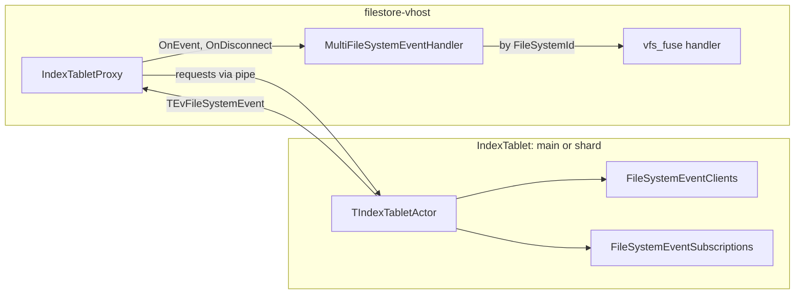
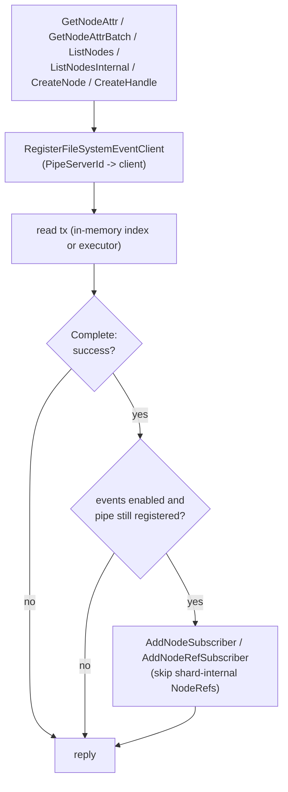
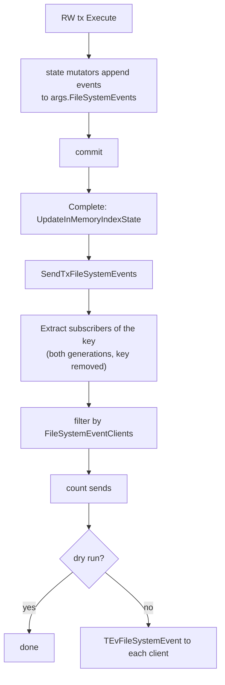
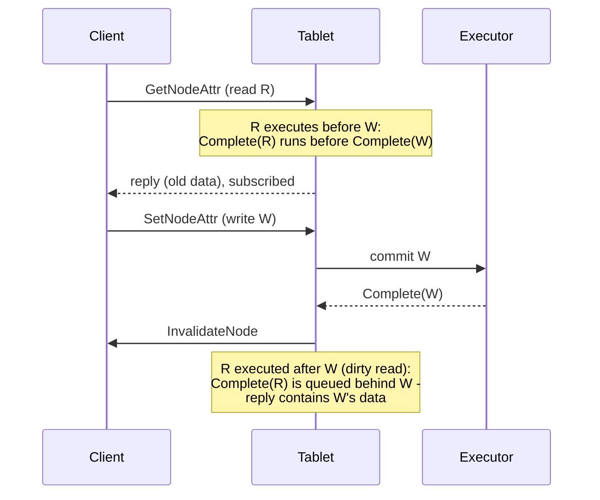

# FileSystemEvents

Tablet → client notifications about the changes of the cached Nodes and
NodeRefs. The goal is to let the clients (vhost / vfs_fuse) cache Nodes and
NodeRefs and drop them as soon as they change.

## Events

- `InvalidateNode {NodeId}` - node attrs changed or the node was removed
- `InvalidateNodeRef {NodeId (parent), Name}` - directory entry created or
  removed
- `FileSystemId` is always the main filesystem id, even for the events sent by
  the shards
- proto: `cloud/filestore/public/api/protos/filesystem_event.proto`

## Components

## Subscribing (read path)

- The client is identified by the tablet pipe server it's connected through
  (`ev->Recipient`), the events are sent to `ev->Sender`
- Requests sent without a pipe (`Recipient == SelfId()`) are not registered
- The subscription is made in the Complete stage of the read tx

- Shard-internal NodeRefs (`RootNodeId`, generated name) in the shards are
  never subscribed to and never produce events
- The attrs of external nodes are subscribed to in the shards (via the
  GetNodeAttr / GetNodeAttrBatch requests sent by the service to the shards)

## Generating and sending (write path)

- Sources:
  - `CreateNodeRef` / `RemoveNodeRef` -> `InvalidateNodeRef`
  - `RemoveNode` -> `InvalidateNode`
  - `UpdateNode` -> `InvalidateNode` only for non-time attr changes (a write
    produces an event only if it changes the size)
  - `SetNodeAttr` -> `InvalidateNode` for explicit time changes too
  - `GenerateFileSystemEvent` private action - manual event (tests, debug)
- Events are sent after `UpdateInMemoryIndexState` - otherwise the client
  could re-read stale data from the in-memory index cache
- Subscriptions are one-shot: the client registers again upon the next read

## Ordering

- In-memory index reads complete synchronously and see only completed txs
- Executor RO txs complete only after all the previously committed RW txs
  (`TLogicRedo::CommitROTransaction`)
- => the tablet never replies with data that isn't covered by a subscription
  or already includes the change
- Client side TODO: the response and the event reach the client cache via
  different paths - a per-key version is needed before using the events for
  cache invalidation (see `filesystem_event_handler.cpp`)

## Subscription registry

- `TFileSystemEventSubscriptions` (`libs/storage/tablet/model`)
- 2 generations: Active and Sealed
  - new registrations go to Active
  - every `FileSystemEventSubscriptionsSealPeriod` (lazy, upon access): drop
    Sealed, Active -> Sealed, new Active
  - a registration lives between 1 and 2 seal periods
  - lookups consult both generations
- Per generation:
  - `Clients` vector + `PipeServerId -> index` map
  - `Node -> TClientMask`, `NodeRef -> TClientMask`
  - `TClientMask` - paged bitmap: first ui64 page inline, other pages on
    demand
- Pipe disconnect (`TEvServerDisconnected`) removes the client from
  `FileSystemEventClients`; its stale bits are filtered out upon send and
  disappear with the rotation
- The client side gets `OnDisconnect(tabletId)` when its pipe to the tablet
  breaks

## Config

| Field | Meaning |
|-------|---------|
| `FileSystemEventsEnabled` | generate, subscribe and send events |
| `FileSystemEventsDryRunModeEnabled` | subscribe and count, but don't send |
| `FileSystemEventSubscriptionsSealPeriod` | generation rotation period (default 30 min) |

## Metrics

- `InvalidateNodeEventSendCount`, `InvalidateNodeRefEventSendCount` - number of
  (event, client) pairs, counted in dry run mode too
- `FileSystemEventsSubscriberRegistry*` - registry size: `NodeCount`,
  `NodeRefCount`, `ClientCount`, `ExtraPageCount`

## Client side

- `IndexTabletProxy` delivers `TEvFileSystemEvent` to
  `IMultiFileSystemEventHandler`, which dispatches by `FileSystemId`
- vfs_fuse registers its handler under the filesystem id returned by
  CreateSession, not under the requested one (which may be an alias)
- `vfs_fuse` `TFileSystemEventHandler` - logging only for now; names are
  logged at DEBUG level only (masked at INFO)
