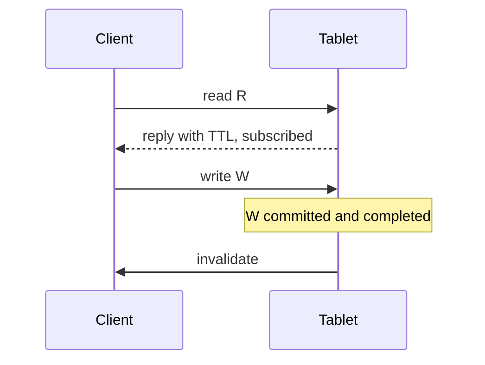

# FileSystemEvents

Tablet → client notifications about the changes of the Nodes, NodeRefs and
XAttrs the client has read. The goal is to let the clients (vhost / vfs_fuse)
cache them and drop them as soon as they change.

## Events

- `InvalidateNode {NodeId}` - node attrs changed or the node was removed
- `InvalidateNodeRef {ParentNodeId, Name}` - directory entry created or removed
- `InvalidateNodeXAttr {NodeId, Name}` - extended attribute created or changed
- Always carry the main `FileSystemId`, even when sent by a shard

## Overview

## Read path: subscribing

- A client is identified by its tablet pipe; the subscriptions of a
  disconnected pipe are dropped and the client gets a disconnect notification
- Subscriptions are one-shot: an event removes them, the client re-subscribes
  upon the next read
- Shard-internal NodeRefs (shard root entries named by the main tablet) are
  invisible to the clients - never subscribed to, never produce events
- Only the reads whose responses may be cached subscribe; e.g. CreateNode and
  CreateHandle responses are not cacheable
- A sender that doesn't cache anything (e.g. the directory viewer) sets
  `THeaders.FileSystemEventSubscriptionDisabled`; the decision is per request,
  since a pipe (e.g. of the tablet proxy) may be shared with caching senders

## Cache TTLs

The responses tell the client for how long it may cache each kind of data. A
nonzero TTL means the client is subscribed to the corresponding key.

| Response | NodeCacheTTL | NodeRefCacheTTL | XAttrCacheTTL |
|----------|:---:|:---:|:---:|
| GetNodeAttr | if the node is local | if looked up by name | - |
| ListNodes, ListNodesInternal | + | + | - |
| GetNodeAttrBatch | + | - (NodeRefs are shard-internal) | - |
| GetNodeXAttr | - | - | + (also for "no such xattr") |

- TTL = seal period - `FileSystemEventSubscriptionsCacheTTLMargin` (the margin
  covers the delivery and processing delays)
- TTL = 0 if events are disabled, in dry run mode, if the subscription is
  disabled by the sender or the pipe is not registered
- The service combines the responses of the main tablet and the shards:
  - GetNodeAttr: NodeRef TTL from the main tablet, Node TTL from the shard
  - ListNodes: Node TTL = min over the main tablet and the shards
- Negative caching is allowed for XAttrs only

## Write path: sending

- Event sources:
  - entry created / removed -> `InvalidateNodeRef`
  - node removed or its attrs changed -> `InvalidateNode`
  - time-only changes (e.g. MTime upon write) don't produce events; explicit
    time changes via SetNodeAttr do
  - XAttr created / changed -> `InvalidateNodeXAttr` (creation invalidates the
    cached absence)
- Events are sent only after the in-memory index cache is updated - otherwise
  the client could re-read stale data from that cache
- TODO: XAttr removal -> `InvalidateNodeXAttr`; node removal should drop the
  node's XAttrs on the client

## Correctness

- The tablet never replies with data that neither is covered by a
  subscription nor already includes the change:
  - in-memory cache reads complete immediately and see only completed writes
  - executor reads complete only after all the previously committed writes
    (`TLogicRedo::CommitROTransaction`) - a read that saw an uncommitted
    write replies after that write has completed
- Client side TODO: the reply and the event reach the client cache via
  different paths - a per-key version is needed so that an invalidation
  applied before the reply is cached isn't lost

## Subscription lifetime

- Two generations of subscriptions: active and sealed
- Every seal period the sealed one is dropped and the active one is sealed
- => a subscription lives between 1 and 2 seal periods, hence TTL < seal period

## Config

| Field | Meaning |
|-------|---------|
| `FileSystemEventsEnabled` | generate, subscribe and send events; nonzero TTLs for GetNodeAttr and GetNodeXAttr |
| `FileSystemListingEventsEnabled` | also subscribe and return TTLs for ListNodes, ListNodesInternal, GetNodeAttrBatch |
| `FileSystemEventsDryRunModeEnabled` | subscribe and count, don't send; TTLs are 0 |
| `FileSystemEventSubscriptionsSealPeriod` | subscription generation period |
| `FileSystemEventSubscriptionsCacheTTLMargin` | TTL = seal period - margin |
