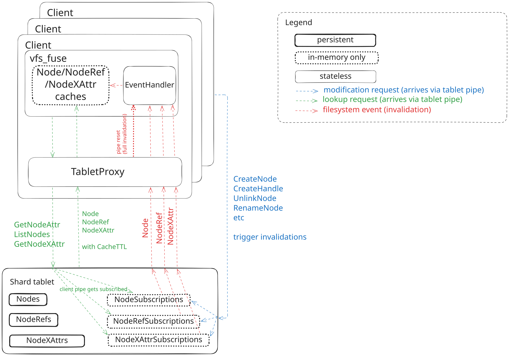
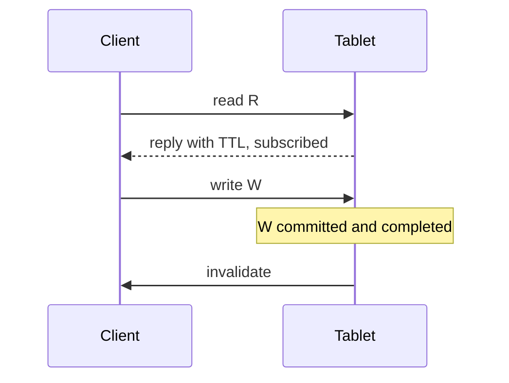

# FileSystemEvents

Tablet → client notifications about the changes of the Nodes, NodeRefs and
XAttrs the client has read. The goal is to let the clients (vhost / vfs_fuse)
cache them and drop them as soon as they change.

## Events

- `InvalidateNode {NodeId}` - node attrs changed or the node was removed
- `InvalidateNodeRef {ParentNodeId, Name}` - directory entry created or removed
- `InvalidateNodeXAttr {NodeId, Name}` - extended attribute created or changed
- Always carry the main `FileSystemId`, even when sent by a shard

## Overview

## Animated overview for a single NodeRef + Node pair

Step-by-step version with controls:
[filesystem_events_animation.html](filesystem_events_animation.html) (open it
in a browser). The SVG is generated by `filesystem_events_animation_svg.py`.

## Read path: subscribing

- A client is identified by its tablet pipe; the subscriptions of a
  disconnected pipe are dropped and the client gets a disconnect notification
  (see Disconnects)
- Subscriptions are one-shot: an event removes them, the client re-subscribes
  upon the next read
- Shard-internal NodeRefs (shard root entries named by the main tablet) are
  invisible to the clients - never subscribed to, never produce events
- Only the requests whose responses may be cached subscribe (see Cache TTLs);
  e.g. CreateNode and CreateHandle don't
- A sender that doesn't cache anything (e.g. the directory viewer) sets
  `THeaders.FileSystemEventSubscriptionDisabled`; the decision is per request,
  since a pipe (e.g. of the tablet proxy) may be shared with caching senders

## Cache TTLs

The responses tell the client for how long it may cache each kind of data. A
nonzero TTL means the client is subscribed to the corresponding key.

| Response | NodeCacheTTL | NodeRefCacheTTL | XAttrCacheTTL |
|----------|:---:|:---:|:---:|
| GetNodeAttr | if the node is local | if looked up by name | - |
| ListNodes, ListNodesInternal | + | + | - |
| GetNodeAttrBatch | + | - (NodeRefs are shard-internal) | - |
| GetNodeXAttr | - | - | + (also for "no such xattr") |
| SetNodeXAttr | - | - | + (also for "no such xattr" upon F_REPLACE) |

- TTL = seal period - `FileSystemEventSubscriptionsCacheTTLMargin` (the margin
  covers the delivery and processing delays)
- TTL = 0 if events are disabled, in dry run mode, if the subscription is
  disabled by the sender or the pipe is not registered
- The directory's NodeRefs live in the tablet of the directory (the main
  tablet or the shard the directory has been created in), its children's
  Nodes - in the tablets of the children; the service combines their
  responses:
  - GetNodeAttr by name: NodeRef TTL (and source) from the tablet of the
    parent directory, Node TTL (and source) from the tablet of the node
  - ListNodes: Node TTL = min over the tablet of the directory and the
    tablets of the listed nodes; no sources are reported (the nodes come from
    different tablets), the client doesn't cache the listings
- Negative caching is allowed for XAttrs only
- XAttr values carry a version (a per-tablet counter incremented upon each
  XAttr write) which orders the values of the same XAttr; `E_FS_NOXATTR`
  responses carry no version

## Write path: sending

- Event sources:
  - entry created / removed -> `InvalidateNodeRef`
  - node removed or its attrs changed -> `InvalidateNode`
  - time-only changes produce `InvalidateNode` as well: the file MTime/CTime
    upon writes (even within the file size) and the parent directory
    MTime/CTime upon entry creation / removal / rename
  - XAttr created / changed -> `InvalidateNodeXAttr` (creation invalidates the
    cached absence)
  - XAttr removed -> `InvalidateNodeXAttr`
- Events are sent only after the in-memory index cache is updated - otherwise
  the client could re-read stale data from that cache
- Events are sent before the completion of the request that generated them,
  so a writer subscribed by its own request (SetNodeXAttr) doesn't get its
  own change; it does get the next one

## Correctness

- The tablet never replies with data that neither is covered by a
  subscription nor already includes the change:
  - in-memory cache reads complete immediately and see only completed writes
  - executor reads complete only after all the previously committed writes
    (`TLogicRedo::CommitROTransaction`) - a read that saw an uncommitted
    write replies after that write has completed
- The reply and the event reach the client cache via different paths - the
  client remembers the versions of the recent invalidations (tombstones) and
  doesn't cache the replies to the requests started before them (see Client
  side)

## Disconnects

- The tablet proxy (one per process, owns the pipes) defines the source id of
  a pipe - currently the tablet id - and uses it in both places:
  - sets it in the cacheable requests sent via the pipe
    (`THeaders.FileSystemEventSourceId`) - the tablet doesn't interpret it
    and returns it as `NodeCacheSourceId`, `NodeRefCacheSourceId` or
    `XAttrCacheSourceId` along with a nonzero TTL. The requests come from the
    actors of the same process, so setting the header doesn't require
    parsing anything; the responses are not parsed by the tablet proxy
  - reports the loss of the pipe via `IFileSystemEventHandler::OnDisconnect`
- The events (and the disconnects) are delivered only to the process which
  sends the requests to the tablets. The requests received via the gRPC API
  have `THeaders.FileSystemEventSubscriptionDisabled` set (the tablets don't
  subscribe the client and return zero TTLs), and the sessions created via
  the gRPC API don't have `FileSystemEventsEnabled` in their features - the
  clients of the gRPC API don't cache the data according to the TTLs
- Upon `OnDisconnect(sourceId)` the client invalidates only the data of this
  source: the data fetched from it by the requests started before the
  disconnect is neither cached nor used. The data of the other sources stays
- The data without a source (`UnknownSourceId`, e.g. from older backends or
  cached by the legacy xattr timeout) is invalidated upon any disconnect

## Client side (vfs_fuse)

Caches:

| Cache | Key | Filled by | Expires |
|-------|-----|-----------|---------|
| `TNodeAttrsCache` | NodeId | GetNodeAttr (Lookup, GetAttr) | NodeCacheTTL |
| `TNodeRefCache` | ParentNodeId + Name | GetNodeAttr by name (Lookup) | NodeRefCacheTTL |
| `TXAttrCache` | NodeId + Name | GetNodeXAttr, own SetNodeXAttr | XAttrCacheTTL or `XAttrCacheTimeout` if 0 |

- The client consumes the events (registers its event handler) only if the
  session features have `FileSystemEventsEnabled` - the tablet's effective
  value, false in dry run mode. Without the handler the cache TTLs are
  ignored: the backend may enable the events after the session has started
  (e.g. upon a tablet restart with a new config), but the invalidations would
  not be received
- Lookup and GetAttr are replied from the caches; the guest still caches the
  replies for `EntryTimeout` / `AttrTimeout` independently of the TTLs
- Versions: every invalidation generates a new cache version
  (`GlobalCacheVersion`); every request remembers the version at which it has
  started
- `TInvalidations` (one per cache shard) decides whether a response may be
  cached:
  - one tombstone per key with the max version of its invalidations; the
    responses to the requests started before it are not cached
  - bounded by the cache limit, the least recently invalidated key is evicted
    first; an evicted tombstone raises the watermark - nothing started before
    it is cached
  - per-source watermarks (see Disconnects); checked upon Add and upon Get,
    so a source invalidation is O(1) and the stale entries are dropped lazily
- Local changes invalidate the caches straight away (SetAttr, writes,
  fallocate, O_TRUNC, the parent upon create / unlink / rename, ...)
- Own changes: the response of a request which changed the node reflects
  this change - Create, Link and SetAttr check whether the node has been
  changed by something else since the request started and invalidate it
  atomically (`CheckAndInvalidate`); the guest may cache the response if the
  check passes
- Own SetNodeXAttr: the set value (or the absence found out upon `F_REPLACE`)
  is cached if the response passes the race check, and a tombstone is left
  upon the response arrival - otherwise a GetNodeXAttr processed by the
  backend before the SetNodeXAttr could cache the older value or its absence
  and break read-after-write
- Guest caches: the attr and entry timeouts of the replies to the guest are
  zero if the node has been invalidated after the request started (the same
  tombstones as `TNodeAttrsCache`, tracked regardless of the TTLs); the
  source watermarks are not involved - the guest caches by timeouts, not by
  subscriptions
- `TXAttrCache` predates FileSystemEvents: with XAttrCacheTTL = 0 it falls
  back to the time-based expiration (`XAttrCacheTimeout`)
- `TXAttrCache` also has node-wide tombstones: a node id returned by a
  create may be reused by the local backend, so all the xattrs of the node
  cached before the create are dropped (`XAttrCacheInvalidateOnCreateEnabled`)

## Subscription lifetime

- Two generations of subscriptions: active and sealed
- Every seal period the sealed one is dropped and the active one is sealed
- => a subscription lives between 1 and 2 seal periods, hence TTL < seal period

## Config

| Field | Meaning |
|-------|---------|
| `FileSystemEventsEnabled` | generate, subscribe and send events; nonzero TTLs for GetNodeAttr, GetNodeXAttr and SetNodeXAttr; published to the client in the session features (false in dry run mode) - the client consumes the events and honours the TTLs only if set |
| `FileSystemListingEventsEnabled` | also subscribe and return TTLs for ListNodes, ListNodesInternal, GetNodeAttrBatch |
| `FileSystemEventsDryRunModeEnabled` | subscribe and count, don't send; TTLs are 0 |
| `FileSystemEventSubscriptionsSealPeriod` | subscription generation period |
| `FileSystemEventSubscriptionsCacheTTLMargin` | TTL = seal period - margin |
| `NodeRefCacheLimit`, `NodeAttrsCacheLimit` | client cache limits (and of the remembered invalidations), passed to vfs_fuse via the session features; 0 - the vfs_fuse default |
| `XAttrCacheLimit`, `XAttrCacheTimeout` | xattr cache limit and the fallback expiration, passed the same way |
