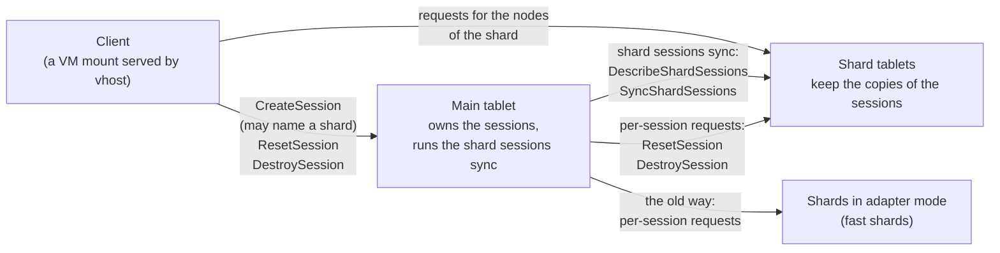
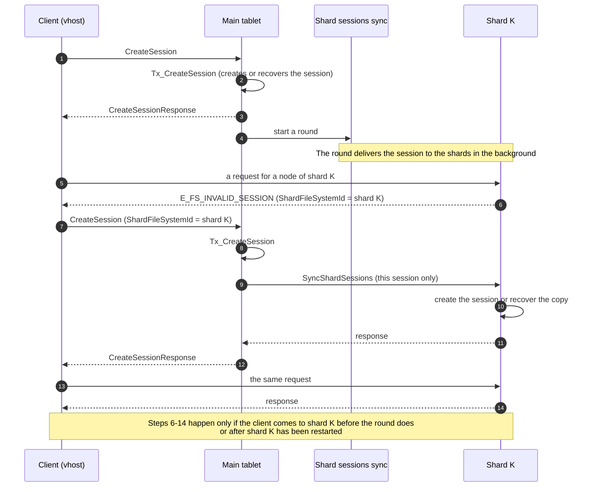
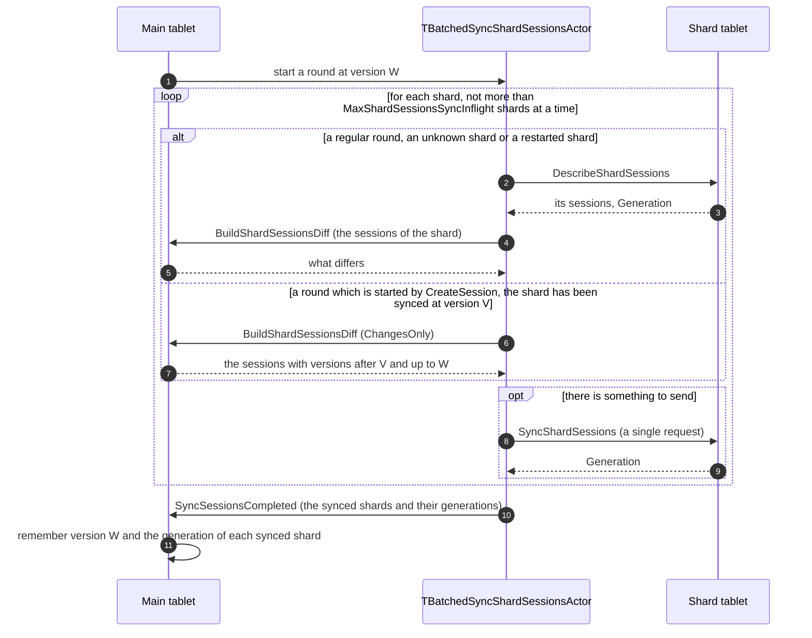

# Lazy shard sessions

Status: proposal.

## Problem

Each mount (VM) creates a session in the main tablet. The main tablet creates
the session in each of the shards and responds only after all the shards have
responded (see "CRUD and Session Management" in [sharding.md](sharding.md)).
`ResetSession` (vhost sends it upon FUSE init and destroy) and
`DestroySession` are sent to all the shards the same way.

So a mount costs two requests per shard (CreateSession and DestroySession).
If 1000 VMs start simultaneously and the filesystem has 25K shards, the main
tablet sends 50M requests to the shards at once. It gets overloaded, the
requests time out and the retries add more load.

## Idea

The main tablet remains the only owner of the sessions, the shards keep the
copies. `CreateSession` becomes lazy: the main tablet responds without
waiting for the shards. A shard gets the session in the background from the
shard sessions sync or, if a client comes to the shard earlier, upon the
request of this client.

1. `CreateSession` runs its transaction in the main tablet, starts the shard
   sessions sync and responds. No shard is contacted before the response.
2. The sync works in rounds. A round sends one `SyncShardSessions` request
   per shard at most and processes a limited number of shards at a time. Any
   number of simultaneous `CreateSession` requests share the same round.
3. Each session has a version. The main tablet remembers which version each
   shard has been synced at and sends only what is newer. A regular round
   (the existing schedule, `IdleSessionTimeout / 3`) asks each shard for its
   sessions and fixes any discrepancy.
4. A client may come to a shard which doesn't have its session yet or has
   been restarted: the request fails with `E_FS_INVALID_SESSION`. The client
   sends `CreateSession` to the main tablet again, as it does now, but names
   the shard in the request. The main tablet sends the session to this shard
   only - there is no fan-out to all the shards - and the client retries the
   request.
5. `ResetSession` and `DestroySession` keep their semantics: the main tablet
   sends them to all the shards and responds after all the shards have
   responded. They are to be handled later.

| 1000 simultaneous mounts, 25K shards | Current | Proposed |
| --- | --- | --- |
| `CreateSession`: requests to shards | 25M, the clients wait for all of them | a few rounds in the background, 25K small requests each at most; one request per shard which a client comes to before the sync does |
| `CreateSession`: duration | a fan-out to all the shards | a transaction of the main tablet |
| `ResetSession`, `DestroySession` | 25M requests to shards each | not changed |

The regular rounds stay expensive (a shard returns all its sessions), but
they run once in 20 minutes by default, not upon each change.

The shards which work in adapter mode can't process the requests of the
sync: their sessions are still managed by the per-session requests, and
`CreateSession` waits for these shards the way it does now.

## CreateSession

* **CreateSession.** The transaction of the main tablet creates or recovers
  the session the way it does now, the response is sent right after it. If
  the transaction has created the session or has recovered it for a client
  which has started anew (vhost has been restarted, a VM is being migrated),
  the session gets a new version and a round is started.
* **CreateSession for a shard.** A response of a shard with
  `E_FS_INVALID_SESSION` carries the filesystem id of the shard. The client
  does what it does now upon this error - establishes the session via the main
  tablet and retries the request - but passes the id of the shard in
  `CreateSession` (`ShardFileSystemId`). The main tablet runs the same
  transaction and sends the session to this shard only: a `SyncShardSessions`
  request with a single session, out of the rounds. The shard creates the
  session or makes its copy active with the same subsessions that the main
  tablet has. The response waits for this shard only. It's the same client,
  so the transaction normally changes nothing and no round is started.
* **Requests of the tablets.** The requests which a tablet sends to a shard
  on behalf of a client (`CreateNode`, `UnlinkNode`, `GetNodeAttr`,
  `RenameNodeInDestination` and the like) are processed by the shard without
  a session, so they don't depend on whether the shard has got the session.
  The requests which need a session in a shard come from the client, so it's
  the client that gets `E_FS_INVALID_SESSION`.
* **Unconfirmed writes.** A tablet which recovers a session upon
  `CreateSession` drops the unconfirmed writes of this session: the previous
  incarnation of the client will not confirm them, and a tablet which gets
  restarted applies all the unconfirmed writes which it finds. Now the client
  gets the response before the shards do it: a shard drops these writes when
  it gets the recovered session (it's marked as `Interrupted`) from a round
  or from a `CreateSession` for this shard. Until then the shard gets rid of
  such a write on its own - when the pipe of the previous incarnation gets
  disconnected or when `GenerateBlobIdsReleaseCollectBarrierTimeout` (10 s)
  expires. If the shard is restarted before any of this happens, it may apply
  the write over the data which the new incarnation has already written to
  the same range. This needs the unconfirmed writes to be enabled
  (`AddingUnconfirmedDataEnabled`, off by default). A write of a client which
  is still there is not lost: its confirmation fails and it falls back to a
  regular write.

## ResetSession and DestroySession

They are processed the way they are now: the transaction of the main tablet,
then a per-session request to each shard, the response after all the shards
have responded.

One thing is added. A shard which doesn't have the session fails
`ResetSession` with `E_FS_INVALID_SESSION` and that fails the whole request,
and a shard which gets the session from a round after `DestroySession` keeps
it until a regular round. So the main tablet rejects `ResetSession` and
`DestroySession` (`E_REJECTED`, the client retries) while the sync still has
to deliver this session to some of the shards. It means that a mount (vhost
sends `ResetSession` upon FUSE init) still waits until the session is in all
the shards, unlike `CreateSession`.

## Sync rounds

* **When a round is started.** By the regular schedule; right away when
  `CreateSession` has created a session or has changed its subsessions;
  `ShardSessionsSyncDelay` after a round which hasn't delivered a session to
  some of the shards. Only one round runs at a time.
* **What a shard gets from a round which is started by CreateSession.** The
  sessions which are newer than the version of the shard. A shard which has
  nothing to get is not contacted at all.
* **When a shard is compared in full.** By each regular round. By any round
  if the main tablet knows nothing about the shard (the main tablet has been
  restarted) or if the shard has been restarted - the generation in its
  response is not the remembered one, and none of its sessions is active
  until the main tablet recovers them. The comparison sends the sessions
  which are missing, not active or have other subsessions, and destroys the
  sessions which are unknown to the main tablet.
