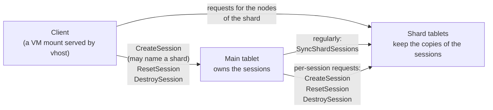
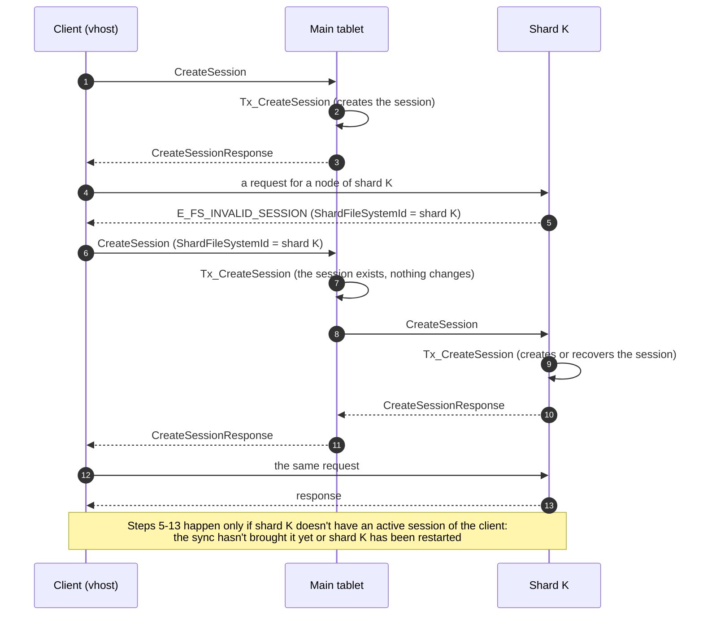

# Lazy shard sessions

Status: proposal.

## Problem

Each mount (VM) creates a session in the main tablet. The main tablet creates
the session in each of the shards and responds only after all the shards have
responded (see "CRUD and Session Management" in [sharding.md](sharding.md)).
`ResetSession` (vhost sends it upon FUSE init and destroy) and
`DestroySession` are sent to all the shards the same way.

So a mount costs two requests per shard (CreateSession and DestroySession).
If 1000 VMs start simultaneously and the filesystem has 25K shards, the main
tablet sends 50M requests to the shards at once. It gets overloaded, the
requests time out and the retries add more load.

## Idea

The main tablet remains the only owner of the sessions, the shards keep the
copies. The creation of a new session becomes lazy: the main tablet responds
without going to the shards. A shard gets the session when the client comes
to it, or from the regular sync. Everything else works the way it does now.

1. `CreateSession` which creates a new session runs its transaction in the
   main tablet and responds. No shard is contacted.
2. A client may come to a shard which doesn't have its session: the request
   fails with `E_FS_INVALID_SESSION`. The client sends `CreateSession` to the
   main tablet again, as it does now, but names the shard in the request. The
   main tablet creates the session in this shard only - there is no fan-out
   to all the shards - and the client retries the request.
3. `SyncShardSessions` is launched regularly, more often than now, and syncs
   the current state of the main tablet with the shards in batches.
4. The sync and the changes of the sessions don't overlap. The sync is not
   started until a change of a session (it's created with new parameters,
   reset or destroyed) is completed, and such a request is rejected until the
   sync is complete.
5. `CreateSession` for an existing session (the client recovers it, a VM is
   being migrated), `ResetSession` and `DestroySession` keep their semantics:
   the main tablet sends them to all the shards and responds after all the
   shards have responded. `ResetSession` and `DestroySession` are to be
   handled later.

| 1000 simultaneous mounts, 25K shards | Current | Proposed |
| --- | --- | --- |
| `CreateSession`: requests to shards | 25M, the clients wait for all of them | one per shard which a client comes to; the regular sync does the rest in batches |
| `CreateSession`: duration | a fan-out to all the shards | a transaction of the main tablet |
| `ResetSession`, `DestroySession` | 25M requests to shards each | not changed |

## CreateSession

* **A new session.** The transaction of the main tablet creates the session,
  the response is sent right after it. The shards are not contacted.
* **An existing session.** `CreateSession` for a session which the main
  tablet already has works the way it does now: the main tablet sends it to
  all the shards and responds after all the shards have responded. It happens
  when the client recovers the session (vhost or the main tablet has been
  restarted) or when a VM is being migrated and its new vhost adds a
  subsession. The shards need it: a shard which doesn't know the new
  subsession would take `DestroySession` of the old one for the destruction
  of the whole session.
* **CreateSession for a shard.** A response of a shard with
  `E_FS_INVALID_SESSION` carries the filesystem id of the shard. The client
  does what it does now upon this error - establishes the session via the main
  tablet and retries the request - but passes the id of the shard in
  `CreateSession` (`ShardFileSystemId`). The main tablet runs the same
  transaction and sends `CreateSession` to this shard only - the per-session
  request which it sends to all the shards now. The response waits for this
  shard only. Such a request doesn't change the session, so the other shards
  have nothing to get, and it's not rejected during the sync.
* **Requests of the tablets.** The requests which a tablet sends to a shard
  on behalf of a client (`CreateNode`, `UnlinkNode`, `GetNodeAttr`,
  `RenameNodeInDestination` and the like) are processed by the shard without
  a session, so they don't depend on whether the shard has got the session.
  The requests which need a session in a shard come from the client, so it's
  the client that gets `E_FS_INVALID_SESSION`.

## ResetSession and DestroySession

They are processed the way they are now: the transaction of the main tablet,
then a per-session request to each shard, the response after all the shards
have responded. They are to be handled later.

A shard may not have the session now. Such a shard has nothing to reset or
destroy and responds with success (it already does so for `DestroySession`).

## Shard sessions sync

`SyncShardSessions` is launched regularly. It syncs the current state of the
main tablet with the shards: creates the sessions which a shard doesn't have
or which are not active there, updates the ones which differ and destroys
the ones which the main tablet doesn't have. It works in batches: a shard
gets everything in a single request instead of a request per session, and a
limited number of shards is processed at a time.

Now the sync is launched once in `IdleSessionTimeout / 3` (20 minutes by
default). It should be launched more often after the change: the sync becomes
the only way for a new session to get to the shards which its client hasn't
come to.

The sync and the changes of the sessions don't overlap:

* The sync is not started while a session is being changed. A `CreateSession`
  which creates a session or changes its parameters, a `ResetSession` or a
  `DestroySession` has to be completed first, including its requests to the
  shards.
* Such a request is rejected (`E_REJECTED`, the client retries it) until the
  sync is complete.

The shards which work in adapter mode (fast shards) can't process the batched
requests: the sync manages their sessions by per-session requests, the way it
does now.
