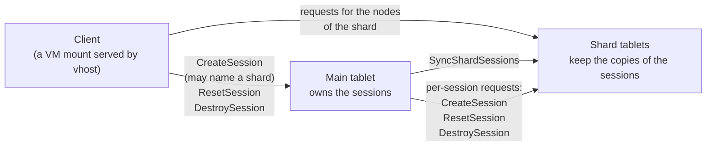
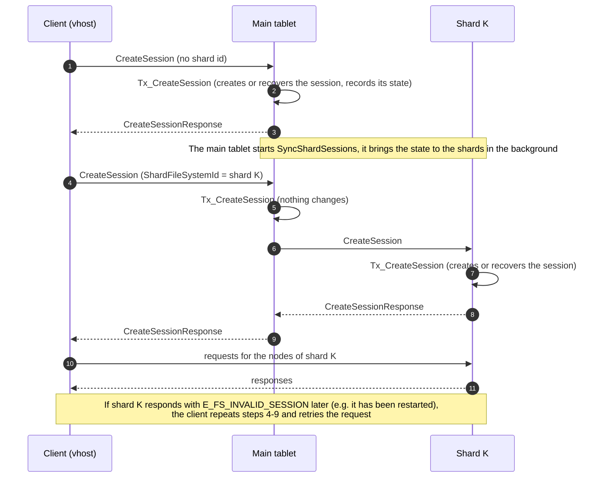

# Lazy shard sessions

Status: proposal.

## Problem

Each mount (VM) creates a session in the main tablet. The main tablet creates
the session in each of the shards and responds only after all the shards have
responded (see "CRUD and Session Management" in [sharding.md](sharding.md)).
`ResetSession` (vhost sends it upon FUSE init and destroy) and
`DestroySession` are sent to all the shards the same way.

So a mount costs two requests per shard (CreateSession and ResetSession).
If 1000 VMs start simultaneously and the filesystem has 25K shards, the main
tablet sends 50M requests to the shards at once. It gets overloaded, the
requests time out and the retries add more load.

## Idea

The main tablet remains the only owner of the sessions, the shards keep the
copies. `CreateSession` doesn't go to all the shards anymore unless it
changes the parameters of an existing session. The main tablet records the
state of the session and starts the sync, and the client asks the main tablet
to bring the session to a concrete shard before it uses this shard.
Everything else works the way it does now.

1. `CreateSession` which creates a new session or recovers an existing one
   (the client has been restarted) carries no shard id. The main tablet runs
   its transaction, records the state of the session - for a recovery it's at
   least the timestamp, even if nothing else has changed - and responds. Then
   it starts the sync. No shard is contacted before the response.
2. Before the client uses a concrete shard, it sends `CreateSession` for this
   shard through the main tablet. The main tablet syncs the session with the
   shard synchronously: the request waits only for `CreateSession` to this
   concrete shard, not to all the shards. After that the client can use the
   shard.
3. If the shard responds with `E_FS_INVALID_SESSION` later, the client does
   the same: it sends `CreateSession` for this shard through the main tablet
   again and retries the request.
4. `SyncShardSessions` syncs the current state of the main tablet with the
   shards in batches. It's launched by `CreateSession` (1) and regularly,
   more often than now.
5. The sync and the requests which go to all the shards don't overlap. The
   sync is not started until a change of a session (it's created with new
   parameters, reset or destroyed) is completed, and such a request is
   rejected until the sync is complete.
6. `CreateSession` which changes the parameters of an existing session (a VM
   is being migrated), `ResetSession` and `DestroySession` keep their
   semantics: the main tablet sends them to all the shards and responds after
   all the shards have responded. `ResetSession` and `DestroySession` are to
   be handled later.

| 1000 simultaneous mounts, 25K shards | Current | Proposed |
| --- | --- | --- |
| `CreateSession`: requests to shards | 25M, the clients wait for all of them | one per shard which a client uses; the sync does the rest in batches |
| `CreateSession`: duration | a fan-out to all the shards | a transaction of the main tablet |
| `ResetSession`, `DestroySession` | 25M requests to shards each | not changed |

## CreateSession

* **CreateSession without a shard.** The client sends it when it starts and
  after its restart. The transaction of the main tablet creates the session
  or recovers it and records its state: a recovery updates the timestamp of
  the session (`RecoveryTimestampUs`) even if nothing else has changed. The
  response is sent right after the transaction. Then the main tablet starts
  the sync, which brings the state to the shards.
* **CreateSession for a shard.** Before its first request to a shard after a
  start or a restart, the client sends `CreateSession` with the id of the
  shard (`ShardFileSystemId`) to the main tablet. The main tablet syncs the
  session with this shard: it sends `CreateSession` to the shard - the
  per-session request which it sends to all the shards now - and responds
  after the shard has responded. The request is synchronous, but it waits for
  this concrete shard only. It doesn't change the state of the session in the
  main tablet, so it doesn't start the sync and is not rejected during it.
  The shard creates the session or recovers its copy, and a tablet which
  recovers a session drops the unconfirmed writes of the previous incarnation
  of the client. So the client never uses a shard which doesn't know that the
  client has been restarted.
* **Invalid session.** A shard may fail a request with `E_FS_INVALID_SESSION`
  later, e.g. after its restart, when its copy of the session is not active
  anymore. The client sends `CreateSession` for this shard through the main
  tablet again, the main tablet synchronously sends it to the shard, and the
  client retries the request.
* **New parameters.** `CreateSession` which changes the parameters of an
  existing session works the way it does now: the main tablet sends it to
  all the shards and responds after all the shards have responded. It happens
  when a VM is being migrated and its new vhost adds a subsession with a new
  `MountSeqNumber`. The shards need it: a shard which doesn't know the new
  subsession would take `DestroySession` of the old one for the destruction
  of the whole session.
* **Requests of the tablets.** The requests which a tablet sends to a shard
  on behalf of a client (`CreateNode`, `UnlinkNode`, `GetNodeAttr`,
  `RenameNodeInDestination` and the like) are processed by the shard without
  a session, so they don't depend on whether the shard has got the session.
  The requests which need a session in a shard come from the client.

## ResetSession and DestroySession

They are processed the way they are now: the transaction of the main tablet,
then a per-session request to each shard, the response after all the shards
have responded. They are to be handled later.

A shard may not have the session now. Such a shard has nothing to reset or
destroy and responds with success (it already does so for `DestroySession`).

## Shard sessions sync

`SyncShardSessions` syncs the current state of the main tablet with the
shards: creates the sessions which a shard doesn't have or which are not
active there, updates the ones which differ and destroys the ones which the
main tablet doesn't have. It works in batches: a shard gets everything in a
single request instead of a request per session, and a limited number of
shards is processed at a time.

The sync is launched when `CreateSession` has created or recovered a session
(if the sync is running, it's launched again after it completes) and
regularly. Now the regular sync is launched once in `IdleSessionTimeout / 3`
(20 minutes by default). It should be launched more often after the change:
the copies of the shards are kept up to date only by the sync now.

The sync and the requests which go to all the shards don't overlap:

* The sync is not started while such a request is being processed. A
  `CreateSession` which changes the parameters of an existing session, a
  `ResetSession` or a `DestroySession` has to be completed first, including
  its requests to the shards.
* Such a request is rejected (`E_REJECTED`, the client retries it) until the
  sync is complete.

`CreateSession` without a shard and `CreateSession` for a shard are not
rejected during the sync: they don't go to all the shards.

The shards which work in adapter mode (fast shards) can't process the batched
requests: the sync manages their sessions by per-session requests, the way it
does now.
