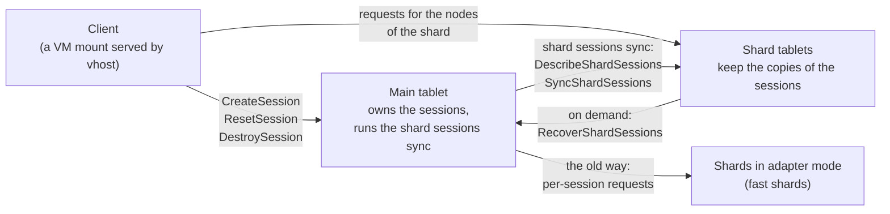
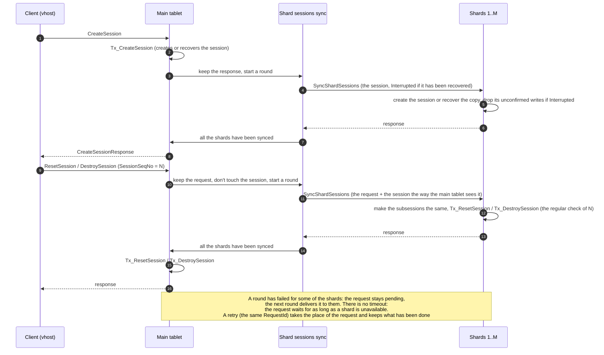
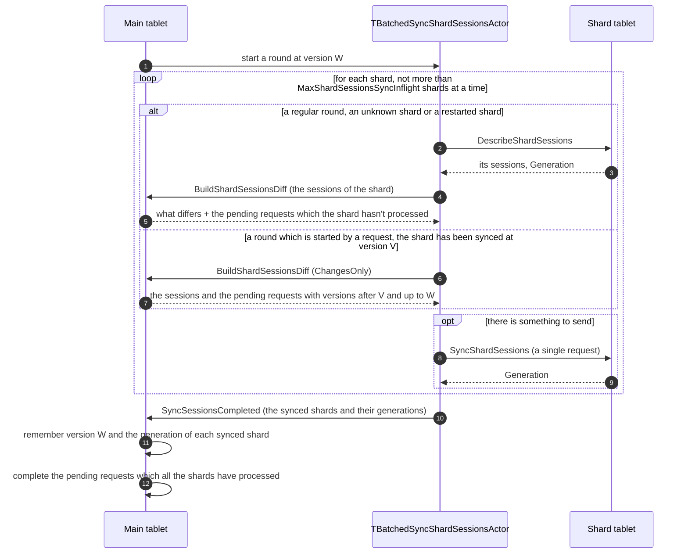

# Shard sessions sync: session requests in batches

Status: proposal.

## Problem

Each mount (VM) creates a session in the main tablet. The main tablet creates
the session in each of the shards and responds only after all the shards have
responded (see "CRUD and Session Management" in [sharding.md](sharding.md)).
`ResetSession` (vhost sends it upon FUSE init and destroy) and
`DestroySession` are sent to all the shards the same way.

So a mount costs two requests per shard. If 1000 VMs start simultaneously and
the filesystem has 25K shards, the main tablet sends 50M requests to the
shards at once. It gets overloaded, the requests time out and the retries add
more load.

## Idea

The main tablet remains the only owner of the sessions, the shards keep the
copies. A request per session per shard is replaced with the shard sessions
sync: a single place which sends one batched request per shard with
everything that all the clients are waiting for. What the clients see doesn't
change: a session request is acknowledged only after all the shards have
processed it.

1. The sync works in rounds. A round sends one `SyncShardSessions` request
   per shard at most and processes a limited number of shards at a time.
2. `CreateSession`, `ResetSession` and `DestroySession` become pending in the
   main tablet and start a round right away. The client gets the response
   when all the shards have processed the request. Any number of simultaneous
   requests share the same round.
3. `CreateSession` is processed by the main tablet first: that's what tells
   which session the shards should get. `ResetSession` and `DestroySession`
   are processed by the shards first and by the main tablet last, so all of
   them decide against the same subsessions.
4. Everything that the shards should get has a version. The main tablet
   remembers which version each shard has been synced at and sends only what
   is newer, so a round which is started by a request asks the shards for
   nothing. A regular round (the existing schedule, `IdleSessionTimeout / 3`)
   asks each shard for its sessions and fixes any discrepancy.
5. A request has no timeout: it waits for as long as some of the shards are
   unavailable. A shard has to process a request only once, so the request
   is completed as soon as each shard has been reached once.
6. The requests are idempotent: a client may retry a request at any moment.
   A retry is recognized by the request id, it doesn't start over and is not
   taken for a client which has started anew.
7. An independent improvement: a shard which has no active session for a
   request of a client (e.g. after its restart) requests the session from
   the main tablet instead of failing the request.

| 1000 simultaneous mounts, 25K shards | Current | Proposed |
| --- | --- | --- |
| requests to shards | 25M `CreateSession` + 25M `ResetSession` | a few rounds, 25K small requests each at most |
| duration of a mount | two fan-outs to all the shards | at least two rounds |

The regular rounds stay expensive (a shard returns all its sessions), but
they run once in 20 minutes by default, not upon each change.

The shards which work in adapter mode can't process the requests of the
sync: their sessions are still managed by the per-session requests.

## Session requests

* **Pending requests.** Such a request is kept in the main tablet
  (`PendingShardSessionRequests`, at most one per session) and gets a
  version. A round delivers the requests which arrived before its start. The
  ones which arrive during a round wait for the next one, which is started
  right away: N simultaneous requests cost two rounds at most. If a round
  fails for some of the shards, the request stays pending and the next round
  is started `ShardSessionsSyncDelay` later. The shards which have already
  processed the request don't get it again.
* **CreateSession.** The transaction of the main tablet creates or recovers
  the session, the response waits until the round delivers the session to
  all the shards: a shard creates the session or makes its copy active with
  the same subsessions. If the transaction has recovered an existing session
  and the request is not a retry (the client has started anew: vhost has
  been restarted, a VM is being migrated), the session is marked as
  `Interrupted` and the shard drops its unconfirmed writes before it
  responds - the same thing a tablet does when it recovers a session upon
  `CreateSession` itself. One more `CreateSession` for the same session takes
  the place of the pending one.
* **Why CreateSession is not lazy.** Replying before the shards have got the
  session would save a round per mount. But a client which recovers its
  session repeats the requests which its previous incarnation hasn't
  completed and goes on, while a shard may still keep an unconfirmed write of
  that incarnation: the blobs are written, the write is not confirmed. A
  shard which gets restarted applies all the unconfirmed writes which it
  finds, so that write would be applied over the data which the new
  incarnation has written to the same range later - an acknowledged write
  would be lost. So each shard has to drop these writes before the client
  gets the session back, and only the main tablet knows that the session has
  been recovered. A write of a client which is still there is not lost: its
  confirmation fails and it falls back to a regular write.
* **ResetSession and DestroySession.** The main tablet doesn't touch the
  session upon the arrival of the request. The request gets to a shard
  together with the session the way the main tablet sees it: the shard makes
  the subsessions of its copy the same and runs the regular transaction with
  the regular check - the session is reset / destroyed if `SessionSeqNo` is
  the seqno of its last read-write client, otherwise `ResetSession` is
  ignored and `DestroySession` removes just the subsession. Nothing is
  forced. When all the shards are done, the main tablet runs the same
  transaction. Until then the session is frozen: the other session requests
  for it (except the retries of this one) are rejected with `E_REJECTED` and
  the sync doesn't send it on its own.
* **No timeout.** A pending request waits for as long as some of the shards
  are unavailable: the main tablet neither fails it nor completes it without
  a shard. A shard has to process a request only once - the main tablet
  remembers the version which each shard has been synced at - so a request
  is completed as soon as each shard has been reached once, even if each
  round fails for some of the shards. A deadline would throw this progress
  away, and a client which doesn't want to wait may retry on its own. The
  cleanup of idle sessions sends `DestroySession` as well, but it doesn't
  wait for these requests: the next cleanup is run on schedule and skips the
  sessions which are still being destroyed.
* **Retries.** A session request carries `Headers.RequestId` - the id which
  the tablet already uses to deduplicate the requests for the nodes. The
  client library generates it once per request and sends it with each
  attempt. The service passes it on and uses it when it repeats the request
  itself: the session actor does it each time it reconnects to the tablet.
  The main tablet compares it with the id of the pending request of the
  session and with the ids of the last requests which have been completed
  for the session (kept in memory):
  * a retry of a pending request takes its place and keeps its version: the
    response goes to the new attempt, the shards which have processed the
    request are not waited for once again;
  * a retry of a completed request is acknowledged right away, without a
    round. `CreateSession` makes sure that the shards still have what the
    request has left: if the session has changed since then, it's delivered
    once again. `ResetSession` and `DestroySession` are not repeated - that
    would also drop what the client has done since then;
  * a retry of `CreateSession` comes from the same incarnation of the client,
    so it doesn't mark the session as `Interrupted`: the shards have dropped
    the unconfirmed writes of the previous incarnation (or are being told to
    do it) because of the first attempt.

  A request with another id is another request, a request without an id (an
  old client) is never a retry.
* **Adapter mode.** Such shards get the per-session requests from the main
  tablet: `CreateSession` - after the rest of the shards, `ResetSession` and
  `DestroySession` - after the transaction of the main tablet.

## Sync rounds

* **When a round is started.** By the regular schedule; right away when a
  request becomes pending; `ShardSessionsSyncDelay` after a round which
  hasn't delivered a pending request to some of the shards or after a request
  has released its session and has left it alive. Only one round runs at a
  time.
* **What a shard gets from a round which is started by a request.** The
  sessions and the pending requests which are newer than the version of the
  shard. The main tablet doesn't know which shards have a session, so each
  shard gets each request: `ResetSession` / `DestroySession` for a session
  which the shard doesn't have do nothing there. A shard which has nothing
  to get is not contacted at all.
* **When a shard is compared in full.** By each regular round. By any round
  if the main tablet knows nothing about the shard (the main tablet has been
  restarted) or if the shard has been restarted - the generation in its
  response is not the remembered one, and none of its sessions is active
  until the main tablet recovers them. The comparison sends the sessions
  which are missing, not active or have other subsessions, and destroys the
  sessions which are unknown to the main tablet.
* **State.** The versions and the generations of the shards
  (`ShardSyncStates`) and the pending requests are kept in memory. After a
  restart of the main tablet the clients retry their requests and the first
  round compares each shard in full.

## Session recovery on demand

A session is in all the shards by the time its client gets it, so a shard
lacks an active session only if something has gone wrong - usually the shard
has been restarted. Without this mechanism the client gets
`E_FS_INVALID_SESSION` and establishes the session anew. With it the shard
postpones the request, asks the main tablet for the session
(`RecoverShardSessions`, one request per session), recovers it and processes
the postponed requests in the order of their arrival. If the session is not
active in the main tablet, the requests fail with `E_FS_INVALID_SESSION`; if
it's being destroyed or the main tablet is unavailable - with `E_REJECTED`.
