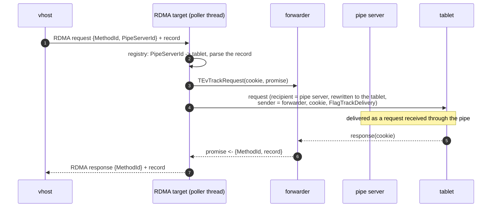
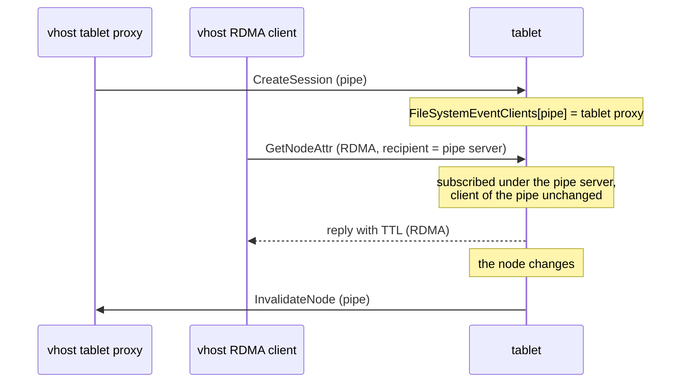

# RDMA channel between filestore-vhost and the index tablet

This document describes the target state of the first version.

Today every request from filestore-vhost to an index tablet goes through the
tablet proxy, the tablet pipe client, the interconnect
and the tablet pipe server. The RDMA channel adds a second transport next to
the pipe: an RDMA queue pair (QP) between vhost and the node of the tablet.
The pipe stays. It remains the control channel and the identity of the client;
the QP carries the hot requests on behalf of the pipe.

## Goals

* Lower latency and CPU per request for the hot requests (GetNodeAttr,
  CreateHandle, the three-stage write, ...) by skipping the tablet proxy, the
  pipe and the interconnect hops.
* No change in the tablet semantics: a request that arrives over RDMA is
  handled exactly as if it came through the client's pipe (sessions,
  unconfirmed data, the duplicate request cache, throttling).
* Safe fallback: any request can go over the pipe instead. The client uses
  RDMA only when the channel is up and the method is allowed.

Non-goals of the first version: replacing the pipe.

## Design summary

* One QP per vhost <-> tablet pipe: the QP is a sidecar of the pipe, with the
  same granularity and lifetime. The pipe server id names the connection.
* The pipe is opened first, as today. The client learns the pipe server id
  (`TEvClientConnected::ServerId`) and connects a QP to the tablet's node.
* Every RDMA request carries an envelope `{MethodId, PipeServerId}` and the
  serialized request record. Until the QP is bound to the pipe at connect time
  ([#7890](https://github.com/ydb-platform/nbs/issues/7890)), the pipe server
  id is sent with every request.
* On the tablet's node, the RDMA handler finds the tablet by the pipe server id
  in a per-node registry and sends the request to the pipe server, rewritten to
  the tablet. The tablet sees a request received through that pipe
  (`ev->Recipient` is the pipe server).
* The tablet replies to a per-node forwarder actor, which completes the RDMA
  request.
* Control requests (CreateSession, DestroySession, ...) and admin, unsafe and
  shard-internal requests stay on the pipe.
* FileSystemEvents: an RDMA request subscribes under its pipe, and the events
  keep going over the pipe (see [FileSystemEvents](#filesystemevents)).
* The tablet forgets the pipe when it disconnects or when the tablet dies; RDMA
  requests for a forgotten pipe are rejected and the client rebinds after it
  reconnects the pipe.
* Any transport failure other than throttling turns RDMA off for the pipe: the
  client resends the request over the pipe and uses RDMA on that pipe again only
  after the pipe reconnects (see [Errors](#errors)).

## Request path

* The forwarder knows the cookie before the tablet's response arrives: a local
  `Send()` adds the event to the recipient's mailbox before it returns, the
  handler sends `TEvTrackRequest` before it sends the request, and the tablet
  can respond only after it has received the request. So the response is added
  to the forwarder's mailbox after `TEvTrackRequest`, and the mailbox delivers
  the events in the order they were added, whatever their senders.
* The handler runs on the RDMA poller thread and never blocks: a registry
  lookup, one parse, two actor sends.

### Wire format

* The core RDMA library message: an 8-byte header (`MsgId`, `Flags`,
  `ProtoLen`, `DataLen`), a proto part and a data part.
* `MsgId` is `TabletRequest = 1` or `TabletResponse = 2`. The method is
  `MethodId` in the envelope: the actor event type, which doesn't fit the 8-bit
  `MsgId`.
* The proto part holds the envelope (`TTabletRdmaRequest {MethodId,
  PipeServerId}` or `TTabletRdmaResponse {MethodId}`), the data part holds the
  record. 

### Registry

* A tablet registers a pipe server on `TEvServerConnected` in StateWork,
  unregisters it on `TEvServerDisconnected`, and unregisters all its pipes in
  `OnTabletDead` and `OnDetach`.
* FastShard adapter not supported yet.
* When an RDMA request reaches the handler, the tablet has always registered
  its pipe already: the client uses RDMA on a pipe only after it gets the
  CreateSession response over that pipe, and the tablet registers the pipe
  before it sends that response:
  * the pipe server puts `TEvServerConnected` into the tablet's mailbox before
    it forwards any request of that pipe, so the tablet registers the pipe
    before it handles CreateSession;
* If the request's pipe is not in the registry, the handler answers
  E_REJECTED, a transport failure: the client turns RDMA off for that pipe (see
  [Errors](#errors)). There are two cases, and the handler can't tell them
  apart:
  * not registered yet: the pipe has just connected and the tablet hasn't
    registered it. This shouldn't happen because of the CreateSession round
    trip above;
  * already gone: the pipe has disconnected, and the client sent an RDMA
    request before it noticed the disconnect.

### Forwarder

* One actor per node; the in-flight requests are keyed by a cookie generated
  by the handler.
* Fails a request when it is not delivered to the tablet, when its tablet
  leaves the registry (`TEvTabletGone`), when the forwarder stops and on a
  timeout.
* The timeout is a leak guard, not a latency limit: an RDMA request that never
  gets an answer keeps its buffers and doesn't let the RDMA session be torn
  down. It is longer than the client timeouts (60 s by default, from config).

### Allowed methods

Over RDMA:

* the service requests (`FILESTORE_SERVICE_REQUESTS`);
* the data-path tablet requests: GenerateBlobIds, AddData, ConfirmAddData,
  CancelAddData, DescribeData, GetNodeAttrBatch, ListNodesInternal.

Everything else stays on the pipe:

* CreateSession: the tablet takes the sender as the session owner and kills
  the old owner upon a session takeover. Over RDMA the sender is the forwarder,
  which serves every client of the node.
* Admin and unsafe requests: the RDMA port is not authenticated ( the same model we assume for interconnect or blockstore rdma. After #7890 it will be associated with pipe at connect time and auth model will be even stronger). RDMA transport for such request will buy nothing, so they stay on pipe right now.
* Shard-internal requests: they are a protocol between the tablets of a
  filesystem, not a client API. (communication between shards also can use RDMA, but it is not the first priority and will be revisited later wether it make sense)

### Errors

The client tells three kinds of errors apart:

1. The tablet's own errors come inside the response record, as over the
   pipe. The RDMA path has worked: the client handles them with its usual retry
   logic and keeps using RDMA.
2. Throttling by the RDMA server (response status `RDMA_PROTO_THROTTLED`): the
   only transport failure the client retries over the same QP.
3. Any other transport failure: the client turns RDMA off for the pipe, resends
   the request over the pipe, and uses RDMA on that pipe again only after the
   pipe reconnects (a new pipe or after backof timeout for retry). 

The transport failures:

| Code | Cases | Source |
|------|-------|--------|
| E_REJECTED | unknown pipe, tablet gone, tablet shutting down, forwarder stopped or unavailable | handler, forwarder |
| E_TIMEOUT | the forwarder timeout | forwarder |
| E_NOT_IMPLEMENTED | method not allowed, unexpected message id, payload response | RDMA target, handler, forwarder |
| E_ARGUMENT | no pipe server id, malformed request, response doesn't fit the client's buffer | RDMA target, handler |
| E_FAIL | exception in the handler | RDMA target |
| E_RDMA_UNAVAILABLE, E_TIMEOUT | endpoint unavailable, request timed out | core RDMA client |

* The server reports a transport failure only for its own failures. A tablet's
  error is always passed through inside the response record.
* So that RDMA is turned off only by real failures:
  * the CreateSession round trip makes sure the pipe is registered before the
    first RDMA request, so "unknown pipe" means the pipe is gone
    (see [Registry](#registry));
  * the client sizes the response buffer for the largest response of the
    method, so "doesn't fit" is a bug.
* A request resent over the pipe after a timeout may execute twice, as with any
  retry after a timeout; the duplicate request cache covers the requests with a
  RequestId.

### Ordering

* The requests of one pipe sent over RDMA and over the pipe are not ordered
  relative to each other, and a QP isn't FIFO either (the core library runs
  small requests at once and larger ones after an RDMA READ).
* The client relies only on request/response ordering: a request that depends
  on another one is sent after its response.

### Unconfirmed data

* The tablet keys unconfirmed data by the pipe server. An RDMA request arrives
  with the pipe server as its recipient, so GenerateBlobIds and ConfirmAddData
  over RDMA keep the unconfirmed data tied to the pipe, and the pipe's
  disconnect cleans it up as today.
* A request that has passed the registry lookup can reach the tablet after the
  pipe's cleanup. Its unconfirmed data then waits for
  `GenerateBlobIdsReleaseCollectBarrierTimeout` (10 s). This window is accepted
  in the first version.

## FileSystemEvents

How subscriptions work is described in
[FileSystemEvents](cache/filesystem_events.md).
Two parts matter here:

* the subscriptions are keyed by the pipe server (`ev->Recipient`);
* the events go to the client actor registered for that pipe server
  (`FileSystemEventClients[pipeServerId] = ev->Sender`), which is the tablet
  proxy of the vhost: it sends every request on the pipe on its own behalf.

An RDMA request subscribes as if it came through the pipe, and the events keep
going over the pipe; only the reply comes over RDMA.

* The subscription key needs no change: an RDMA request already arrives with
  the pipe server as `ev->Recipient`, so the subscriptions and the TTL are
  computed for that pipe.
* The sender of an RDMA request
  is the forwarder, which serves every client of the node; if the tablet
  registered it, the events of the whole pipe would go to the forwarder. So:
  * the handler sets a header flag on every request it forwards, and the tablet
    subscribes such a request under the pipe server without changing the
    client of the pipe;
  * the tablet registers the client of the pipe upon CreateSession, which
    always comes over the pipe before any RDMA request of that pipe (see
    [Registry](#registry)), so the pipe has its client before the first RDMA
    request subscribes.
* The events go over the pipe's interconnect path, as today. Nothing is sent
  over RDMA by the server on its own: the core RDMA library is request/response
  only, and the pipe already gives the delivery and the disconnect
  notification that the events rely on.
* Correctness doesn't change: the reply and the event already reach the client
  cache by different paths, and the client doesn't cache the replies to the
  requests started before an invalidation (tombstones). An RDMA reply is one
  more such path.
* Lifetime doesn't change:
  * pipe lost: the tablet drops the client of the pipe, vhost gets the
    disconnect notification and drops its cache; the registry forgets the pipe
    and its RDMA requests are rejected;
  * QP lost, pipe alive: the events keep flowing; RDMA requests fail and go
    over the pipe.
* Changes: the tablet (`RegisterFileSystemEventClient`, the header flag, the
  registration upon CreateSession) and the handler (sets the flag). The vhost
  cache doesn't change, and the cacheable reads go over RDMA like the other
  allowed methods.

## Connection model

* First version: the QP is bound to the pipe only by the client, which sends
  the pipe server id with every request.
* After #7890 the client sends the pipe server id when it connects the QP. The
  server binds the QP to the pipe: the tablet is resolved once per QP, the
  envelope loses `PipeServerId`, and the server closes the QP when the pipe
  disconnects. This gives a pipe-style client <-> tablet connection with an
  explicit lifetime, and a place for authentication.

## Configuration and rollout

* filestore-server: listening behind a flag, off by default; address `::`, port
  10021; the forwarder timeout (60 s by default).
* filestore-vhost: a separate flag; RDMA only for the allowed methods, with
  fallback to the pipe.
* The servers are rolled out first (listening, idle), then the clients are
  enabled gradually.
