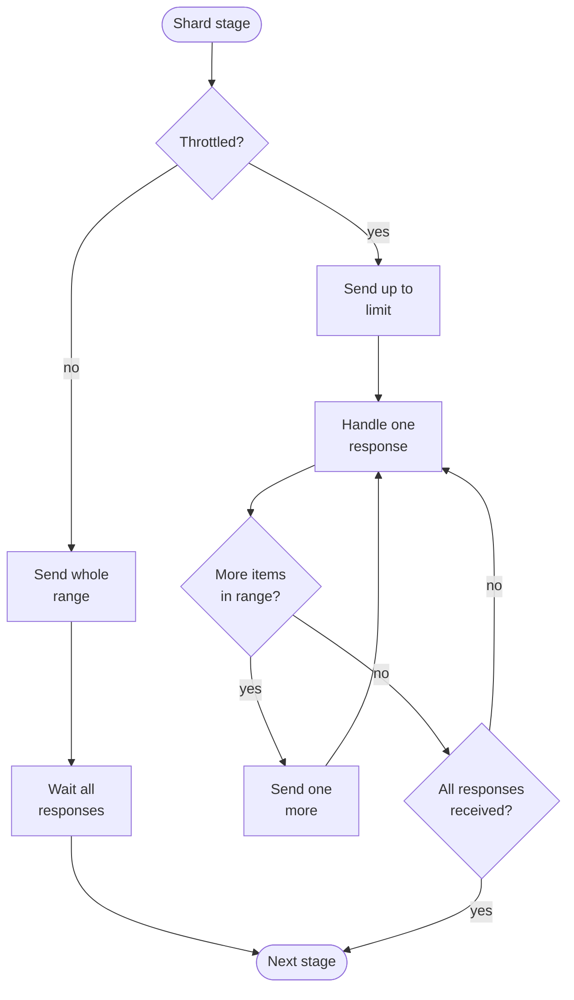
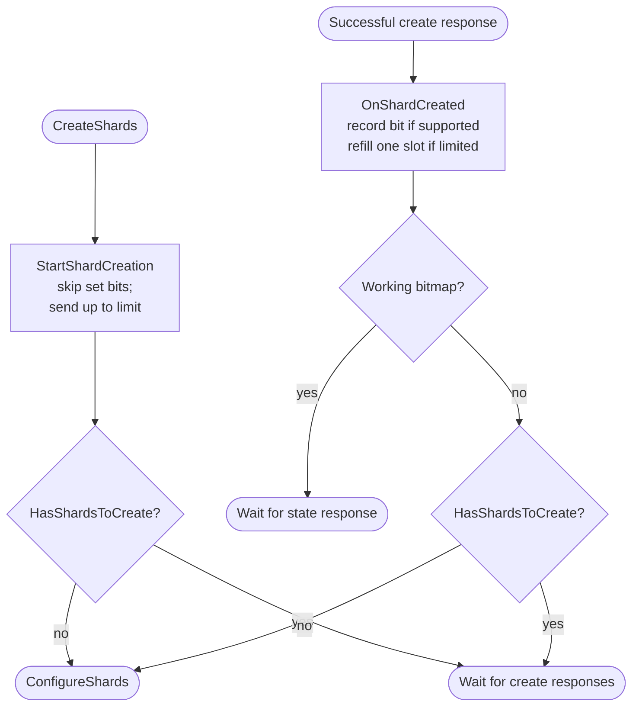
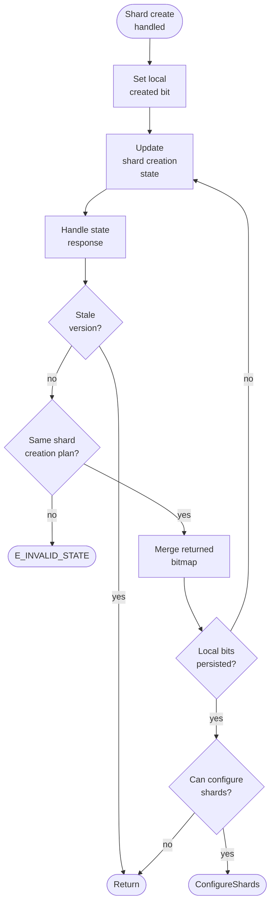

# Filestore resize

Resizing a sharded filesystem is a multi-step operation. A shard can exist in
SchemeShard before it appears in the main filesystem Tablet's topology. If the
resize stops between those steps, a retry must know which shards were already
created.

This document explains that recovery and the limits of concurrent resize
attempts. It covers the resize path of
[the alter actor](../../../cloud/filestore/libs/storage/service/service_actor_alterfs.cpp),
[its shard creation companion](../../../cloud/filestore/libs/storage/service/shard_creation_state_companion.cpp),
and [the main Tablet's state update](../../../cloud/filestore/libs/storage/tablet/tablet_actor_unsafe_node_ops.cpp).

## What happens during a resize?

The actor reads the current filesystem configuration and topology, calculates
the requested shard layout, and updates the main filesystem in SchemeShard.
It may then resize existing shards and create new ones. New shard Tablets are
configured before existing shard Tablets. Finally, the main Tablet receives
the new topology. Until that last step, a newly created shard is not part of
the filesystem topology.

```mermaid
flowchart TD
    Start([Resize]) --> DescribeMain["Describe<br/>main FS"]
    DescribeMain --> ThrottledStart{Throttled?}
    ThrottledStart -->|yes| ReadState["Read<br/>shard creation<br/>state"]
    ReadState --> PrepareLayout["Prepare<br/>target layout"]
    ThrottledStart -->|no| PrepareLayout

    PrepareLayout --> NeedDescribe{Existing shards<br/>need resize?}
    NeedDescribe -->|yes| DescribeShards{{Describe shard<br/>configs<br/>throttled/all}}
    NeedDescribe -->|no| AlterMain["Alter<br/>main FS"]
    DescribeShards --> AlterMain

    AlterMain --> NeedAlter{Existing shards<br/>need resize?}
    NeedAlter -->|yes| AlterShards{{Alter existing<br/>shards<br/>throttled/all}}
    NeedAlter -->|no| MoreCreate
    AlterShards --> MoreCreate

    MoreCreate{More shards<br/>to create?}
    MoreCreate -->|no| AllocateFast
    MoreCreate -->|yes| CreateMode{Throttled?}

    CreateMode -->|no| LegacyCreate{{Create missing<br/>shards: all}}
    LegacyCreate --> AllocateFast

    CreateMode -->|yes| CreateWindow{{Create missing<br/>shards<br/>with limit}}
    CreateWindow --> AllocateFast

    AllocateFast["Allocate fast shards<br/>if needed"] --> ConfigureStart
    ConfigureStart{Configure<br/>shards?}
    ConfigureStart -->|no| ConfigureMain
    ConfigureStart -->|yes| NewShards{New<br/>shards?}
    NewShards -->|yes| ConfigureNew{{Configure new<br/>shards<br/>throttled/all}}
    ConfigureNew --> ExistingLeft{Existing<br/>shards?}
    ExistingLeft -->|yes| ConfigureOld{{Configure old<br/>shards<br/>throttled/all}}
    ExistingLeft -->|no| ConfigureMain
    NewShards -->|no| ConfigureOld
    ConfigureOld --> ConfigureMain

    ConfigureMain{Configure<br/>main FS?}
    ConfigureMain -->|no| Done([Response])
    ConfigureMain -->|yes| ConfigureMainReq["Configure<br/>main FS"]
    ConfigureMainReq --> Done
```

The first question in the diagram selects the request limit. With
`MaxShardManagementRequestsInFlight == 0`, each stage sends its whole range
at once and does not use persistent shard creation progress. With a positive
limit, the actor keeps at most that many shard management requests in flight.
If the main Tablet supports persistent shard creation state, the actor also
records successful shard creations there. An older Tablet can omit that state:
the limit still applies, but progress cannot be recovered from a bitmap.

## How does a retry find its work?

The main Tablet stores a bitmap of shards created by a resize. Bit `i` means
that creation of shard `i` succeeded; the shard may still be absent from the
published topology. On a retry, the actor starts with the current topology
and skips new shard indexes whose bits are set.

The saved progress belongs to a *shard creation plan*: the topology shard count
at the start of that plan, the requested final shard count, and a hash of the
new shard configs. The hash excludes operational fields such as config version
and timestamps, so a retry with the same requested configs identifies the same
plan.

If saved bits exist beyond the current topology, a retry must have the same
plan. A different plan fails with `E_INVALID_STATE`: its shard configs might
not fit shards created by the previous attempt. Once the topology contains all
saved shard indexes, that progress is committed history and a later resize can
start a new plan. If there are no saved bits beyond the topology, the companion
can also prepare a new plan.

A successful create response sets a bit locally and sends an update to the
Tablet. The actor waits until every requested shard is accounted for **and**
its local bits are durable before it starts shard configuration. If every
missing shard was already marked in the saved bitmap, there are no create
responses to wait for and configuration starts immediately.

There is a gap between physical creation and saving its bit. If the actor
stops in that gap, a retry may send the create request again. The bitmap
supports recovery; it does not make shard creation exactly once.

## What if two actors resize the same filesystem?

Reading state and checking the plan do not lock the filesystem. Two actors can
read the same initial state and begin creating shards before either has saved
progress. Preparing a plan locally does not reserve it in the Tablet.

For state updates, the Tablet uses `Version` as a compare-and-swap (CAS)
guard. An update with the current version replaces the saved state and
increments `Version`. An update with an old version changes nothing and
returns the current state **without an error**. The companion then examines
that returned state:

* **Same plan:** it adds the Tablet's bits to its local bitmap. If its own
  created-shard bits are still missing from the saved bitmap, it retries with
  the newer version. For example, if one actor saved shard 2 and the other
  completed shard 3, the retry writes both bits.
* **Different plan:** it compares the starting topology count, final shard
  count, and config hash. If they differ, the actor ends with `E_INVALID_STATE`.
  When both plans create shards, the first saved progress wins this race; an
  actor that started from an older version discovers the conflict in its update
  response.

For example, A and B both read version 10 and prepare different plans. A
creates a shard and saves its bit as version 11. B's update still carries
version 10, so the Tablet leaves A's state intact and returns it to B. B then
sees a different plan and fails. If B starts after A has saved a bit outside
the topology, it fails during initial plan setup instead.

These checks protect saved shard creation progress, not the whole resize.
Both actors may have already sent SchemeShard requests when the conflict is
detected. An attempt that creates no new shards sends no bitmap update, so it
does not repeat the plan comparison at this point.

CAS also checks **only the version**, not the meaning of the new state. The
Tablet validates the serialized bitmap's shape and size, but does not check
that an update keeps previously set bits or the same plan. The no-lost-bits
argument for same-plan concurrency relies on actors merging returned progress
before retrying; a writer with the current version could overwrite it with a
different, well-formed bitmap.

## Why can a response be stale?

Each successful shard create response can send a state update immediately.
Several updates can therefore be in flight from one actor. Responses need not
reach it in the order in which the Tablet processed the updates. If the
companion has already accepted state version 102 and then receives a response
containing version 101, that response is stale *for this actor*. It ignores
the older state rather than rolling back its version or bitmap.

An old **request** and a stale **response** are different things. The Tablet
does not return a CAS error for an old request; it returns its current state.
A stale response is discarded only after the actor has already observed a
newer state. For a current response, the actor compares plans, merges bits,
and retries if its local progress is still missing.

## What happens when an attempt fails?

The caller can retry a failed resize with the same parameters. With
persistent state, the next attempt uses saved bits to skip created shards.
An update error terminates the current attempt; there is no dedicated state
update timeout or retry backoff inside the actor. Repeated CAS conflicts can
lead to repeated updates.

If an unfinished plan has saved shards outside the topology, a request with
different parameters is rejected. There is no automatic cleanup of those
shards or reset of that plan. If retries of the original request are exhausted,
the state and created shards need investigation before a different resize can
proceed.

In legacy mode, or when the Tablet does not support persistent shard creation
state, a retry starts from topology without a saved bitmap. It may reissue
create requests for shards that already exist outside that topology.
