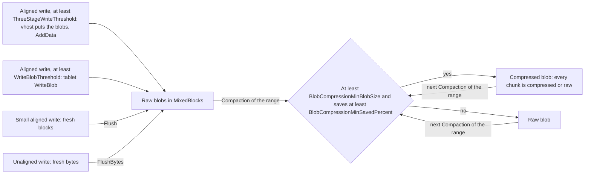
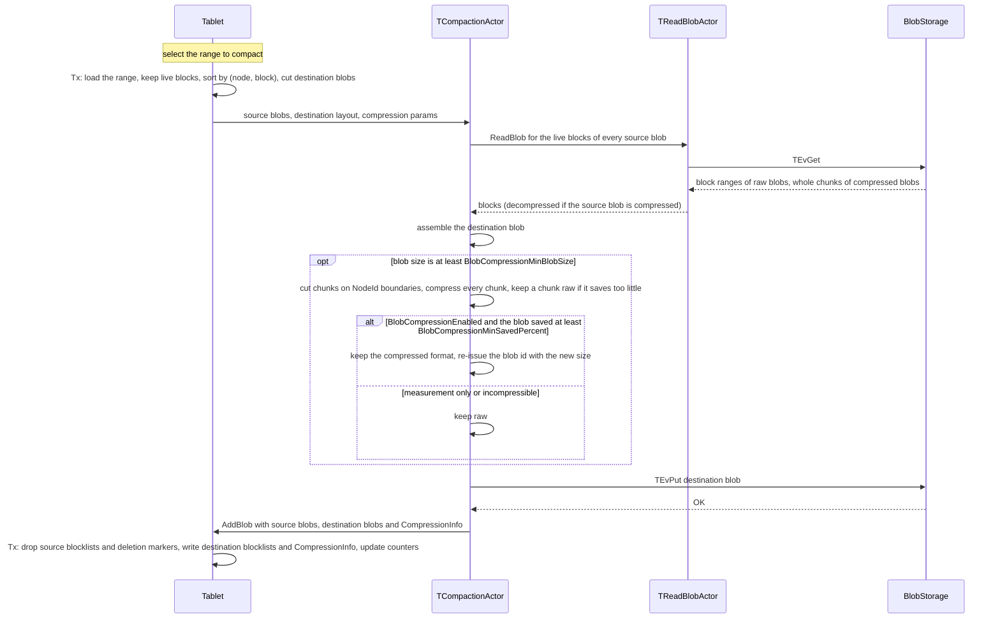
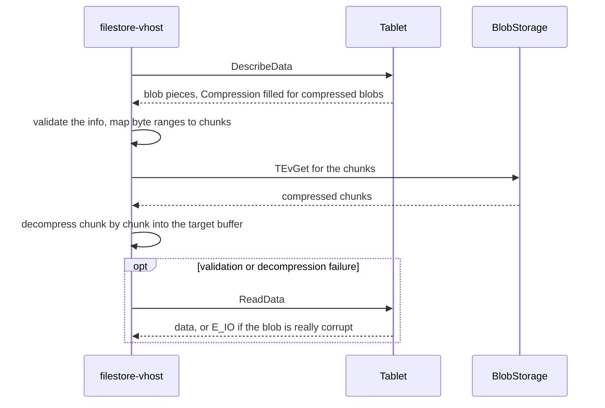

# Blob compression

This document describes the target state of the first version.

Compaction stores the blobs it writes to the [MixedBlocks](data_index.md#mixedblocks) layer in compressed form. Compressed blobs are decompressed on both read paths: in the tablet and in filestore-vhost (two-stage read). The feature is disabled by default and is controlled by `BlobCompressionEnabled` in TStorageConfig.

## Goals

* Save space in BlobStorage for compressible data without changing the BlobStorage API or the garbage collection logic.
* Keep small random reads cheap: reading one block must not require fetching and decompressing a whole blob.

Non-goals of the first version: compressing data on the write path, shared dictionaries, compressing data which Compaction never rewrites (see [Which data gets compressed](#which-data-gets-compressed)).

## Design summary

* Compression happens only in Compaction, inside TCompactionActor and not in the tablet actor. Flush, FlushBytes and three-stage writes always write raw blobs.
* A blob is compressed chunk by chunk with independent chunks (no shared dictionary, no cross-chunk state), so any single block can be read by fetching and decompressing exactly one chunk. A chunk is at most `BlobCompressionChunkSize` and holds whole blocks.
* Chunks are cut on NodeId boundaries: a chunk never holds blocks of two nodes.
* The decision is made per chunk: a chunk is stored compressed only if the codec saves at least `BlobCompressionMinSavedPercent` of its size, otherwise the chunk is stored raw inside the same blob. A blob which saves less than `BlobCompressionMinSavedPercent` in total is written raw as a whole, without metadata. Blobs smaller than `BlobCompressionMinBlobSize` are not compressed. (Currently with one limit, later it can be revisited)
* Compression metadata (codec, compressed and uncompressed size of every chunk) is stored in the MixedBlocks index next to the blocklist, not inside the blob. An empty metadata column means a raw blob, so existing blobs need no changes.
* Readers validate the metadata: the layout is checked against the blob size and the declared length of every chunk is checked before decompression. Any mismatch produces an error and the `BlobDecompressionError` critical event.
* The DescribeData response carries the compression info, and filestore-vhost decompresses on the two-stage read path. There is no capability flag: the readers are deployed before any compressed blob can appear (see [Implementation stages](#implementation-stages)).

## Which data gets compressed

Only the blobs written by Compaction are compressed. Every other writer produces raw blobs:



### What one blob and one chunk contain

Compaction keeps the live blocks of the range, sorts them by (NodeId, BlockIndex) and cuts a destination blob every `MaxBlobSize`. A blob may therefore hold data of several files: a range holds the same 64-block window of up to 16 neighbouring node ids, plus the node groups which collide in the range hash.

A chunk holds data of one file only. Inside a blob a new chunk starts at every NodeId change and after every `BlobCompressionChunkSize` bytes of the same node, so the last chunk of every node may be shorter. Examples for 4 KiB blocks and 16 KiB chunks:

```
A) 16 files of 4 KiB, node ids 96..111                   -> one blob, 64 KiB
   blob:    | f96 | f97 | f98 | f99 | f100 | ... | f111 |
   chunks:  | c0  | c1  | c2  | c3  | c4   | ... | c15  |       16 chunks of 4 KiB, one per file

B) file A = 12 KiB (node 96), file B = 1 GiB (node 97), window 0   -> 268 KiB
   blob:    | A0 A1 A2 | B0 B1 ... B63 |
   chunks:  | A0 A1 A2 | B0..B3 | B4..B7 | ... | B60..B63 |     1 chunk of A (12 KiB), 16 chunks of B
   windows 1..4095 of B: 64 blocks of B only -> 256 KiB, 16 chunks

C) 16 large files, node ids 96..111, any window          -> 4 MiB, 256 chunks
   blob:    | f96: 64 blocks | f97: 64 blocks | ... | f111: 64 blocks |
   16 chunks per file; a hole or a dead block in one file's window
   shortens the last chunk of that file and does not move the chunks of the others
```

Why chunks are cut on NodeId boundaries:

* A chunk which mixes unrelated files can compress much worse than the same data compressed per file, up to making compression useless for that chunk.
* A read of one file does not fetch and decompress blocks of another file.
* The cost is small: at most one extra short chunk per node in the blob

Chunks of one blob have different uncompressed sizes because of this, so the metadata stores the uncompressed size of every chunk (see [Blob format](#blob-format)). A range with fewer live bytes than `BlobCompressionMinBlobSize` stays raw.

### Coverage

A range is rewritten only when Compaction selects it. 

A range with one blob and no garbage is never selected. A large file written once with large sequential writes leaves exactly one raw blob per range (the three-stage write puts one blob per 64-block window), so such data is not compressed by the first version unless a forced compaction (`filestore-client forcedcompaction`) is run. The sampling by `BlobCompressionRate` has the same bias: it measures only the blobs which Compaction writes. Closing this gap is listed in [Future work](#future-work).

## Blob format

Uncompressed blob data is split into chunks. A chunk holds whole blocks of one node and is at most `ChunkSize` bytes. Every chunk is compressed independently with `Codec`. A chunk which saves less than `BlobCompressionMinSavedPercent` is kept raw. The chunks, compressed or raw, are written one after another. The blob id carries the compressed size, so nothing changes for BlobStorage and garbage accounting.

```
uncompressed:  [ chunk 0 | chunk 1 | ... | chunk N-1 ]    UncompressedChunkSizes[i] bytes each, at most ChunkSize
stored:        [ c0 | c1 | ...... | cN-1 ]                 ChunkSizes[i] bytes each, compressed or raw
```

The metadata is `NProtoPrivate::TBlobCompressionInfo`:

| Field | Meaning |
|---|---|
| `Codec` | codec id from the common codec registry (see [Relation to blockstore blob compression](#relation-to-blockstore-blob-compression)) |
| `ChunkSize` | maximum uncompressed chunk size, a multiple of the block size |
| `ChunkSizes[]` | stored size of every chunk, in blob order; `sum == BlobSize`. `ChunkSizes[i] == UncompressedChunkSizes[i]` means that chunk `i` is stored raw |
| `UncompressedChunkSizes[]` | uncompressed size of every chunk, in blob order; each is a multiple of the block size and at most `ChunkSize`; the sum is the uncompressed blob size |
| `reserved 5` (will be added later) | kept for a shared dictionary id (see [Future work](#future-work)) |

Chunk `i` covers uncompressed bytes `[sum(UncompressedChunkSizes[0..i)), +UncompressedChunkSizes[i])` and occupies stored bytes `[sum(ChunkSizes[0..i)), +ChunkSizes[i])`.

A chunk is either compressed or raw:

* `ChunkSizes[i] < UncompressedChunkSizes[i]`: the chunk is compressed. It is a separate NBlockCodecs frame, so its declared uncompressed length can be checked before decompression.
* `ChunkSizes[i] == UncompressedChunkSizes[i]`: the chunk is raw. Its bytes are the data, and a reader copies them without decompression.
* `ChunkSizes[i] > UncompressedChunkSizes[i]` is invalid.

The writer keeps this unambiguous: it stores a chunk compressed only if the frame is smaller than the raw chunk by at least `BlobCompressionMinSavedPercent` (will be guarded to disallow useless compression), so a compressed chunk never has the same size as its data. Readers support raw chunks from the first version, so the per-chunk decision needs no separate rollout.

The format does not depend on how the writer cuts chunks: a reader needs only the two size lists. The rule for cutting (NodeId boundaries, `BlobCompressionChunkSize`) can change later without changing the format.

The codec id is stored per blob, so `BlobCompressionCodec` and `BlobCompressionChunkSize` may be changed at any time: old blobs are still read with the codec they were written with. Storing an id and not an NBlockCodecs name keeps the on-disk format independent of the library naming.

The uncompressed sizes let a reader validate a requested range before issuing any IO and check the exact length of every chunk after decompression. Storing all N stored sizes (rather than N-1 and deriving the last one from the blob size) costs two bytes per blob and makes `sum == BlobSize` a consistency check. (discuss this with right side)

## Storage

* `MixedBlocks` localdb table: new column `CompressionInfo` (serialized `TBlobCompressionInfo`, empty for raw blobs). It is written together with the blocklist and is kept when the blocklist is rewritten (Cleanup, FlushBytes, DeleteCheckpoint).
* The in-memory TMixedBlocks index keeps the serialized info per blob; it is looked up under the transaction which locates the blocks, while the range is loaded.
* The `FileSystem` table gets three persisted counters: `CompressedBlobsCount`, `CompressedBlobsBytes` (physical), `CompressedBlobsLogicalBytes` (uncompressed). They are maintained together with `MixedBlobsCount` / `MixedBlocksCount`.

The metadata of a 4 MiB blob with 16 KiB chunks is 256 compressed sizes and 256 uncompressed sizes, about 1.3 KiB serialized, i.e. about 0.03% of the data.

## Config

TStorageConfig:

| Field | Default | Meaning |
|---|---|---|
| `BlobCompressionEnabled` | `false` | store compressed blobs; when `false` compression is only measured for the blobs sampled by `BlobCompressionRate` |
| `BlobCompressionCodec` | `lz4` | NBlockCodecs codec name used by Compaction; must be a codec from the common registry, e.g. `lz4` (`lz4-fast14-safe`), `zstd_1`, `zstd_3` |
| `BlobCompressionChunkSize` | `16384` | maximum uncompressed chunk size, rounded down to a multiple of the block size (min one block) |
| `BlobCompressionMinSavedPercent` | `12` | minimum saving in percent, applied twice: a chunk is stored compressed only if it saves at least this share of its size, and a blob keeps the compressed format only if it saves at least this share in total |
| `BlobCompressionMinBlobSize` | `16384` | blobs smaller than this are written raw without measuring |
| `BlobCompressionRate` | `0` | measurement only: every N-th blob (by blob id hash) is compressed to update the `*BytesWritten` counters and the result is discarded |

`BlobCompressionEnabled`, `BlobCompressionMinSavedPercent` and `BlobCompressionMinBlobSize` are new. The default of `BlobCompressionChunkSize` changes from 80 KiB to 16 KiB, which changes what the existing sampling measures.


### Why these defaults

The numbers come from the read / compress benchmark published in [#7107](https://github.com/ydb-platform/nbs/issues/7107). They were measured on a test node and are given only for relative comparison. Proper numbers will be added later.

* Chunk size 16 KiB. The tablet serves 4 KiB block reads and the typical guest read is 4-16 KiB, so a chunk is the unit of read amplification. With lz4 a random 4 KiB read costs 3.8 us and fetches 6.1 KiB of compressed data with 16 KiB chunks versus 16.9 us and 23.3 KiB with 64 KiB chunks, while the ratio only drops from 2.75 to 2.63 on text and stays equal on record-like data. 16 KiB is also the Cassandra default chunk length.
* Threshold 12%. Close to the value ZFS uses (a block is stored compressed only if it shrinks by at least 1/8, i.e. 12.5%), RocksDB (`max_compressed_bytes_per_kb = 896`, i.e. 7/8) and Ceph BlueStore (`bluestore_compression_required_ratio = 0.875`). Below that, huge-blob slot rounding in the VDisk eats most of the saving while every read still pays for decompression.
* Min blob size 16 KiB, i.e. one chunk. Smaller blobs are produced only by tiny Compaction runs; the metadata row and the per-read decompression are not worth it. This mirrors F2FS, whose default compression cluster is 16 KiB with partial clusters left raw, and Ceph BlueStore's `bluestore_compression_min_blob_size`.
* lz4. 910 MB/s compression and 2.6x on text on a single core: a 4 MiB blob costs ~4.6 ms of CPU inside the compaction actor. zstd_1 gives 4.8x on text and 2.0x on records but compresses at 510 MB/s and decompresses a 4 KiB read in 12.9 us instead of 3.8 us.

## Write path (Compaction)



What is new compared with Compaction today:

* a destination blob of at least `BlobCompressionMinBlobSize` is cut into chunks and compressed. The blocks are already sorted by (NodeId, BlockIndex); a new chunk starts at every NodeId change and after every `BlobCompressionChunkSize` bytes of the same node. A chunk which saves less than `BlobCompressionMinSavedPercent` is kept raw, and the result is used only if the whole blob saves at least `BlobCompressionMinSavedPercent`;
* a compressed blob gets a new blob id with the new size (same generation, step, channel and cookie); the id reserved before is not written;
* AddBlob carries the compression info of every destination blob and the transaction stores it.

## Tablet read path

The reader (ReadData, Compaction or FlushBytes) passes the compression info from the index to `TReadBlobActor` together with the blocks. For a compressed blob the actor reads the chunks which contain these blocks, decompresses the compressed ones, takes the raw ones as they are and returns the blocks.

If the info is invalid or a chunk cannot be decompressed, the request fails with `E_IO`, the `BlobDecompressionError` critical event and the `BlobDecompressionErrors` counter.

## Two-stage read path (filestore-vhost)



The `DescribeData` response contains the compression info of every compressed blob. filestore-vhost (`TReadDataActor`) reads the chunks which cover the requested byte ranges from BlobStorage, decompresses the compressed ones and copies the raw ones. `TRangeInBlob` offsets stay uncompressed offsets, so the read-ahead cache is not affected.

If the info is invalid or a chunk cannot be decompressed, vhost reports it (`ReadBlobDecompressionErrors`, critical event) and falls back to `ReadData`. The tablet then returns `E_IO` if the blob is really corrupt.

## Metrics

Per filesystem / shard (`component=storage_fs`, summed across shards):

| Sensor | Kind | Meaning |
|---|---|---|
| `UncompressedBytesWritten`, `CompressedBytesWritten`, `ZeroBytesWritten` | rate | bytes seen / produced by the codec / zero bytes, for every compressed or measured blob |
| `CompressedBlobsWritten`, `IncompressibleBlobsWritten` | rate | blobs stored in the compressed format / written raw as a whole because the total saving was below the threshold |
| `CompressedBytesRead`, `DecompressedBytesRead` | rate | tablet read path: compressed bytes fetched / bytes produced |
| `BlobDecompressionErrors` | rate | tablet read path failures (also a critical event) |
| `DescribeDataCompressedBytes` | rate | compressed bytes described to filestore-vhost |
| `CompressedBlobsCount`, `CompressedBlobsBytes`, `CompressedBlobsLogicalBytes` | absolute | persisted counters, also visible via `getstoragestats` |

Per filestore-vhost (`component=service`): `ReadBlobCompressedBytes`, `ReadBlobDecompressedBytes`, `ReadBlobDecompressionErrors`.

Real-time compression ratio: `CompressedBlobsLogicalBytes / CompressedBlobsBytes`; share of compressed blobs: `CompressedBlobsCount / MixedBlobsCount`.

## Compatibility and rollout

* Storage format changes are additive (`MixedBlocks.CompressionInfo`, `FileSystem` counter columns, `TBlobPiece.Compression`). A binary with this feature reads all old data.
* A binary without this feature cannot read a compressed blob (it would treat the payload as raw data). There is no negotiation between vhost and the tablet, so `BlobCompressionEnabled` must be switched on, and the private action must be used, only after every tablet and vhost in the cluster runs a version with the read path.
* Switching the flag off stops producing compressed blobs; existing ones remain readable and are rewritten raw by the next Compaction of their range.
* Corrupt compressed data is a permanent error: reads fail with `E_IO` (the client does not retry it), Compaction of the affected range fails and is re-enqueued exactly like for an unreadable raw blob.

## Relation to blockstore blob compression

Blockstore is adding compression of merged blobs ([#7690](https://github.com/ydb-platform/nbs/issues/7690), [merged_blobs_compression.md](../../../../blockstore/storage/merged_blobs_compression.md)). The two designs share the layout: fixed-size independent chunks, metadata in the index, NBlockCodecs with `lz4-fast14-safe` by default, sampling by `BlobCompressionRate`. The differences between the two designs:

| | Filestore | Blockstore |
|---|---|---|
| Who compresses | Compaction only | Compaction and direct merged writes |
| Chunks | cut on NodeId boundaries, different sizes | fixed size |
| Decision | per chunk: a compressed blob may hold raw chunks | per blob |
| Chunk sizes stored | compressed and uncompressed size of every chunk | N-1 compressed sizes, no uncompressed size |
| Remote readers | vhost, compression info in the DescribeData response | overlay disks ??? |

The codec registry is common for filestore and blockstore and lives in `cloud/storage/core`: the persisted codec ids and their mapping to NBlockCodecs codecs. Blockstore's existing codec table moves there before its format reaches production, and `zstd_1` is added to it. Both services store the same id for the same codec, and a new codec is added in one place.

## Implementation stages

Readers are implemented and deployed first. Automatic compression in Compaction comes last, and `BlobCompressionEnabled` stays `false` by default.

1. Common codec registry in `cloud/storage/core`. Helper library and blob format: `TBlobCompressionInfo`, layout validation, chunk math, per-chunk compress and decompress, new config fields. Nothing uses it yet.
2. Index plumbing: `MixedBlocks.CompressionInfo`, in-memory index, AddBlob carries the info, counters. Every writer passes an empty info.
3. Tablet read path: `TReadBlobActor`, DescribeData for compressed blobs.
4. filestore-vhost two-stage read of compressed blobs.
5. A private API action which compresses the data of one range or one node on request, cutting chunks on NodeId boundaries. Until stage 6 this is the only way a compressed blob can appear, so the readers can be tested and rolled out before anything is compressed automatically.
6. Automatic compression in Compaction; the sampling moves into the same code.
7. Integration test and benchmark.

## Testing

* Helper unit tests: config normalization, the compress / measure / skip decision, round trips, chunks of different sizes, blobs with compressed and raw chunks, chunk span math, thresholds, every validation error, decompression from a fragmented response.
* Tablet unit tests: compaction, chunks cut on NodeId boundaries, blobs which mix compressible and incompressible files, counters, deletion, restart, DescribeData for compressed blobs, FlushBytes over compressed blobs (including unordered fresh bytes), re-compaction, incompressible data, disabled mode.
* Service unit tests: two-stage read of compressed blobs for aligned, unaligned and chunk-crossing ranges, zero-copy reads into iovecs of different sizes, fallback on corrupt and truncated data.
* Integration test with filestore-server and filestore-client: compressible and incompressible files, both read paths, FlushBytes, re-compaction, tablet restart, counters and storage stats.
* Benchmark: codec, chunk size and read cost.

## Future work

Not in the first version:

1. Compress data which Compaction never rewrites (see [Coverage](#coverage)). Options: a throttled background pass which compacts ranges holding raw blobs of at least `BlobCompressionMinBlobSize`; compression on the write path in filestore-vhost, which also makes the puts smaller but adds write latency; forced compaction as a one-off.
2. Verification at write time: decompress every compressed blob and compare it with the source before writing it. A safety flag for the rollout period.
3. Do not compress files smaller than 4 KiB. Compaction blobs mix blocks of many nodes, so TCompactionActor has to know the node sizes (the blocklist gives the node id of a block, but not the node size). The format already allows it: the chunks of such files can be stored raw.
4. Read only the needed blocks of a raw chunk. The first version fetches a raw chunk as a whole, like a compressed one. Fetching only the requested blocks removes the read amplification for raw chunks and does not change the format.
5. Zero chunk markers. A chunk which contains only zero bytes could be stored as `ChunkSizes[i] == 0` and produced on read without fetching anything. The first version rejects empty chunks, so this is a format extension. ZFS treats all-zero blocks as holes for the same reason. Related: turning whole zero blocks into holes before they reach a blob at all.
6. Remember incompressible data. Btrfs sets `NOCOMPRESS` on a file after the first failed attempt. Here it can be an in-memory per-range or per-node mark with a TTL (chunks are already cut per node), so that Compaction does not spend CPU on random or already compressed data.
7. Test shared dictionaries per node, after a benchmark on real data. Field 5 of `TBlobCompressionInfo` is reserved for a dictionary id. This needs a dictionary table in the tablet, a dictionary cache in the tablet and in vhost, a handshake in DescribeData and per-node blob grouping in Compaction. The measurements so far justify it only for files of at least 1-4 MiB with small records; lz4 gains little from a dictionary with 16 KiB chunks.
8. Test compress-then-encrypt per chunk. Chunks are independent and block-aligned, so each compressed chunk can be encrypted separately without changing the layout; the compressed chunk sizes stay in the index.
