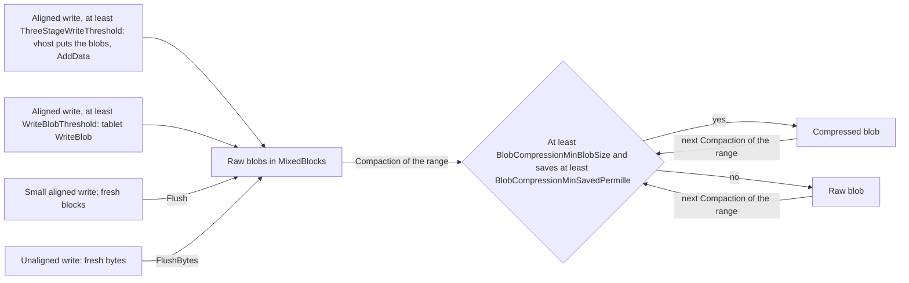
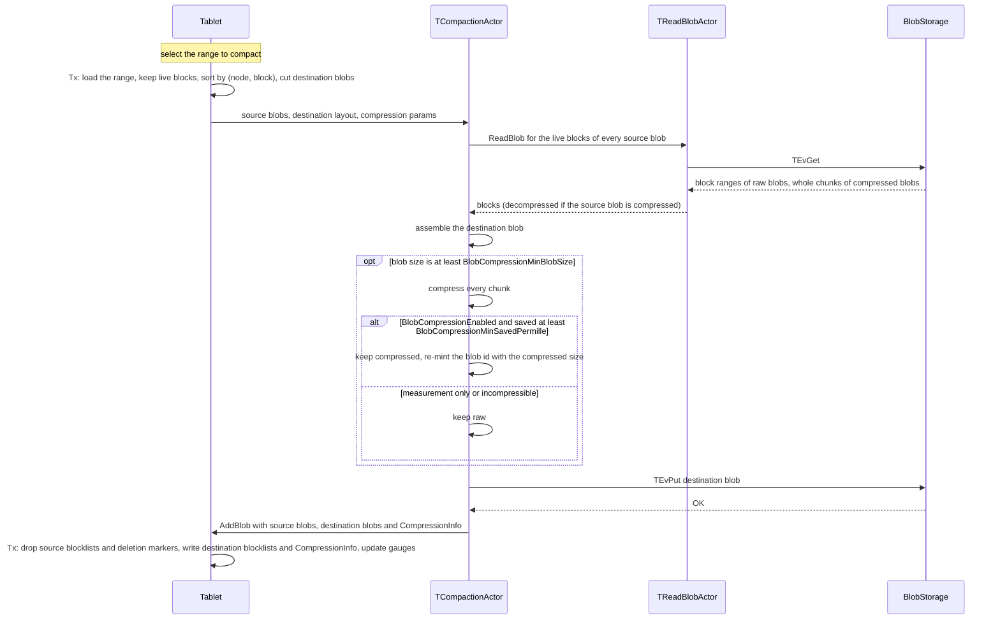
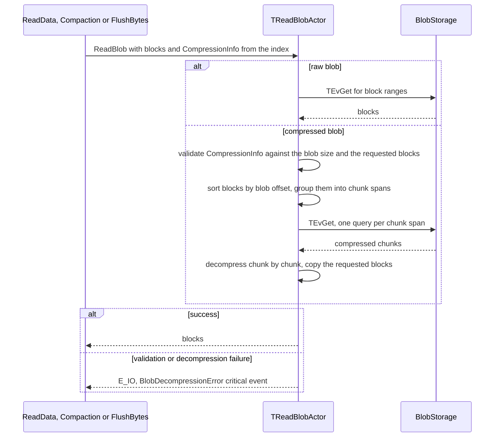
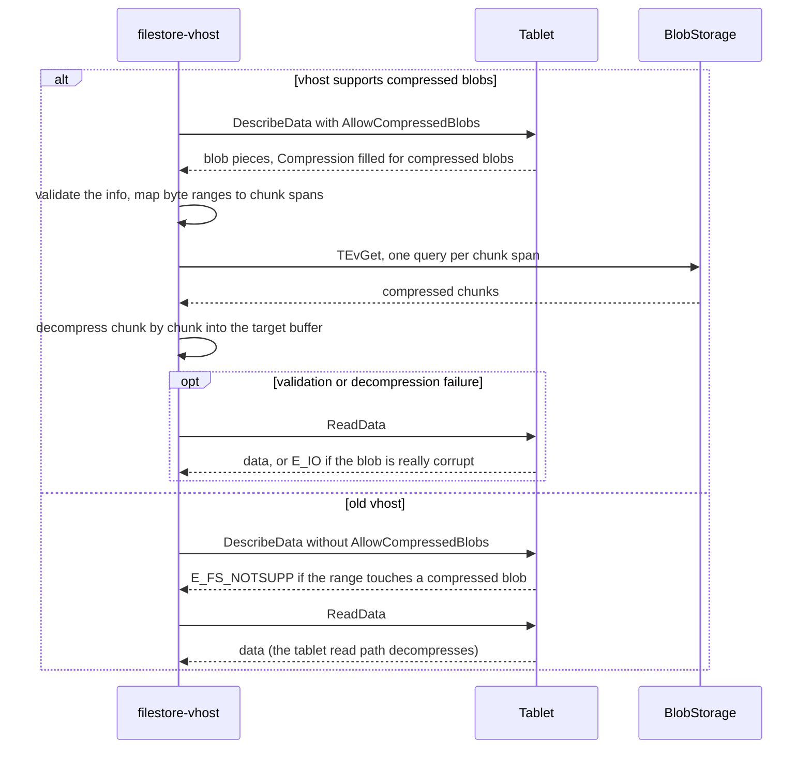

# Blob compression

This document describes the target state of the first version.

Compaction stores the blobs it writes to the [MixedBlocks](data_index.md#mixedblocks) layer in compressed form. Compressed blobs are transparently decompressed on both read paths - inside the tablet and inside filestore-vhost (two-stage read). The feature is disabled by default and is controlled by `BlobCompressionEnabled` in TStorageConfig.

What exists today: `BlobCompressionRate`, `BlobCompressionCodec` and `BlobCompressionChunkSize` make the tablet compress a sample of the blobs written by Compaction and throw the result away, feeding the `UncompressedBytesWritten`, `CompressedBytesWritten` and `ZeroBytesWritten` counters. Nothing is stored compressed.

## Goals

* Save space in BlobStorage for compressible data without changing the BlobStorage API or the garbage collection logic.
* Keep small random reads cheap: reading one block must not require fetching and decompressing a whole blob.
* Keep the tablet safe: corrupt compressed data or bad metadata must produce an error, never a tablet abort.

Non-goals of the first version: compressing data on the write path, shared dictionaries, compressing data which Compaction never rewrites (see [Which data gets compressed](#which-data-gets-compressed)).

## Design summary

* Compression happens only in Compaction, off the tablet(inside TCompactionActor). Flush, FlushBytes and three-stage writes always produce raw blobs
* A blob is compressed chunk by chunk with independent chunks (no shared dictionary, no cross-chunk state), so any single block can be read by fetching and decompressing exactly one chunk. The chunk size is a multiple of the FS block size.
* The decision is made per blob: the blob is stored compressed only if the codec saves at least `BlobCompressionMinSavedPermille` of its size, otherwise it is written raw. Blobs smaller than `BlobCompressionMinBlobSize` are not even tried.
* Compression metadata (codec, chunk size, compressed chunk sizes, uncompressed size) is stored in the MixedBlocks index next to the blocklist, not inside the blob. An empty metadata column means a raw blob, so all pre-existing blobs stay valid.
* Readers never trust the metadata blindly: the layout is validated against the blob size, every chunk's declared length is cross-checked before decompression and any inconsistency is turned into an error plus the `BlobDecompressionError` critical event.
* The two-stage read path negotiates support explicitly: filestore-vhost sets `AllowCompressedBlobs` in DescribeData, and a tablet refuses to describe compressed pieces to a requester which did not set it.

## Which data gets compressed

Only the blobs written by Compaction are compressed. Every other writer produces raw blobs:



### What one blob and one chunk contain

Compaction keeps the live blocks of the range, sorts them by (NodeId, BlockIndex) and cuts a destination blob every `MaxBlobSize`. Compression then cuts the blob into chunks. Nothing aligns chunk boundaries to file boundaries, so both a blob and a single chunk may hold data of several files. Examples for 4 KiB blocks and 16 KiB chunks:

```
A) 16 files of 4 KiB, node ids 96..111                   -> one blob, 64 KiB
   blob:    | f96 | f97 | f98 | f99 | f100 | ... | f111 |
   chunks:  |<------- chunk 0 ------>|<--- chunk 1 ...          4 files per chunk

B) file A = 12 KiB (node 96), file B = 1 GiB (node 97), window 0   -> 268 KiB
   blob:    | A0 A1 A2 | B0 B1 ... B63 |
   chunks:  | A0 A1 A2 B0 | B1..B4 | ... | B61 B62 B63 |        chunk 0 mixes A and B
   windows 1..4095 of B: 64 blocks of B only -> 256 KiB, 16 chunks, one file

C) 16 large files, node ids 96..111, any window          -> 4 MiB, 256 chunks
   blob:    | f96: 64 blocks | f97: 64 blocks | ... | f111: 64 blocks |
   every chunk holds one file, because 64 is a multiple of 4;
   one hole or dead block in a file's window shifts all later chunk boundaries
```

Consequences: reading one block of A in example B also decompresses B0 (bounded by one chunk), chunks which mix unrelated files compress a little worse, and a range with fewer live bytes than `BlobCompressionMinBlobSize` stays raw.

### Coverage

A range is rewritten only when Compaction selects it. 

A range with one blob and no garbage is never selected. A large file written once with large sequential writes leaves exactly one raw blob per range (the three-stage write puts one blob per 64-block window), so such data is not compressed by the first version unless a forced compaction (`filestore-client forcedcompaction`) is run. The sampling by `BlobCompressionRate` has the same bias: it measures only the blobs which Compaction writes. Closing this gap is listed in [Future work](#future-work).

## Blob format

Uncompressed blob data is split into chunks of `ChunkSize` bytes (the last chunk may be shorter). Every chunk is compressed independently with `Codec` and the compressed chunks are written back to back. The blob id carries the compressed size, so nothing changes for BlobStorage and garbage accounting.

```
uncompressed:  [ chunk 0 | chunk 1 | ... | chunk N-1 ]    ChunkSize each, last may be shorter
compressed:    [ c0 | c1 | ...... | cN-1 ]                 ChunkSizes[i] bytes each
```

The metadata is `NProtoPrivate::TBlobCompressionInfo`:

| Field | Meaning |
|---|---|
| `Codec` | `ECodec` enum: `CODEC_LZ4_FAST14_SAFE = 1`, `CODEC_ZSTD_3 = 3`, `CODEC_ZSTD_1 = 4`; value 2 is reserved |
| `ChunkSize` | uncompressed chunk size, a multiple of the block size |
| `ChunkSizes[]` | compressed size of every chunk, in blob order; `sum == BlobSize` |
| `UncompressedSize` | `blocks * BlockSize` |
| `reserved 5` | kept for a shared dictionary id (see [Future work](#future-work)) |

Chunk `i` covers uncompressed bytes `[i * ChunkSize, min((i + 1) * ChunkSize, UncompressedSize))` and occupies compressed bytes `[sum(ChunkSizes[0..i)), +ChunkSizes[i])`. Each compressed chunk is a self-contained NBlockCodecs frame, so its declared uncompressed length can be checked before decompression.

The codec is persisted per blob as an `ECodec` value, so `BlobCompressionCodec` and `BlobCompressionChunkSize` may be changed at any time - old blobs keep being read with the codec they were written with. The enum (rather than an NBlockCodecs name) keeps the on-disk format independent of the library naming

`UncompressedSize` lets a reader validate a requested range before issuing any IO and check the exact length of the last chunk. Storing all N chunk sizes (rather than N-1 and deriving the last one from the blob size) costs two bytes per blob and makes `sum == BlobSize` a consistency check. (discuss this with right side)

## Storage

* `MixedBlocks` localdb table: new column `CompressionInfo` (serialized `TBlobCompressionInfo`, empty for raw blobs). It is written together with the blocklist and travels with the blob through every rewrite (Cleanup, FlushBytes, DeleteCheckpoint), so a compressed blob never loses its metadata.
* The in-memory TMixedBlocks index keeps the serialized info per blob; it is looked up under the transaction which locates the blocks, while the range is loaded.
* The `FileSystem` table gets three persisted gauges: `CompressedBlobsCount`, `CompressedBlobsBytes` (physical), `CompressedBlobsLogicalBytes` (uncompressed). They are maintained together with `MixedBlobsCount` / `MixedBlocksCount`.

The metadata of a 4 MiB blob with 16 KiB chunks is 256 chunk sizes, about 0.5 KiB serialized, i.e. about 0.013% of the data.

## Config

TStorageConfig:

| Field | Default | Meaning |
|---|---|---|
| `BlobCompressionEnabled` | `false` | store compressed blobs; when `false` compression is only measured for the blobs sampled by `BlobCompressionRate` |
| `BlobCompressionCodec` | `lz4` | NBlockCodecs codec name used by Compaction; must resolve to an `ECodec` value: `lz4` / `lz4-fast14-safe`, `zstd_1`, `zstd_3` |
| `BlobCompressionChunkSize` | `16384` | uncompressed chunk size, rounded down to a multiple of the block size (min one block) |
| `BlobCompressionMinSavedPermille` | `125` | store compressed only if it saves at least this share of the blob size (12.5%) |
| `BlobCompressionMinBlobSize` | `16384` | blobs smaller than this are written raw without measuring |
| `BlobCompressionRate` | `0` | measurement-only sampling: every N-th blob (by blob id hash) is compressed and thrown away to feed the `*BytesWritten` counters |

`BlobCompressionEnabled`, `BlobCompressionMinSavedPermille` and `BlobCompressionMinBlobSize` are new. The default of `BlobCompressionChunkSize` changes from 80 KiB to 16 KiB, which changes what the existing sampling measures.


### Why these defaults

The numbers come from the read / compress benchmark published in [#7107](https://github.com/ydb-platform/nbs/issues/7107).

* Chunk size 16 KiB. The tablet serves 4 KiB block reads and the typical guest read is 4-16 KiB, so a chunk is the unit of read amplification. With lz4 a random 4 KiB read costs 3.8 us and fetches 6.1 KiB of compressed data with 16 KiB chunks versus 16.9 us and 23.3 KiB with 64 KiB chunks, while the ratio only drops from 2.75 to 2.63 on text and stays equal on record-like data. 16 KiB is also the Cassandra default chunk length
* Threshold 12.5%. The same value ZFS uses (a block is stored compressed only if it shrinks by at least 1/8), RocksDB (`max_compressed_bytes_per_kb = 896`, i.e. 7/8) and Ceph BlueStore (`bluestore_compression_required_ratio = 0.875`). Below that, huge-blob slot rounding in the VDisk eats most of the saving while every read still pays for decompression.
* Min blob size 16 KiB, i.e. one chunk. Smaller blobs are produced only by tiny Compaction runs; the metadata row and the per-read decompression are not worth it. This mirrors F2FS, whose default compression cluster is 16 KiB with partial clusters left raw, and Ceph BlueStore's `bluestore_compression_min_blob_size`.
* lz4. 910 MB/s compression and 2.6x on text on a single core: a 4 MiB blob costs ~4.6 ms of CPU inside the compaction actor. zstd_1 gives 4.8x on text and 2.0x on records but compresses at 510 MB/s and decompresses a 4 KiB read in 12.9 us instead of 3.8 us;

## Write path (Compaction)



Without compression the diagram is the same minus the `opt` block and the `CompressionInfo` in AddBlob. In detail:

1. `CompleteTx_Compaction` builds the compression params from the merged config and passes them to TCompactionActor.
2. After the actor has read the source blobs and assembled the destination blobs, it decides for each one whether to compress: no if the codec is unknown or the blob is smaller than `BlobCompressionMinBlobSize`; yes when compression is enabled; otherwise the `BlobCompressionRate` sampling decides whether to measure.
3. The blob is compressed chunk by chunk and the result is accounted in the compression stats. When compression is disabled, or the saving is below `BlobCompressionMinSavedPermille`, the blob is written raw (counted in `IncompressibleBlobsWritten` in the latter case).
4. A compressed blob gets a re-minted blob id with the compressed size (same generation, step, channel and cookie), so the id written to BlobStorage matches the payload; the originally reserved id is simply never written.
5. `TEvAddBlobRequest` carries the compression info per destination blob; the AddBlob transaction persists it and updates the gauges. `TEvCompactionCompleted` carries the stats which are added to the tablet counters.

## Tablet read path

`TReadBlobActor` serves ReadData below the two-stage threshold, Compaction source reads and FlushBytes source reads.



For a compressed blob:

1. The info is validated against the blob size and every requested block must lie inside `UncompressedSize`. A failure is answered with `E_IO`, the `BlobDecompressionError` critical event and the `BlobDecompressionErrors` counter.
2. The requested blocks are sorted by their offset in the blob and grouped into chunk spans; adjacent chunks are merged into one span, so one `TEvGet` query fetches one span.
3. Every response is decompressed chunk by chunk. For each chunk the compressed size, the declared length and the produced length are checked. A chunk is read straight from the response when it is contiguous there and copied into a scratch buffer only otherwise. Any mismatch (including a codec exception) is reported as `E_IO` plus the critical event.

Compaction and FlushBytes read compressed source blobs through the same actor, so re-compaction and unaligned overwrites of compressed data need no special handling. Blocks rebuilt by FlushBytes are written raw and compressed again by the next Compaction.

## Two-stage read path (filestore-vhost)



1. The service sets `AllowCompressedBlobs` in `DescribeData`. The tablet fills `TBlobPiece.Compression` for compressed blobs; `TRangeInBlob` offsets stay uncompressed (logical) offsets, so the read-ahead cache and its byte-level re-slicing are unchanged.
2. If the requester did not set the flag and the range touches a compressed blob, the tablet replies `E_FS_NOTSUPP` and counts `DescribeDataCompressedFallbacks`; the existing fallback in the service then reads the data through `ReadData`. This is what happens with an old filestore-vhost and a new tablet.
3. For a compressed piece the service validates the info, maps every range to the chunks it touches, merges overlapping and adjacent intervals into chunk spans and issues one `TEvGet` query per span.
4. Each response is decompressed chunk by chunk. A chunk is decompressed directly into the target buffer when one range covers the whole chunk, the chunk lies inside the requested byte range and the target buffer is contiguous there (always for a buffered read, depending on the iovec layout for a zero-copy read). Otherwise it is decompressed into a chunk-sized buffer and its intersection with every range is copied out. A validation or decompression error is reported (`ReadBlobDecompressionErrors`, critical event) and the request falls back to `ReadData` - the tablet then returns `E_IO` if the blob is really corrupt.

## Metrics

Per filesystem / shard (`component=storage_fs`, summed across shards):

| Sensor | Kind | Meaning |
|---|---|---|
| `UncompressedBytesWritten`, `CompressedBytesWritten`, `ZeroBytesWritten` | rate | bytes seen / produced by the codec / zero bytes, for every compressed or measured blob |
| `CompressedBlobsWritten`, `IncompressibleBlobsWritten` | rate | blobs stored compressed / written raw because the saving was below the threshold |
| `CompressedBytesRead`, `DecompressedBytesRead` | rate | tablet read path: compressed bytes fetched / bytes produced |
| `BlobDecompressionErrors` | rate | tablet read path failures (also a critical event) |
| `DescribeDataCompressedFallbacks`, `DescribeDataCompressedBytes` | rate | DescribeData refused for a requester without `AllowCompressedBlobs` / compressed bytes described |
| `CompressedBlobsCount`, `CompressedBlobsBytes`, `CompressedBlobsLogicalBytes` | absolute | persisted gauges, also visible via `getstoragestats` |

Per filestore-vhost (`component=service`): `ReadBlobCompressedBytes`, `ReadBlobDecompressedBytes`, `ReadBlobDecompressionErrors`.

Real-time compression ratio: `CompressedBlobsLogicalBytes / CompressedBlobsBytes`; share of compressed blobs: `CompressedBlobsCount / MixedBlobsCount`.

## Compatibility and rollout

* Storage format changes are additive (`MixedBlocks.CompressionInfo`, `FileSystem` gauge columns, `TBlobPiece.Compression`, `TDescribeDataRequest.AllowCompressedBlobs`). A binary with this feature reads all old data.
* A binary without this feature cannot read a compressed blob (it would treat the payload as raw data). `BlobCompressionEnabled` must therefore be switched on only after every tablet and vhost in the cluster runs a version with the read path; the read path itself has to be kept forever.
* Switching the flag off stops producing compressed blobs; existing ones remain readable and are rewritten raw by the next Compaction of their range.
* Corrupt compressed data is a permanent error: reads fail with `E_IO` (the client does not retry it), Compaction of the affected range fails and is re-enqueued exactly like for an unreadable raw blob.

## Relation to blockstore blob compression

Blockstore is adding compression of merged blobs ([#7690](https://github.com/ydb-platform/nbs/issues/7690), [merged_blobs_compression.md](../../../../blockstore/storage/merged_blobs_compression.md)). The two designs share the layout: fixed-size independent chunks, metadata in the index, NBlockCodecs with `lz4-fast14-safe` by default, sampling by `BlobCompressionRate`. The differences which matter for a future shared implementation:

| | Filestore | Blockstore |
|---|---|---|
| Who compresses | Compaction only | Compaction and direct merged writes |
| Chunk sizes stored | all N, plus `UncompressedSize` | N-1, no uncompressed size |
| Remote readers | vhost, negotiated by `AllowCompressedBlobs` in DescribeData | overlay disks ??? |

The `ECodec` values are aligned with blockstore's `ECompressionType` where they overlap (`LZ4_FAST14_SAFE = 1`, `ZSTD_3 = 3`; 2 is `SNAPPY` there and reserved here), so the two enums can be merged later without migrating data. Moving the storage-agnostic part (metadata, layout validation, per-chunk encode and decode) to `cloud/storage/core` is possible future work and does not block this design.

## Implementation stages

Read support lands before the write path, and `BlobCompressionEnabled` stays `false` by default, so no intermediate state can produce a blob which some reader cannot read.

1. Helper library and blob format: `TBlobCompressionInfo`, layout validation, chunk math, per-chunk compress and decompress, new config fields. Nothing uses it yet.
2. Index plumbing: `MixedBlocks.CompressionInfo`, in-memory index, AddBlob carries the info, gauges. Every writer passes an empty info.
3. Tablet read paths: `TReadBlobActor`, the DescribeData refusal for requesters without `AllowCompressedBlobs`.
4. Compaction writes compressed blobs; the sampling moves into the same code.
5. filestore-vhost two-stage read of compressed blobs.
6. Integration test and benchmark.

After stage 4 a compressed blob is readable everywhere, but an old or stage-4 vhost reads it through `ReadData`. The flag should be enabled in production only when every vhost runs stage 5.

## Testing

* Helper unit tests: config normalization, the compress / measure / skip decision, round trips, chunk span math, thresholds, every validation error, decompression from a fragmented response.
* Tablet unit tests: compaction, gauges, deletion, restart, the DescribeData handshake, FlushBytes over compressed blobs (including unordered fresh bytes), re-compaction, incompressible data, disabled mode.
* Service unit tests: two-stage read of compressed blobs for aligned, unaligned and chunk-crossing ranges, zero-copy reads into iovecs of different sizes, fallback on corrupt and truncated data.
* Integration test with filestore-server and filestore-client: compressible and incompressible files, both read paths, FlushBytes, re-compaction, tablet restart, counters and storage stats.
* Benchmark: codec, chunk size and read cost.

## Future work

Deliberately left out of the first version:

1. Compress data which Compaction never rewrites (see [Coverage](#coverage)). Options: a throttled background pass which compacts ranges holding raw blobs of at least `BlobCompressionMinBlobSize`; compression on the write path in filestore-vhost, which also shrinks the puts but costs write latency; forced compaction as a one-off.
2. Verification at write time: decompress every compressed blob and compare it with the source before writing it, as a safety flag for the rollout period.
3. Do not compress files smaller than 4 KiB. Compaction blobs mix blocks of many inodes, so this needs per-inode size knowledge in TCompactionActor (block -> node id is available in the blocklist, the size is not). Candidate: group small-file blocks into separate raw blobs.
4. Zero chunk markers. A chunk consisting only of zero bytes could be stored as `ChunkSizes[i] == 0` and produced on read without fetching anything; the first version rejects empty chunks, so this is a format extension. ZFS treats all-zero blocks as holes for the same reason. Related: turning whole zero blocks into holes before they reach a blob at all.
5. Sticky incompressible flag. Btrfs sets `NOCOMPRESS` on a file after the first failed attempt; the analogue here is an in-memory per-range (or per-node) "incompressible" hint with a TTL so that Compaction stops paying the codec cost for random / already compressed data. A cheaper first step is an incompressible probe: compress the first chunk and skip the blob if it does not shrink.
6. Test shared dictionaries per inode, gated on a real-data benchmark. Field 5 of `TBlobCompressionInfo` is reserved for a dictionary id; the scheme needs a dictionary table in the tablet, a dictionary cache in the tablet and in vhost, a handshake in DescribeData and per-inode blob grouping in Compaction. The measurements so far justify it only for files of at least 1-4 MiB with a small-record structure; lz4 gains little from a dictionary at 16 KiB chunks.
7. Test Compress-then-encrypt per chunk. Chunks are already independent and block-aligned, so per-chunk encryption can be layered on the compressed chunk without changing the layout; the compressed chunk sizes stay in the index.
